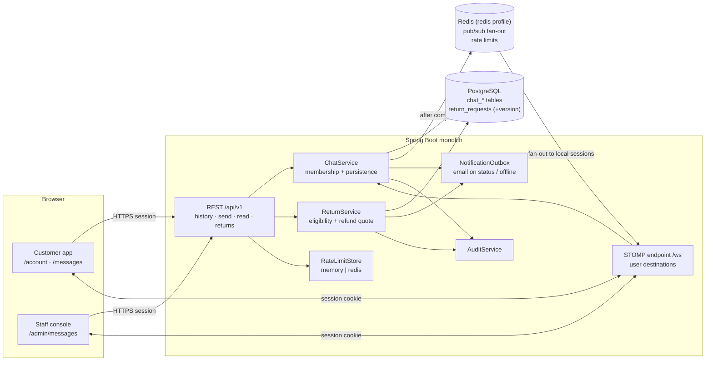
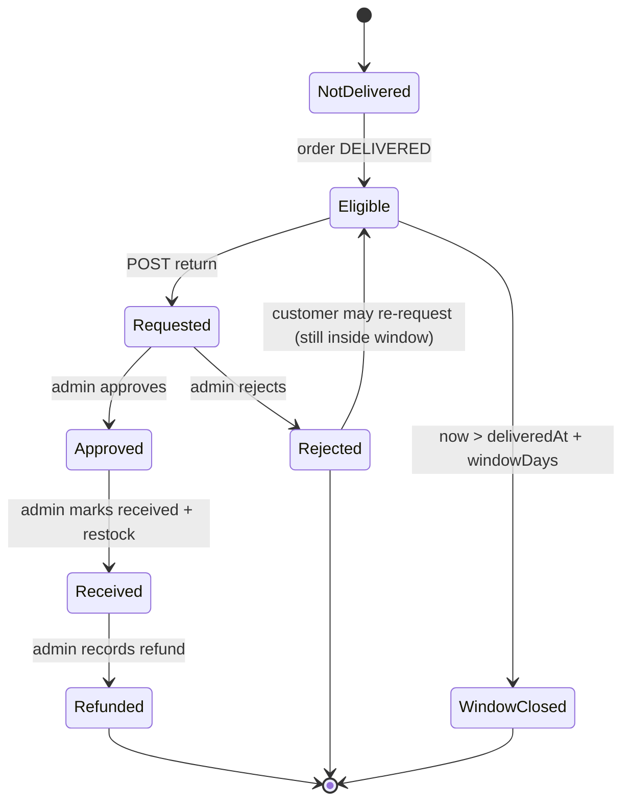
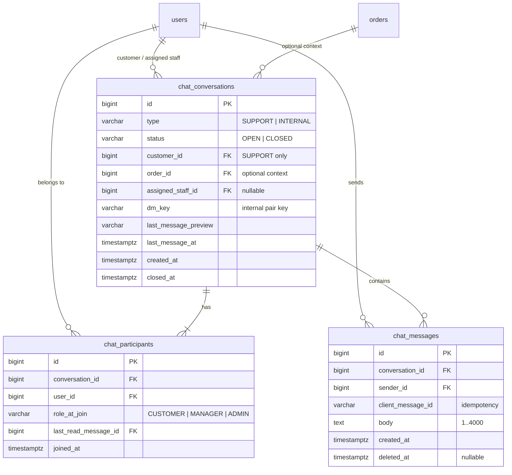
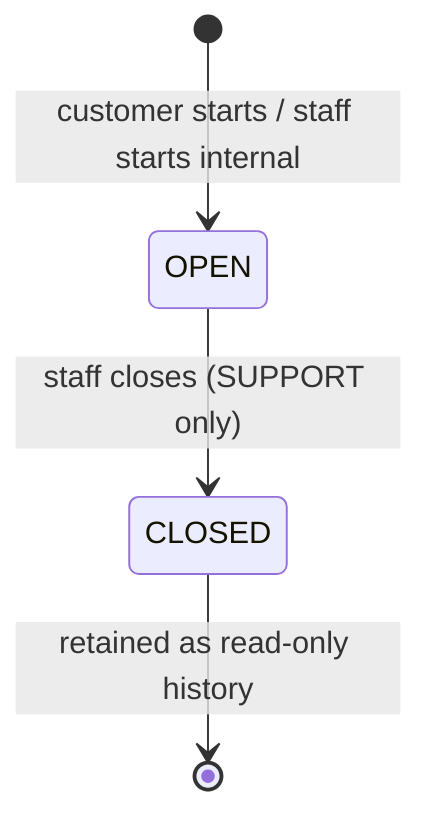

# Real-time messages and customer returns

<!-- track-status:begin -->
> **Execution status** — **done** — every item complete · updated 11th Nov 2026 03:14 (+0600) by `track_status.py` (track-based-development; do not edit by hand)
> - **Track file:** [.docs/tracks/add-message-and-return.md](../.docs/tracks/add-message-and-return.md)
> - **Progress:** 40 / 40 complete · 0 incomplete (0 open, 0 in progress, 0 blocked)
> - **Harness run reports:** none — worked in-session, no `harness run` (`.claude/reports/<run-id>/`)
> - **Prompt activity reports** (local, gitignored; index [.claude/reports/prompts/index.md](../.claude/reports/prompts/index.md)): none yet
<!-- track-status:end -->

**Status:** implemented (`track-based-development`, 11th Nov 2026) · track 40/40
**Last updated:** 2026-11-11 · **Decision record:** §10.1
**Source note:** the original 3-line `AddMessageAndReturn.md` (now this document)
**Scope:** `e-commerce/backend` (Spring Boot 4.1, Java 25) and `e-commerce/frontend` (Angular 22)

This document replaces the three-line note with the requirement, the verified current state, the data model, the APIs, the real-time mechanism and a phased plan. Two items were asked for:

1. **Chat** between a customer and a manager, and between a manager and an admin, in real time, WhatsApp-style.
2. **Return options on the customer dashboard.**

Three decisions were taken before writing, because each changes the data model or the money flow (restated as D1–D3 in §10.1):

| Decision | Chosen |
|---|---|
| Customer↔staff topology | **Support inbox + staff DMs.** A customer has one open support thread handled by any manager; admins can read, assign and reply for oversight. Managers and admins have 1:1 internal DMs. |
| Meaning of the return ask | **Add return history and status** to the dashboard. The per-order Return button already exists (`account.component.html:51–52`); the missing piece is eligibility and post-request visibility. |
| Partial-return refund | **Returned items only**, coupon allocated pro-rata, delivery refunded only when the whole order is returned. Admin confirms the computed amount. |

---

## 1. The ask, read against the code

| # | Asked for | What the code already has | What is actually missing |
|---|---|---|---|
| 1 | Customer↔manager and manager↔admin real-time chat | Nothing. A case-insensitive search for `chat`, `websocket` and `stomp` across `backend/src`, the Gradle catalog and `frontend/src` returns **0 hits**; there is no chat table in `V1`–`V3`. | The entire feature: tables, service, REST, WebSocket transport, UI, unread state. |
| 2 | Return options on the user dashboard | A complete return backend (`return_requests`, `return_items`, `ReturnService`, admin queue) and a customer request endpoint; `/account` renders a Return button for `DELIVERED` orders. | Customer-side return **visibility**: no `GET /me/returns`, no status after submission, no window/duplicate state, and the existing button ignores both. |

The second finding is the important one: the ask is not "build returns from scratch". The return state machine, restock and admin queue already exist (`ReturnService.java:100–119`, `V2__phase3_phase5.sql:7–31`); what a customer cannot do is *see* whether a return is possible or what happened to the one they sent. The design below therefore fixes the return correctness defects first, then adds the dashboard, and builds chat on top of the existing session/Redis/notification infrastructure.

---

## 2. Findings register

Markers: 🔴 silent defect · 🟠 missing capability · 🟡 enhancement · 🟢 already done / reusable.

| ID | Marker | Finding | Evidence |
|---|---|---|---|
| R1 | 🟢 | Return backend exists: statuses `REQUESTED → APPROVED → RECEIVED → REFUNDED` / `REJECTED`, restock on receipt, admin queue and refund endpoint. | `ReturnService.java:100–141`, `V2__phase3_phase5.sql:7–31`, `AdminReturnController.java:14–40` |
| R2 | 🟢 | Customer can request a return for their own delivered order. | `MeController.java:51–56`, `ReturnService.java:50–88` |
| R3 | 🟠 | **No customer return list or status.** There is no `GET /me/returns`; the only customer-side call is the create POST. After submitting, the customer has no screen showing `REQUESTED`/`APPROVED`/`REFUNDED`. | `MeController.java:41–56`; grep for `me/returns` returns 0 hits |
| R4 | 🟠 | The dashboard's Return button is `DELIVERED`-only and ignores the 7-day window and any existing request, so it shows an action that the server will then reject with 409. | `account.component.html:51–52` vs `ReturnService.java:58–62` |
| R5 | 🔴 | **Duplicate order-item lines bypass the quantity cap.** Each line is checked independently against `orderItem.quantity`; two entries for the same `orderItemId` can total more than was ordered, and receipt restocks every line. | `ReturnService.java:70–84`, `ReturnService.java:107–110` |
| R6 | 🔴 | **A partial return refunds the whole order by default.** When the admin leaves the amount empty, `amount` = `order.grandTotal`; the order is then marked `REFUNDED`. | `ReturnService.java:127`, `ReturnService.java:135`, `admin-returns.component.ts:33`, `admin-returns.component.html:41` |
| R7 | 🟠 | `ReturnRequest` has no optimistic locking, so two concurrent admin actions can both restock or both refund. `Order` already uses `@Version`; the return entity does not. | `ReturnRequest.java:11–31` vs `Order.java:97–99` |
| R8 | 🟡 | The return form defaults **every** item to quantity 1, so opening it and submitting returns the whole order by accident; there is no refund estimate and no window end shown. Several visible strings are literal English in a translated component. | `return-request.component.ts` constructor, `return-request.component.html:19,23–25,35` |
| R9 | 🟡 | Return status changes send no notification. The outbox only knows order-confirmation templates. | `NotificationService.java:33–43` |
| C1 | 🟠 | **Chat does not exist** in any layer: no entity, table, endpoint, component, or dependency. | 0 hits for `chat`, `websocket`, `stomp` in `backend/src`, `frontend/src`, `libs.versions.toml` |
| C2 | 🟠 | Managers cannot list admins, so a manager cannot start an internal DM with the person the requirement names. `/api/v1/admin/staff/**` is ADMIN-only. | `SecurityConfig.java:49–51` |
| C3 | 🟢 | Foundations for realtime are already present: Spring Session JDBC, a Redis profile, RFC 7807 problem details, audit, and an in-memory/Redis rate-limit store. | `application.yml:46–54`, `application-redis.yml`, `GlobalExceptionHandler.java`, `RateLimitStore.java` |
| C4 | 🟡 | The notification outbox is order-centric and supports only SMS/EMAIL, but `order_id` is nullable, so it can carry chat/return notifications with a template + JSON payload. | `NotificationOutbox.java:19–35` |

### 2.1 Verified current state — returns

- Customer dashboard = `/account` (`app.routes.ts:12`); it loads `GET /api/v1/me/orders` (`account.component.ts:35`), whose response is `TrackingResponse[]` (`MeController.java:41–44`). `TrackingResponse` already includes `deliveredAt` and per-item `orderItemId` (`TrackingResponse.java:11–22`), so eligibility can be computed without a new order query.
- The Return button is the only return affordance in the dashboard; it always routes to `/returns/request?order=…` (`app.routes.ts:15`, `account.component.html:51–52`).
- Server rules that the dashboard does not mirror: delivered only, 7-day window (`app.returns.window-days` default 7), and at most one non-rejected return per order (`ReturnService.java:55–62`).
- The request form is functional but bare: quantity inputs default to 1, condition selects are English-only, and the empty state says "Open the return link from an order in your account." (`return-request.component.html:15–35`).
- The admin refund form asks for an amount with no suggested value (`admin-returns.component.html:41`); the service defaults to the full total (`ReturnService.java:127`).
- Timeline: the account Return button was added on 2026-11-10; the stub note is dated 2026-11-11. At the time of writing the database contains one delivered order for the customer account (user 2) and zero return requests, so the button is visible but easy to miss and carries no state.

### 2.2 Verified current state — chat

- The persistence stack is JPA + PostgreSQL with `@ManyToOne` relations, `Instant` timestamps, identity keys and check constraints (`V1__baseline.sql`, `V2__phase3_phase5.sql`).
- Authentication is Google OIDC with a server-side session (`SPRING_SESSION` in JDBC, same-site `Lax` cookie; `application.yml:1–12,46–50`). A WebSocket handshake is an HTTP GET and therefore carries the same session cookie.
- Spring Security authorizes by path: `/api/v1/me/**` authenticated, `/api/v1/admin/**` ADMIN or MANAGER, with staff/settings/audit narrowed to ADMIN (`SecurityConfig.java:42–52`). Method security is enabled.
- Redis is optional: the default cache is Ehcache (`application.yml:51–54`); the `redis` profile swaps the cache and rate-limit store to Redis (`application-redis.yml`). Any multi-replica chat fan-out must therefore be an explicit, documented profile rather than assumed.
- The notification outbox and audit services are reusable, and rate limiting already has a Redis/in-memory strategy interface (`RateLimitStore.java`, `RateLimitFilter.java:62–72`).
- The frontend has no WebSocket client dependency; `package.json` contains only Angular, Express/SSR and tooling.

---

## 3. Target architecture



The key split: **messages are written over REST (CSRF-protected, idempotent, rate-limited) and pushed over WebSocket.** The socket never accepts message bodies. That keeps one authorization path for writes and one durable source of truth; the socket is a fan-out channel. Redis is only needed for more than one replica; with a single instance the local publisher delivers directly.

---

## 4. Returns — dashboard, eligibility and refund correctness

### 4.1 Customer-facing state

Add a **Returns** tab alongside Orders on `/account`, and turn the per-order action into an eligibility-aware state:

| Order state | Dashboard action |
|---|---|
| Not delivered | No return action (current behaviour) |
| Delivered, inside window, no return | `Return items` primary-outline button |
| Delivered, return exists | Status badge (`Requested`, `Approved`, `Received`, `Refunded`, `Rejected`) + `View return` |
| Delivered, window closed | Muted `Return window closed on <date>` (no button) |
| Return rejected | `Rejected` badge + reason, and `Request again` if still inside the window |

The Returns tab lists the requests themselves: order number, status, requested/resolved dates, item lines with condition, refund amount/method when resolved, and an expected-refund quote while open. Empty state: "No returns yet."

### 4.2 Server-side eligibility

Do not compute the window in Angular from a hardcoded 7. The server owns it, so a config change (`app.returns.window-days`) cannot desync the UI.



A rejected return whose window has since closed resolves to `WINDOW_CLOSED`; the diagram shows the common path.

The server returns an enum, not a boolean:

```json
{
  "orderNumber": "ORD-20261110-QPEUTR",
  "status": "DELIVERED",
  "deliveredAt": "2026-11-10T18:46:18Z",
  "return": {
    "returnId": 12,
    "status": "REQUESTED",
    "requestedAt": "2026-11-11T09:12:00Z",
    "windowEndsAt": "2026-11-17T18:46:18Z",
    "eligibility": "ALREADY_REQUESTED",
    "ineligibleReason": null
  }
}
```

`eligibility ∈ { ELIGIBLE, NOT_DELIVERED, WINDOW_CLOSED, ALREADY_REQUESTED }`. A non-rejected request yields `ALREADY_REQUESTED`; a rejected one makes the order `ELIGIBLE` again while the window is open, so the customer may re-request (OQ-12, §10.1) — the service excludes `REJECTED` at `ReturnService.java:61` — and the block adds `previousReturnId` and `previousRejectionReason` so the dashboard can explain why.

### 4.3 API changes

| Method | Endpoint | Roles | Change |
|---|---|---|---|
| GET | `/api/v1/me/orders` | CUSTOMER (authenticated) | New `MyOrderResponse` that adds the `return` block above. Keep the guest tracking contract unchanged. |
| GET | `/api/v1/me/returns` | CUSTOMER | **New.** The caller's return requests, newest first, with quote + items. |
| GET | `/api/v1/me/returns/{id}` | CUSTOMER | Optional detail; the list is enough for v1. |
| POST | `/api/v1/me/orders/{orderNumber}/return-quote` | CUSTOMER | **New.** Preview the refund for the selected items; no persistence. The create endpoint recomputes it server-side. |
| POST | `/api/v1/me/orders/{orderNumber}/returns` | CUSTOMER | Existing; add aggregate validation and return the quote. |
| POST | `/api/v1/admin/returns/{id}/refund` | ADMIN | Use the computed quote when `amount` is omitted; reject an amount above the quote. |

Repository additions:

- `ReturnRequestRepository.findByOrderUserIdOrderByRequestedAtDesc(Long userId)` — one query for all returns on the account page, avoiding an N+1 per order.
- Keep `findFirstByOrderIdAndStatusNot` for the create path.

`MyOrderResponse` is a new DTO rather than extra fields on `TrackingResponse`: guest tracking is public and must not start carrying return state. Map the existing tracking fields and add the return block.

Worked request:

```http
GET /api/v1/me/returns
Authorization: session cookie
```

```json
[
  {
    "id": 12,
    "orderNumber": "ORD-20261110-QPEUTR",
    "status": "REQUESTED",
    "requestedAt": "2026-11-11T09:12:00Z",
    "resolvedAt": null,
    "windowEndsAt": "2026-11-17T18:46:18Z",
    "refundMethod": null,
    "refundAmount": null,
    "quote": {
      "itemsAmount": 1200.00,
      "couponDiscountShare": 50.00,
      "deliveryAmount": 0.00,
      "total": 1150.00,
      "fullOrder": false,
      "currency": "BDT"
    },
    "items": [
      {
        "id": 31,
        "orderItemId": 88,
        "productName": "Panjabi",
        "sizeLabel": "M",
        "quantity": 1,
        "condition": "UNOPENED"
      }
    ]
  }
]
```

### 4.4 Refund computation

The order already stores everything needed: `subtotal`, `deliveryCharge`, `couponDiscount`, per-item `unitPriceSnapshot` and `lineTotal` (`Order.java:35–58`, `OrderItem.java:35–50`). The grand total is `subtotal + deliveryCharge − couponDiscount` (`OrderService.java:158–166`).

For a return with item lines \((q_i, \text{unitPrice}_i)\):

```
returnedValue   = Σ unitPrice_i × q_i
couponShare     = subtotal > 0 ? round(couponDiscount × returnedValue / subtotal, 2) : 0
deliveryRefund  = fullOrder ? deliveryCharge : 0
refund          = max(0, returnedValue − couponShare + deliveryRefund)
```

Worked example — order `ORD-20261110-QPEUTR`: subtotal 2,400, delivery 60, coupon 100, grand total 2,360.

| Case | Items returned | Item value | Coupon share | Delivery | Refund |
|---|---|---|---|---|---|
| Partial (1 of 2 items, unit 1,200) | 1 × 1,200 | 1,200 | 50 (100 × 1200/2400) | 0 | **1,150** |
| Full (2 × 1,200) | 2,400 | 2,400 | 100 | 60 | **2,360** |

Rules that come with it:

- Delivery is refunded only when the returned quantity equals the ordered quantity for **every** line.
- The coupon share is capped at `couponDiscount` and rounded half-up to 2 decimals.
- The admin sees the quote before confirming; the amount is still editable within `[0.01, quote]`. An amount outside that range is `422 RETURN_REFUND_AMOUNT_INVALID`.
- For COD, `PaymentService.refund` already returns `MANUAL_COD` (`PaymentService.java:85–98`); the return is recorded as a manual payout that staff must actually pay. For prepaid, the gateway refund is recorded against the original method.
- Order payment status: a partial refund sets the order to `PARTIALLY_REFUNDED`; only a refund equal to the order grand total sets `REFUNDED` (OQ-2, §10.1). The enum value, the admin/account payment badge maps and the updated `orders_payment_status_check` constraint (`V1__baseline.sql:167`) ship together in P1/V4.
- The return's `resolvedAt` is set on `REFUNDED` (already) and on `REJECTED` (already); add clarification text so the customer sees "resolved" for both.

### 4.5 Fixes to the existing return code

1. **Aggregate by order item before validating** (`ReturnService.java:70–84`). Sum quantities per `orderItemId`; reject when the sum exceeds the ordered quantity. This closes R5 and prevents over-restock on `RECEIVED` (`ReturnService.java:107–110`).
2. **Never default to the full order total** (`ReturnService.java:127`). Use the 4.4 quote; if the caller omits `amount`, use `quote.total`. Reject `amount > quote.total`.
3. **Add `@Version long version` to `ReturnRequest`** (the `Order` entity already does this at `Order.java:97–99`) and a `version` column (`V4`). A concurrent approve/receive/refund then fails with an optimistic-lock exception; map `OptimisticLockingFailureException` to `409 CONCURRENT_MODIFICATION` in `GlobalExceptionHandler` so the second admin sees a retryable conflict instead of a 500.
4. **Do not mark the order `REFUNDED` for a partial refund** (`ReturnService.java:135`); use `PARTIALLY_REFUNDED` as decided in OQ-2 and described in 4.4.
5. **Return the quote in `ReturnResponse`** so the customer and admin see the same number; add `quote` and item `unitPrice`/`lineTotal` fields.

### 4.6 Return form and admin card

**Customer `/returns/request`** (`return-request.component.html`):

- Show the order number, delivery date and **window end** at the top.
- Each item gets a checkbox/quantity starting at **0**, a "Return all" shortcut, and a live quote panel: *Items − coupon share + delivery = estimated refund*. The panel calls the return-quote endpoint (debounced) rather than reimplementing the formula in Angular; delivery shows as 0 with the note "Delivery is refunded only when the whole order is returned."
- Translate the literals at lines 19, 23–25 and 35, and the empty state: `return.itemSummary`, `return.condition.*`, `return.openFromAccount`, `return.quantity`, `return.selectAtLeastOne`, `return.windowEnds`, `return.estimated`, `return.deliveryFullOnly`.
- Success redirects to `/account?tab=returns`, so the new status is immediately visible.

**Admin returns** (`admin-returns.component.html`):

- Show each line's unit price and line total, the order subtotal/delivery/coupon, and a **prefilled refund amount** from the quote.
- Require an explicit confirmation of the amount; disable the button when the amount is outside `[0.01, quote]`.
- Show the current payment status before/after; a partial refund leaves `PARTIALLY_REFUNDED`.
- Keep the existing state buttons; add a "Reject" reason field (optional) for the customer's Returns tab.
- Status transitions remain ADMIN/MANAGER; refund remains ADMIN-only (`AdminReturnController.java:14–40`).

### 4.7 Returns notifications

On `APPROVED`, `REJECTED`, `RECEIVED` and `REFUNDED`, enqueue an email (and optionally SMS) through the existing outbox:

```text
template = RETURN_APPROVED | RETURN_REJECTED | RETURN_RECEIVED | RETURN_REFUNDED
payload  = { orderNumber, returnId, status, refundAmount? }
```

`NotificationOutbox` already supports a nullable order reference, a recipient and a JSON payload (`NotificationOutbox.java:19–35`); `NotificationService.enqueue(Order, channel, recipient, template, payload)` needs only the new templates and a call from `ReturnService.advance/refund`. This is also what makes the dashboard status discoverable when the customer is not on the site.

---

## 5. Chat — domain model

### 5.1 Entity model



Rules that come with the model:

- **Two conversation types only.** `SUPPORT` has a `customer_id` and no `dm_key`; `INTERNAL` has a `dm_key` and no `customer_id`. A check constraint enforces the shape.
- **One open support thread per customer.** A partial unique index on `(customer_id) WHERE type = 'SUPPORT' AND status = 'OPEN'`. Closing a thread allows a new one; history stays.
- **One thread per manager↔admin pair.** `dm_key = LEAST(userA, userB) || ':' || GREATEST(userA, userB)`, unique where `type = 'INTERNAL'`. Same-role pairs are not created in v1 (OQ-10, §10.1); the index shape leaves room to enable them later.
- **Participants are explicit, with one role-based exception.** An `INTERNAL` conversation is accessible only to its two participant rows (OQ-11, §10.1). A `SUPPORT` conversation always has the customer participant; any active MANAGER/ADMIN may read the queue, and admins may also reply (OQ-1), but a staff participant row is created on that staff member's first read or reply so read state stays per person. No role grants access to an `INTERNAL` thread.
- **Messages are append-only.** `deleted_at` exists for moderation, but v1 has no delete endpoint. Body is plain text, 1–4000 characters, never rendered as HTML.
- **Idempotent send.** Unique `(conversation_id, sender_id, client_message_id)`; a retried POST returns the existing row with `200` instead of `201`.
- **Read state is per participant.** `last_read_message_id` is the highest message the participant has seen. Unread count = messages with a higher id from the other side. For support, the customer sees "Read" when any staff participant has read past their message.
- **Cursor pagination.** Page on `id` (`beforeId` exclusive) rather than offset; the index `(conversation_id, id DESC)` makes it stable.
- **Order context is optional and informational.** A support thread can carry one `order_id` when opened from an order card; the thread view shows the order number and status, but messages are not tied to it. Creation verifies the order belongs to the customer (`order.user.id == customer.id`); an arbitrary order number must not be attachable.

V1 of the feature is text-only by decision (OQ-6, §10.1); attachments, reactions, message editing, device delivery receipts and presence are later-phase enhancements. The schema leaves room via nullable columns and a separate media table if added later.

### 5.2 Lifecycle



Support threads start unassigned and appear in the manager queue. The first staff reply auto-assigns the thread to that staff member; an admin can reassign. Closing is a support action: a closed support thread becomes read-only history, and the customer starts a new one from **Message us** (which reopens nothing and cannot create a second open thread). Internal DMs are never closed in v1; the unique `dm_key` keeps one thread per staff pair, so both sides keep their history.

### 5.3 REST API

All endpoints are authenticated; the service checks the caller's access — customer ownership, staff access to a support queue, or internal-thread membership — not just the route role.

| Method | Endpoint | Roles | Purpose |
|---|---|---|---|
| GET | `/api/v1/me/chat/conversations` | CUSTOMER (and any authenticated user for their own) | The caller's threads, unread counts, last message |
| POST | `/api/v1/me/chat/conversations` | CUSTOMER | Create-or-get the open support thread and optionally send the first message |
| GET | `/api/v1/me/chat/conversations/{id}/messages?beforeId=&limit=50` | customer participant | Cursor page, ascending in the response |
| POST | `/api/v1/me/chat/conversations/{id}/messages` | customer participant | Send `{ clientMessageId, body }` |
| POST | `/api/v1/me/chat/conversations/{id}/read` | customer participant | `{ lastReadMessageId }`, idempotent |
| GET | `/api/v1/admin/chat/conversations?type=&status=&assigned=me\|unassigned&q=` | ADMIN, MANAGER | Staff inbox / queue |
| GET | `/api/v1/admin/chat/conversations/{id}/messages` | staff (SUPPORT) / participant (INTERNAL) | History |
| POST | `/api/v1/admin/chat/conversations/{id}/messages` | staff (SUPPORT) / participant (INTERNAL) | Send |
| POST | `/api/v1/admin/chat/conversations/{id}/read` | staff (SUPPORT) / participant (INTERNAL) | Read receipt |
| PATCH | `/api/v1/admin/chat/conversations/{id}/assign` | ADMIN any; MANAGER self | `{ staffUserId }` |
| POST | `/api/v1/admin/chat/conversations/{id}/close` | ADMIN, MANAGER | Close a `SUPPORT` thread (internal DMs stay open) |
| GET | `/api/v1/admin/chat/contacts` | ADMIN, MANAGER | Active admins (for a manager) / managers (for an admin) |
| POST | `/api/v1/admin/chat/internal` | ADMIN, MANAGER | Create-or-get a DM and optionally send the first message |

`GET /admin/chat/contacts` is required because `/api/v1/admin/staff/**` is ADMIN-only (`SecurityConfig.java:49–51`): a manager cannot use the staff endpoint to find an admin. This narrow endpoint returns only `{ id, fullName, role, pictureUrl }` for active staff of the opposite role — no emails or allow-list state — and only manager↔admin pairs are valid (OQ-10, §10.1).

Create a support thread:

```http
POST /api/v1/me/chat/conversations
Content-Type: application/json
X-XSRF-TOKEN: …

{
  "orderNumber": "ORD-20261110-QPEUTR",
  "clientMessageId": "0f1c9e4a-7d7c-4c1e-9f3c-2d6a0f1b8e21",
  "body": "The panjabi arrived with a torn seam — can I return it?"
}
```

```json
{
  "conversationId": 41,
  "type": "SUPPORT",
  "status": "OPEN",
  "assignedStaff": null,
  "message": {
    "id": 9001,
    "sender": { "id": 2, "fullName": "Habibul Bashar", "role": "CUSTOMER" },
    "body": "The panjabi arrived with a torn seam — can I return it?",
    "clientMessageId": "0f1c9e4a-7d7c-4c1e-9f3c-2d6a0f1b8e21",
    "createdAt": "2026-11-11T10:02:11Z"
  }
}
```

Send a reply (same shape for customer/staff; membership checked):

```json
{ "clientMessageId": "8a44…", "body": "Of course — open Account → Returns and I will approve it here." }
```

Duplicate `clientMessageId` → `200 OK` with the original message, `Idempotent-Replayed: true` (the platform already uses this header for orders; reuse the convention).

Error codes use the existing problem-detail shape (`GlobalExceptionHandler.java`): `CHAT_NOT_PARTICIPANT` (403), `CHAT_CONVERSATION_CLOSED` (409), `CHAT_MESSAGE_INVALID` (400), `RATE_LIMITED` (429).

### 5.4 Real-time transport

Use **STOMP over native WebSocket**, not SockJS. Angular 22 targets browsers that support WebSocket; SockJS adds a fallback transport and URL complexity this app does not need. The session cookie authenticates the handshake; no token is passed.

- Endpoint: `GET /ws` (Spring's `WebSocketMessageBrokerConfigurer`, `@EnableWebSocketMessageBroker`). The handshake rejects any `Origin` not in the same allow-list as CORS (`SecurityConfig.java:76–87`); the `SameSite=Lax` session cookie already prevents cross-site cookie delivery, but the explicit check is the second gate.
- Client subscribes to `/user/queue/chat`. The server resolves recipients and calls `convertAndSendToUser(principalName, "/queue/chat", event)`; in this app the authenticated principal name is the user's **email**, so the server maps recipient user ids to emails for delivery (the email is never exposed in a payload). **No client-controlled topics** exist, so a customer cannot subscribe to another customer's thread.
- Typing: client sends to `/app/chat/{conversationId}/typing`; the server checks membership and fans out an ephemeral event.
- All writes (message creation, read, assignment, close) go through REST; the socket is push-only plus typing.

```mermaid
sequenceDiagram
    autonumber
    actor C as Customer (browser)
    participant API as REST /api/v1/me/chat
    participant S as ChatService
    participant DB as PostgreSQL
    participant BUS as Redis chat:events (or local)
    participant WS as STOMP /ws
    actor M as Manager (browser)

    C->>API: POST /conversations/41/messages { clientMessageId, body }
    API->>S: send(user=2, conversation=41, …)
    S->>S: membership + OPEN + rate limit
    S->>DB: INSERT chat_messages; UPDATE conversation last_message_*
    DB-->>S: id=9001
    S-->>BUS: publish MESSAGE_CREATED after commit
    BUS-->>WS: listeners on each instance
    WS-->>M: /user/queue/chat MESSAGE_CREATED
    API-->>C: 201 Created (message 9001)

    M->>API: POST /conversations/41/read { lastReadMessageId: 9001 }
    API->>S: read(user=7, 41, 9001)
    S->>DB: UPDATE chat_participants SET last_read_message_id=9001
    S-->>BUS: publish MESSAGE_READ
    BUS-->>WS: fan-out
    WS-->>C: /user/queue/chat MESSAGE_READ { by: 7, lastReadMessageId: 9001 }
```

Server → client event:

```json
{
  "eventId": "9b2f…",
  "type": "MESSAGE_CREATED",
  "conversationId": 41,
  "message": {
    "id": 9002,
    "sender": { "id": 7, "fullName": "Nusrat Jahan", "role": "MANAGER" },
    "body": "Of course — open Account → Returns and I will approve it here.",
    "createdAt": "2026-11-11T10:03:40Z"
  }
}
```

Event types: `MESSAGE_CREATED`, `MESSAGE_READ`, `TYPING`, `CONVERSATION_UPDATED` (assignment/close). Include `eventId` so the client can dedupe after reconnect.

**Publishing after commit** is mandatory: use `@TransactionalEventListener(phase = AFTER_COMMIT)`. Publishing inside the transaction can deliver a message that later rolls back.

**Reconnect and catch-up:** the client reconnects with backoff, then calls `GET messages?beforeId=<last seen>` and merges. Messages are never socket-only, so a dropped socket loses no data. A reconnect banner and a "new messages" pill keep the scroll position.

### 5.5 Read receipts, typing and unread

- `chat_participants.last_read_message_id` is the only read state; it is updated by `POST /read` and by opening/focusing a thread. This avoids a per-message receipt table.
- The message DTO includes `readByOthers` for the sender's view. For support with several staff, `readByOthers` is true when the highest staff `last_read_message_id` is ≥ the message id.
- `TYPING` is ephemeral: no DB write, sent at most once per second per user, expires client-side after 4 seconds. The server may ignore it when the socket is down.
- `unreadCount` in the conversation summary is computed from `last_read_message_id`; opening the thread marks read and broadcasts one `MESSAGE_READ` event (not one per message).
- Delivery ticks are deferred (OQ-7, §10.1): v1 shows "sent" (one tick) and "read" (two ticks); a grey "delivered" tick would need a per-device acknowledgement and is a later phase.

### 5.6 Scale-out and Redis

The default profile runs one replica with the simple broker; the local publisher delivers to locally connected sessions. For two or more replicas (the production/staging shape the PRD already tests for cache coherence), enable the `redis` profile:

- Publish each event to the channel `stitchstyle:chat:events` with `{ recipientUserIds, event }`.
- Every instance subscribes via a `RedisMessageListenerContainer`, resolves the recipient ids to principal names (email) and calls `convertAndSendToUser` for its local sessions.
- The publisher is an interface (`ChatEventBus`) with `LocalChatEventBus` and `RedisChatEventBus`, selected by `app.chat.fanout` (`local` default, `redis` under the profile). This mirrors the existing `RateLimitStore` strategy split (`RateLimitStore.java`, `RedisRateLimitStore`, `InMemoryRateLimitStore`).

Do not make Redis a hard requirement for chat in development: the `redis` profile is optional in this repository (`docker-compose.yml` marks Redis with `profiles: ["redis"]`). Document that chat fan-out across replicas requires it.

### 5.7 Offline notifications

Chat is not useful if the recipient never learns a message exists. Reuse the transactional outbox:

- When a message is inserted and the recipient has no active WebSocket session (an instance-local session registry, or a Redis key when the `redis` profile is on), enqueue `ChatMessage` with `template = CHAT_MESSAGE_UNREAD` and `payload = { conversationId, senderName, preview }`, recipient email.
- Debounce one email per conversation per recipient per 15 minutes (Redis key or in-memory map); never one email per message.
- SMS is not used for chat in v1: cost and noise. Email only.
- The outbox handles retries and failure status already (`NotificationService.dispatchDue`, `NotificationOutbox`); no new delivery mechanism.

---

## 6. Frontend

### 6.1 Customer

- `/account` becomes two tabs, **Orders** and **Returns**, driven by a `tab` query parameter so `?tab=returns` is linkable. Keep the current order cards in the Orders tab.
- Each delivered order card shows the eligibility-aware action from 4.1 (button, status + View return, or window closed).
- The Returns tab lists the requests from `GET /me/returns`: status badge, dates, items, refund amount/method, and the quote while open.
- `/messages` (new) is the customer's thread list + thread view. A single support thread is the default; the empty state has "Message us". The site header gets a `Messages` link with an unread badge next to Wishlist/Cart (`app.html:22–29`), translated.
- `/returns/request` becomes the improved form from 4.6 and redirects to `/account?tab=returns` on success.
- Chat list rows: counterpart name or "Support", last message preview, relative time, unread badge. Thread: date separators, sender **name + role** (OQ-13, §10.1), message bubbles, read marker on own messages, typing line, Enter to send / Shift+Enter newline, retry on failed send, "Reconnect" banner.
- Mobile: the thread is a full-screen route with a back link; the list is a page. Do not force a floating widget in v1.

### 6.2 Staff console

- New route `/admin/messages` under the staff guard (`app.routes.ts:16–30`), with `Messages` added to the admin nav (`admin-layout.component.ts:11–21`).
- Two-pane inbox: left = filters (All / Mine / Unassigned; Support / Internal), search, unread count, last message; right = thread with customer context (name, email/phone, order number + status when present), assignment, close.
- `New internal message` opens a contact picker from `GET /admin/chat/contacts`; a manager sees admins, an admin sees managers (OQ-10, §10.1). Choosing one calls `POST /admin/chat/internal`.
- Assignment: a manager can claim an unassigned support thread; an admin can reassign. Show "Mine", "Unassigned", and "Assigned to <name>" states.
- The thread uses the same chat component as the customer side (a shared `ChatThreadComponent`), so read/typing behaviour is identical. Do not duplicate the socket logic.

### 6.3 Frontend plumbing

- Models: `ChatConversation`, `ChatMessage`, `ChatEvent`, `ChatContact`, `MyOrder` (with return block), `ReturnDetail` (with quote).
- `ChatService`: REST calls + `@stomp/stompjs` client (new dependency) with reconnect delay, heartbeat, `/user/queue/chat` subscription, and an `unread` signal used by the header badge.
- The WebSocket URL is same-origin `/ws`; add `/ws` (with `ws: true`) to `proxy.conf.json` for `ng serve`, and configure the SSR/proxy edge to allow the Upgrade header.
- CSRF: REST writes already go through Angular's `withXsrfConfiguration` (`app.config.ts:16–18`); the WebSocket handshake does not need a CSRF token, but it does require the session cookie. Do not use `withCredentials` on a cross-origin socket in production; serve it same-origin.
- Accessibility: `aria-live="polite"` for incoming messages and typing, visible focus rings, `role="log"` on the message list, no autoplay of sounds, keyboard-only send, and reduced-motion respect.

---

## 7. Cross-cutting concerns

### 7.1 Authorization

| Capability | CUSTOMER | MANAGER | ADMIN |
|---|---|---|---|
| Read/send own support thread | ✅ own only | ✅ queue / assigned | ✅ oversight + reply |
| See another customer's support thread | ❌ | ✅ operational need | ✅ |
| Internal manager↔admin DM | ❌ | ✅ with admins | ✅ with managers |
| Assign support thread | ❌ | ✅ to self | ✅ any staff |
| Close support thread | ❌ (read-only; a new thread starts) | ✅ | ✅ |
| Close/refund a return | ❌ | ✅ advance | ✅ advance + refund |
| Read another user's returns | ❌ | ❌ (admin queue only) | ❌ (admin queue only) |

Enforcement is in `ChatService.requireAccess(conversationId, user)` (customer ownership; active staff for a `SUPPORT` thread; participant rows for `INTERNAL`) and `ReturnService` owner checks, not only in the route config. Guests are explicitly excluded from all chat routes (OQ-5, §10.1), admins may reply in `SUPPORT` threads (OQ-1), and `INTERNAL` threads are visible to their two participants only (OQ-11). Add `/ws/**` to the authenticated matchers and mirror the CORS origin allow-list in `SecurityConfig.java:47–52,76–87`.

### 7.2 Validation and rate limiting

- Message body: trim, reject empty/whitespace, max 4,000 characters; plain text only; never `innerHTML`. Angular interpolation already escapes; the server must still reject control characters and HTML-looking payloads only if a product rule requires it (no need to strip; store as text).
- Payload: a 4,000-character message is ~12 KB of JSON; set the WebSocket message size limit and the HTTP body limit accordingly.
- Rate limits: 30 messages/minute/user and 5 new conversations/minute/user. Reuse `RateLimitStore.tryConsume(key, limit)` (`RateLimitStore.java`) with keys `chat:send:{userId}` and `chat:new:{userId}`. The Redis implementation is a 60-second fixed window (`RedisRateLimitStore`), the in-memory one is a Bucket4j minute refill (`InMemoryRateLimitStore`); both are acceptable for this shape. `RateLimitFilter` already maps a rejection to a 429 problem detail (`RateLimitFilter.java:44–56`); return the same shape from the service.
- Returns: aggregate duplicate lines (4.5), quantities `1..ordered`, amount `0.01..quote`, one non-rejected return per order. Use `422` with a specific code for quantity/amount violations rather than overloading `INVALID_STATUS_TRANSITION` (409).

### 7.3 Notifications

- Return status changes: email via the outbox (4.7), debounced not needed (one per status change).
- Chat: email only when the recipient is offline, debounced 15 minutes per conversation (5.7, OQ-8 in §10.1).
- Do not send SMS for chat. Return notifications can be email; SMS remains available for the existing order-confirmation path but is not required by this feature.
- Templates must not include full message bodies in logs; the payload may contain a short preview, but observability should log ids only.

### 7.4 Privacy, audit and retention

- Messages are visible within their thread: support threads to any active staff member for operational access, internal DMs to their two participants only. Content is not written to application logs. Audit only conversation lifecycle events (created, assigned, closed) and return lifecycle (R1 already records create/status/refund; add assignment/close and refund breakdown).
- Retention: keep chat messages for 24 months (OQ-9, §10.1), then purge; returns follow the accounting policy required by the business (the PRD's data-retention table is the reference). A scheduled purge with the existing single-owner lock pattern (PRD line 487) deletes messages older than the window; closing a conversation does not delete it.
- Account deletion/erasure: anonymize the participant display via the user record; keep the financial return record. This is an operational policy, not a v1 endpoint.

### 7.5 Observability and performance

- Metrics: open WebSocket sessions, messages/minute, p95 send latency, fan-out lag, unread backlog, notification failures. Existing Actuator exposure is `health,info,metrics,caches` (`application.yml`); add the counters to the metrics endpoint.
- Targets: message persist + REST response p95 < 300 ms; fan-out to a connected recipient p95 < 1 s on the same region; conversation list < 200 ms; 100 concurrent sockets per instance is the v1 baseline (Spring's simple broker handles far more; Redis fan-out is the scale path).
- Query plan: conversation list uses `(participant user_id)` → conversations; message page uses `(conversation_id, id DESC)`; unread count is a `COUNT(*)` with `id > last_read_message_id` per listed conversation (bounded to 50 conversations + 20 per page). If the list grows, denormalize `unread_count` per participant; do not add that complexity before measurement.
- No cache for conversations or unread counts: they must be live. The contact list can be cached for 60 seconds.

---

## 8. Database migrations

`V4__chat_and_return_versioning.sql` (single migration, matching the style of `V1`/`V2`):

```sql
-- 1. Optimistic locking for admin return transitions/refunds.
ALTER TABLE return_requests ADD COLUMN version BIGINT NOT NULL DEFAULT 0;

-- 2. Partial-refund order state (OQ-2, decided 11th Nov 2026).
ALTER TABLE orders DROP CONSTRAINT orders_payment_status_check;
ALTER TABLE orders ADD CONSTRAINT orders_payment_status_check
  CHECK (payment_status IN ('UNPAID','INITIATED','PAID','FAILED','EXPIRED','REFUNDED','PARTIALLY_REFUNDED'));

CREATE TABLE chat_conversations (
    id BIGINT GENERATED BY DEFAULT AS IDENTITY PRIMARY KEY,
    type VARCHAR(16) NOT NULL,
    status VARCHAR(16) NOT NULL DEFAULT 'OPEN',
    customer_id BIGINT REFERENCES users (id),
    order_id BIGINT REFERENCES orders (id),
    assigned_staff_id BIGINT REFERENCES users (id),
    dm_key VARCHAR(64),
    last_message_preview VARCHAR(160),
    last_message_at TIMESTAMPTZ,
    created_at TIMESTAMPTZ NOT NULL DEFAULT now(),
    updated_at TIMESTAMPTZ NOT NULL DEFAULT now(),
    closed_at TIMESTAMPTZ,
    CONSTRAINT chat_type_check CHECK (type IN ('SUPPORT','INTERNAL')),
    CONSTRAINT chat_status_check CHECK (status IN ('OPEN','CLOSED')),
    CONSTRAINT chat_shape_check CHECK (
        (type = 'SUPPORT' AND customer_id IS NOT NULL AND dm_key IS NULL) OR
        (type = 'INTERNAL' AND customer_id IS NULL AND dm_key IS NOT NULL)
    )
);
CREATE UNIQUE INDEX chat_support_open_uk ON chat_conversations (customer_id)
    WHERE type = 'SUPPORT' AND status = 'OPEN';
CREATE UNIQUE INDEX chat_dm_pair_uk ON chat_conversations (dm_key)
    WHERE type = 'INTERNAL';
CREATE INDEX chat_queue_idx ON chat_conversations (type, status, last_message_at DESC);

CREATE TABLE chat_messages (
    id BIGINT GENERATED BY DEFAULT AS IDENTITY PRIMARY KEY,
    conversation_id BIGINT NOT NULL REFERENCES chat_conversations (id) ON DELETE CASCADE,
    sender_id BIGINT NOT NULL REFERENCES users (id),
    client_message_id VARCHAR(64) NOT NULL,
    body TEXT NOT NULL,
    created_at TIMESTAMPTZ NOT NULL DEFAULT now(),
    deleted_at TIMESTAMPTZ,
    CONSTRAINT chat_message_body_check CHECK (char_length(body) BETWEEN 1 AND 4000),
    CONSTRAINT chat_message_client_uk UNIQUE (conversation_id, sender_id, client_message_id)
);
CREATE INDEX chat_message_page_idx ON chat_messages (conversation_id, id DESC);

CREATE TABLE chat_participants (
    id BIGINT GENERATED BY DEFAULT AS IDENTITY PRIMARY KEY,
    conversation_id BIGINT NOT NULL REFERENCES chat_conversations (id) ON DELETE CASCADE,
    user_id BIGINT NOT NULL REFERENCES users (id),
    role_at_join VARCHAR(16) NOT NULL,
    last_read_message_id BIGINT REFERENCES chat_messages (id) ON DELETE SET NULL,
    joined_at TIMESTAMPTZ NOT NULL DEFAULT now(),
    CONSTRAINT chat_participant_role_check CHECK (role_at_join IN ('CUSTOMER','MANAGER','ADMIN')),
    CONSTRAINT chat_participant_uk UNIQUE (conversation_id, user_id)
);
CREATE INDEX chat_participant_user_idx ON chat_participants (user_id);
```

No backfill. Chat starts empty; returns already exist. The `version` column defaults to 0 for existing rows.

Configuration additions:

```yaml
app:
  chat:
    enabled: ${CHAT_ENABLED:true}
    fanout: ${CHAT_FANOUT:local}   # local | redis; application-redis.yml sets redis
    max-body-chars: 4000
    send-per-minute: 30
```

`application-redis.yml` gains `app.chat.fanout: redis`.

When `app.chat.enabled` is false, the chat controllers and the `/ws` endpoint are not registered and the customer/staff nav entries are hidden; existing chat rows are retained, so the switch is reversible without a data migration.

---

## 9. Phasing

| Phase | Work | Done when | Docs to update |
|---|---|---|---|
| **P1 — Return correctness** | Aggregate duplicate lines; quote-based refund; `@Version`; partial-refund order status; admin prefill/confirmation | A partial return refunds only the returned items; duplicate lines are rejected; two concurrent refunds produce one success and one 409; unit/integration tests cover each | `e-commerce/README.md`; PRD §5.J |
| **P2 — Return dashboard** | `MyOrderResponse` + eligibility; `GET /me/returns`; account Orders/Returns tabs; improved request form; status emails | Customer sees Return / Requested / Window closed correctly; the Returns tab shows live status; no hardcoded window in Angular; E2E return journey | `i18n.service.ts`; `e-commerce/README.md`; PRD §5.J/§7.3 |
| **P3 — Chat persistence + REST + support inbox** | `chat_*` tables; `ChatService`; `/me/chat`; manager `/admin/chat`; customer and staff thread UI (refresh/manual reload) | A customer sends, a manager sees the thread and replies, read state persists; membership tests; no socket yet | `e-commerce/README.md`; PRD §7.3/§7.4 |
| **P4 — Real time** | `spring-boot-starter-websocket` added to `libs.versions.toml`; STOMP `/ws`; `ChatEventBus` local/Redis; typing; read receipts; unread badges; reconnect/catch-up | Two browser sessions on two replicas exchange a message in <1 s; reconnect after the socket drops leaves no gap or duplicate; typing expires | PRD deployment/Redis note; `proxy.conf.json` |
| **P5 — Internal staff DMs + queue** | `/admin/chat/contacts`; create-or-get internal thread; assignment; close (support) | A manager can message an admin and vice versa; assignment/close reflected in the queue; no duplicate pair threads | Admin UI/manual notes; PRD §7.4 |
| **P6 — Later enhancements** | Offline email notifications (decided: email only); attachments/presence in a later phase; retention job; metrics | Offline recipient gets one email, not one per message; retention job deletes only expired messages; dashboards show chat metrics | README; PRD §5.I/§9 |

P1 and P2 are independent of chat; P3 must land before P4; P5 depends on P3 (and on the contacts endpoint) but not on P4; P6 is optional and can follow any time.

---

## 10. Decisions and remaining open questions

### 10.1 Decided (owner-confirmed, `askme` 11th Nov 2026)

The three decisions taken before the design was written are confirmed and remain in force:

- **D1 — Customer↔staff topology:** a customer has one open support thread handled by the manager pool, admins may read, assign and reply, and managers/admins have 1:1 internal DMs. No customer↔admin DM. Governs §5.1–§5.3 and §7.1. Rationale: a queue with assignment scales for support without exposing a staff directory to customers, while the ask's two role pairs are both covered.
- **D2 — Return dashboard scope:** the dashboard adds a Returns tab with eligibility and history, not merely a Return button. Governs §4.1–§4.3 and §6.1. Rationale: the button already exists; the missing capability is post-request visibility, which is what the ask actually needs.
- **D3 — Refund basis:** a refund is computed from the returned items' value, the order coupon is allocated pro-rata, and delivery is refunded only on a full-order return. Governs §4.4–§4.6. Rationale: avoids over-refunding partial returns; the formula and worked examples are in §4.4. (This resolves OQ-3 and OQ-4.)

Resolved in this session:

- **OQ-1 — Admin participation in support:** admins may read, assign, close **and reply** in `SUPPORT` threads; they still get no customer↔admin DM. Governs §5.3 and §7.1. Rationale: a support thread must not dead-end when no manager is on shift; the customer still talks to a support inbox, not an admin.
- **OQ-2 — Partial refunds:** `PARTIALLY_REFUNDED` is added to `PaymentStatus` and `orders_payment_status_check`; an order becomes `REFUNDED` only when the refund equals the grand total. Governs §4.4, §4.5 and §8. Rationale: the current code marks a partially returned order fully refunded (`ReturnService.java:135`); the enum is cheap to add now because no return rows exist.
- **OQ-5 — Guest chat:** chat requires a signed-in `CUSTOMER`; guests keep the complaint form. Governs §5.1, §6.1 and §7.1. Rationale: a stable identity is needed for thread continuity, unread state and notifications; a guest-to-account merge would be a separate design.
- **OQ-6 — Attachments:** the first release is text-only; images/attachments are a later-phase enhancement. Governs §5.1 and §6.1–§6.2. Rationale: there is no customer media-upload pipeline, validation, quota or moderation; text plus order context covers the support cases.
- **OQ-7 — Message ticks:** v1 shows **sent** and **read**; the grey "delivered" tick is a later phase. Governs §5.5. Rationale: a truthful delivered state needs a per-device acknowledgement model; read state is enough for support.
- **OQ-8 — Offline chat alerts:** email only, debounced to one message per conversation/recipient per 15 minutes; no SMS for chat. Governs §5.7 and §7.3. Rationale: reuses the existing outbox and avoids per-message SMS cost and noise.
- **OQ-9 — Chat retention:** messages are kept for 24 months and then purged; returns follow the accounting retention policy independently. Governs §7.4. Rationale: a two-year support history covers disputes without indefinite retention of customer conversations.
- **OQ-10 — Same-role staff DMs:** only manager↔admin internal DMs are enabled; manager↔manager and admin↔admin are excluded. Governs §5.1, §5.3 and §6.2. Rationale: matches the ask and keeps the contact/authorization matrix small; the `dm_key` schema already permits adding pairs later.
- **OQ-11 — Internal DM privacy:** an internal thread is visible only to its two participants; admins cannot read other internal DMs. Governs §5.1, §7.1 and §7.4. Rationale: support threads are the oversight surface; a private staff line needs least-privilege access.
- **OQ-12 — Rejected returns:** a customer may re-request a return while the window is open, seeing the rejection reason; attempts are rate-limited. Governs §4.1, §4.2 and §7.2. Rationale: the service already excludes `REJECTED` from the one-return rule (`ReturnService.java:61`); this makes that visible and fair without allowing unlimited retries.
- **OQ-13 — Sender identity:** a support thread shows each staff member's **name and role**; no staff directory or contact details are exposed. Governs §5.5 and §6.1. Rationale: transparency and escalation visibility without leaking the staff roster.

### 10.2 Remaining open questions

None. Every item from the original table is decided; implementation can start at P1. OQ-6 (attachments) and OQ-7 (delivered ticks) are scope decisions for a later phase, not deferred blockers.

---

## 11. Acceptance criteria

Returns:

- A delivered order inside the window shows `Return items`; a return in progress shows its status and `View return`; a closed window shows the end date and no button.
- A partial return quote equals the returned item value minus its coupon share; delivery is 0; a full return adds delivery and equals `grandTotal` (within rounding).
- Two return lines for the same `orderItemId` that together exceed the ordered quantity are rejected with `422` and no rows are written.
- Two concurrent admin `RECEIVED` or refund calls: one succeeds, the other returns `409`; stock is restocked once.
- A partial refund sets the order to `PARTIALLY_REFUNDED`; only a refund equal to the grand total sets `REFUNDED`.
- A rejected return shows the rejection reason and allows a re-request while the window is open.
- The customer sees the return status in the dashboard without asking support, and receives an email on approve/reject/refund.
- All new customer strings exist in both `i18n.service.ts` languages.

Chat:

- A customer can open/continue one support thread; a manager sees it in the queue, replies, and assignment is visible.
- A manager and an admin can DM each other; a manager cannot open a thread with another manager or a customer, and a customer cannot read any internal thread.
- An admin can reply in a support thread; a guest cannot start any chat thread.
- An admin who is not a participant cannot read an internal DM.
- Sending the same `clientMessageId` twice creates one message and returns the same id.
- A connected recipient sees the message pushed; a disconnected recipient gets it on reconnect via `beforeId` catch-up, with no duplicates.
- Read receipts move from sent to read for the other side; typing disappears after 4 s.
- With two replicas and the `redis` profile, the message arrives on the instance that does not hold the sender's socket.
- Rate limits return 429 problem details; oversized/empty messages return 400; non-participants get 403.
- No message body appears in logs; audit contains conversation lifecycle and return/refund events only.

---

## 12. Related documentation

- `prd/stitch&style-prd.md` — roles and permission matrix (§2.2, lines 167–193), returns §5.J (lines 801–812), notifications §5.I (lines 790–799), endpoint tables §7.3–7.4 (lines 1218–1258), order/return state diagram (lines 1270–1300), retention table (line 1169).
- `e-commerce/README.md` — run/build instructions and the "What is implemented" list; update it in each phase.
- `e-commerce/backend/src/main/resources/db/migration/V1__baseline.sql`, `V2__phase3_phase5.sql` — table/constraint conventions for `V4`.
- `frontend/src/app/core/i18n.service.ts` — the single EN/BN dictionary; all new customer strings go here.
- `frontend/src/app/core/api.service.ts`, `models.ts` — add the chat/returns clients and DTOs here.
- `e-commerce/backend/src/main/java/com/stitchstyle/app/config/SecurityConfig.java` — path rules to extend with `/ws/**` and the chat endpoints.
- `e-commerce/backend/src/main/resources/application-redis.yml` — the optional Redis fan-out/rate-limit profile.

## 13. Implementation outcome (11th Nov 2026)

P1–P6 shipped in this working tree:

- **Returns:** customer eligibility/history on `/account` (Orders/Returns tabs), `GET /me/returns`, the return-quote preview, 0-default item selection, translated form, admin quote/prefill/confirmation, aggregate quantity validation, optimistic locking, `PARTIALLY_REFUNDED`, and outbox emails on status changes.
- **Chat:** `V5__chat.sql` (conversations, participants, messages), REST history/send/read, customer support inbox, manager↔admin DMs, staff filters/assignment/close, STOMP `/ws` with authenticated user destinations, local/Redis fan-out, typing, read receipts, unread badge, offline email, 24-month retention job and metrics.

**Verification:** `./gradlew compileJava` is green; a real `bootRun` applied migrations V4 and V5, started the SimpleBroker and returned 401 for unauthenticated `/ws` and `/me/chat`. `npx ng build` is green; mocked 1440 screens covered the account Orders/Returns tabs, the return form/quote, admin returns, the customer messages page, the staff inbox and the internal-message panel. The health endpoint reports DOWN only because the optional Redis instance is not running in this environment; that is pre-existing.

**Verification limits:** this environment signs in only with Google OIDC, so a live two-account WebSocket delivery and the offline-email delivery path were not exercised end-to-end; they compile and their beans/configuration start. Offline detection is instance-local: with multiple replicas an online recipient may still get one debounced email (Redis presence is a follow-up). The initial-bundle warning threshold was raised from 500 kB to 520 kB (+2.1 kB for the chat entry and unread store); the 1 MB error budget is unchanged.

**Out of scope by decision:** chat attachments, presence, delivered ticks and same-role staff DMs (§10.1).
