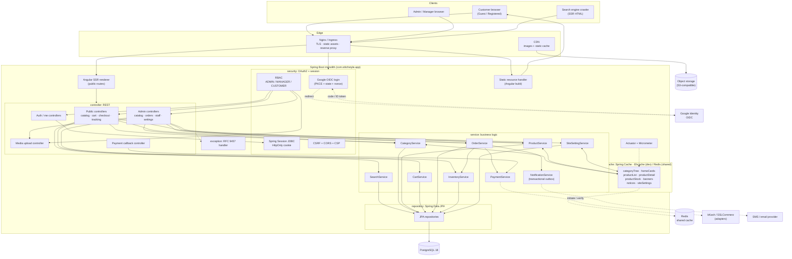
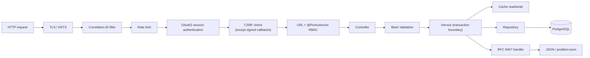
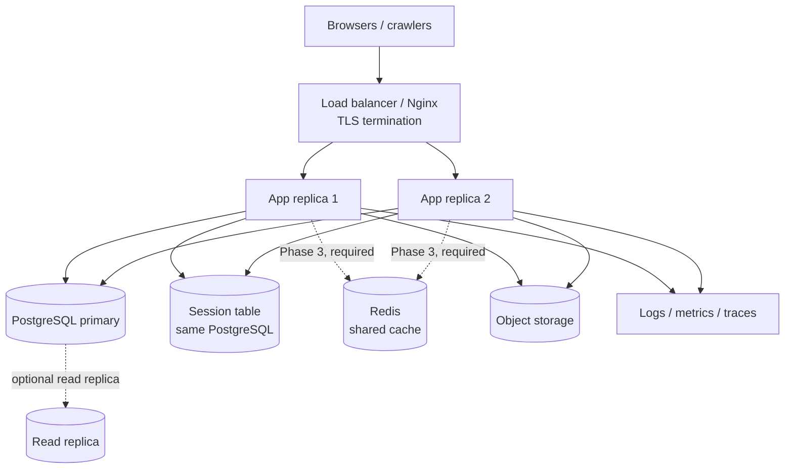
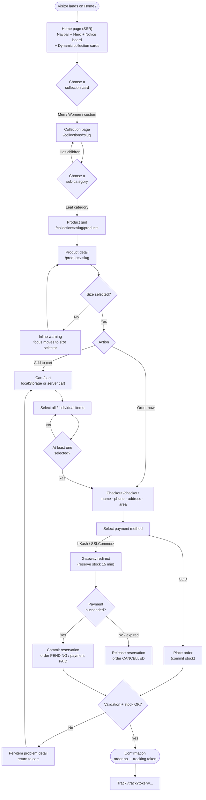
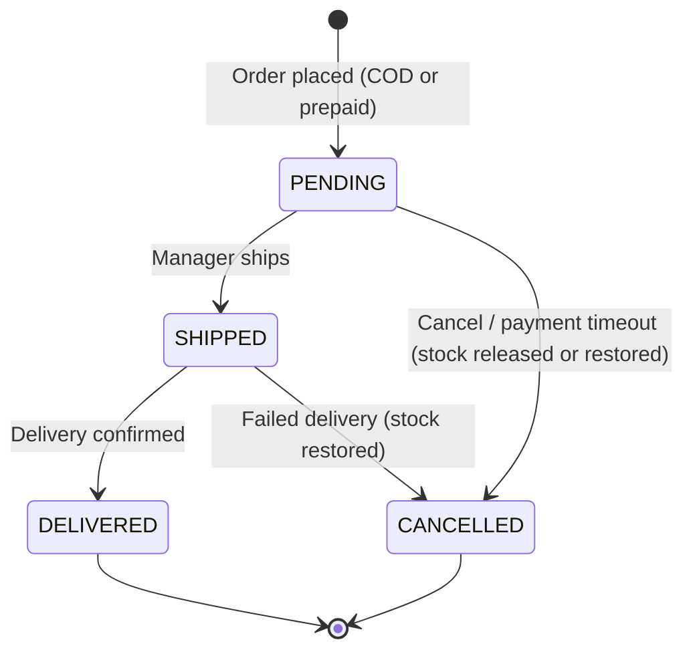
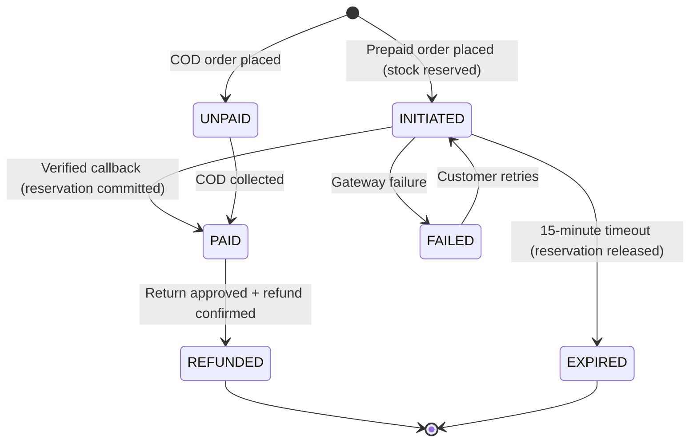
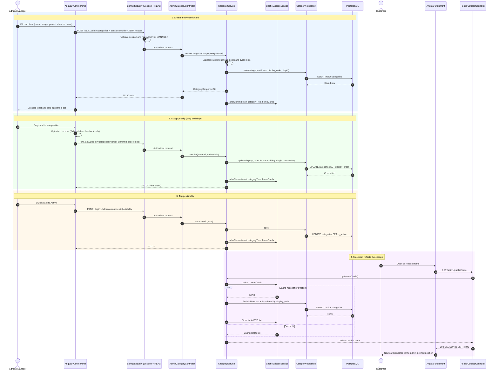

# Product Requirements Document (PRD)

<!-- track-status:begin -->
> **Execution status** — **done** — every item complete · updated 10th Nov 2026 11:11 (+0600) by `track_status.py` (track-based-development; do not edit by hand)
> - **Track file:** [.docs/tracks/stitch-style.md](../.docs/tracks/stitch-style.md)
> - **Progress:** 71 / 71 complete · 0 incomplete (0 open, 0 in progress, 0 blocked)
> - **Harness run reports:** none — worked in-session, no `harness run` (`.claude/reports/<run-id>/`)
> - **Prompt activity reports** (local, gitignored; index [.claude/reports/prompts/index.md](.claude/reports/prompts/index.md)): none yet
<!-- track-status:end -->

## Stitch & Style — Dynamic E-Commerce Web Application (Bangladesh Market)

| Field | Value |
|---|---|
| **Document Version** | 2.1 — Owner decisions and consistency write-back |
| **Supersedes** | 2.0 (2026-11-09) |
| **Date** | 2026-11-09 |
| **Status** | Draft for Review — owner decisions recorded 9th Nov 2026 (§19); production launch gated on counsel sign-off (§19.2) |
| **Review basis** | Internal consistency review of v1.1, applicable IETF/W3C/OWASP standards, the Bangladesh Ministry of Commerce *Digital Commerce Operational Guidelines 2021*, and the owner decision session recorded in §19 |
| **Architecture Style** | Modular monolith — one deployable Spring Boot application serving REST APIs plus the hosted Angular build |
| **Target Market** | Bangladesh (BDT, local phone formats, COD-first, bKash / SSLCommerz) |
| **Primary Stakeholders** | Business Owner, Admin, Manager, Customers (guest and registered), Engineering |

---

## 0. Document Control

### 0.1 Why v2.0 exists

v1.1 was a strong first draft. It was complete enough to build from, but it contained a small number of **internal contradictions** (leftovers from the pre-Google-auth v1.0) and several **silent design gaps** — places where the document said one thing and the data model or API contract implied another. Those are the expensive kind: they compile, they start, and they behave incorrectly only under load, on replay, or after a cache eviction.

v2.0 does not change the product intent. It:

1. resolves every contradiction it found;
2. pins the technology baseline instead of saying "latest stable";
3. replaces bespoke mechanisms with named standards where one exists (RFC 9457 problem details, RFC 9700 OAuth security, the IETF `Idempotency-Key` draft);
4. closes the stock, idempotency, cache-invalidation, SEO and compliance gaps that would otherwise surface after launch;
5. adds a findings register so a reviewer can see exactly what changed and why.

**Terminology.** In this section, **v1.0 / v1.1 / v2.0 / v2.1** are *PRD revisions*. In the rest of the document, **v1.0** (or "the launch release") means the first production release, not a PRD revision.

**v2.1** records the owner decisions that close the v1.1 open questions; §19 is the authoritative decision log. It changes the launch topology (two replicas with Redis), the product schema (`name_i18n`/`description_i18n`), the compliance priority of several 2021 obligations, and the legal launch gate.

### 0.2 Findings register (v1.1 review)

Severity legend: 🔴 silent/live defect in the design · 🟠 genuine missing capability · 🟡 enhancement · 🟢 verified and kept · ❓ needs a product decision

| ID | Severity | Finding in v1.1 | Resolution (v2.0 / v2.1) |
|---|---|---|---|
| F-01 | 🔴 | **Assumption A3 still described "email/phone + password" registration**, contradicting §1.3, §5.G and §9, which make Google OIDC the only sign-in method. | A3 rewritten; no password flow anywhere (§17.2). |
| F-02 | 🔴 | **`JwtAuthenticationFilter.java` remained in the project structure**, although the design is server-side session + OAuth2 login. | Replaced by `SecurityConfig` + `CustomOidcUserService` + session config (§11.1). |
| F-03 | 🔴 | **API path drift**: base path was `/api/v1`, but `/me`, `/me/cart`, `/me/orders`, `/oauth2/**` and `/login/oauth2/**` were listed outside it; §9.3 guarded `/api/v1/me/**` and mixed `/admin/...` with `/api/v1/admin/...`. | One canonical path table; framework OAuth paths explicitly excepted (§7, §9.3). |
| F-04 | 🔴 | **CSRF would block gateway callbacks** (and guest checkout) unless the policy was made explicit. | CSRF policy with one narrow, signature-verified callback exemption (§9.4). |
| F-05 | 🔴 | **`productList` cache key omitted `minPrice`/`maxPrice`** and used an ambiguous `size` parameter, so a filtered request could be served another request's cached page. | Complete, ordered cache-key contract (§8). |
| F-06 | 🔴 | **Cache eviction was specified in the service layer with no after-commit rule**, so a concurrent read can repopulate the old value before commit — the cache then stays stale until TTL. | Evict after commit, with an explicit invalidation matrix (§8.2). |
| F-07 | 🔴 | **Cancellation always "restored" stock**, even for prepaid orders whose stock was never decremented. | Stock ledger + reservation model; restore only a committed decrement (§5.E.1, §6). |
| F-08 | 🔴 | **Prepaid stock was decremented only on payment success**, so two shoppers could both pass checkout for the last unit between initiation and callback. | Reservation with TTL at placement; commit on payment success; release on failure/expiry (§5.D, §5.E.1). |
| F-09 | 🟠 | **Order tracking used a sequential order number + phone**, which is enumerable and open to guessing. | Opaque `public_token` in tracking links; phone fallback rate-limited and constant-time compared (§5.D, §7.1). |
| F-10 | 🟠 | **No SEO/SSR strategy** for a public storefront delivered as an Angular SPA. | Angular SSR/prerender for public routes, metadata, JSON-LD, sitemap (§10.6). |
| F-11 | 🟠 | **No media upload endpoint**, although every image is referenced by URL. | `MediaAsset` entity + upload API + storage abstraction (§5.K, §7.4). |
| F-12 | 🟠 | **No customer notification** (order confirmation) in the launch scope. | Transactional outbox + SMS/email adapter (§5.I). |
| F-13 | 🟠 | **No returns/refunds workflow**, although `payment_status` included `REFUNDED`. | `return_requests` / `return_items` + refund state rules (§5.J). |
| F-14 | 🟠 | **Audit trail was P1 but no audit table existed.** | `audit_log` + auditing rules (§6, §9.7). |
| F-15 | 🟠 | **"Stateless API enables horizontal scaling"** contradicted in-memory sessions and node-local Ehcache. | Spring Session JDBC from day one; Redis shared cache in Phase 3 for the two-replica launch (§4.4, §8.2, IN-2). |
| F-16 | 🟠 | **Tailwind config style was mixed**: `tailwind.config.js` (v3) plus `@plugin daisyui` (v4/v5). | Tailwind 4 + DaisyUI 5, CSS-first config (§3.3, §10.1). |
| F-17 | 🟡 | **Bespoke error envelope** instead of a standard. | RFC 9457 `application/problem+json` (§9.5). |
| F-18 | 🟡 | **Idempotency had a header name but no replay semantics, scope, TTL or conflict rules.** | IETF `Idempotency-Key` draft semantics + `idempotency_keys` table (§7.2, §7.7). |
| F-19 | 🟡 | **Bangladesh legal obligations were mentioned in one line.** | Concrete obligations table from the 2021 Guidelines (§13.3). |
| F-20 | 🟢 | **Google-only OIDC decision** is coherent, well specified and kept. | Retained; hardened with RFC 9700 PKCE and nonce (§5.G, §9.1). |
| F-21 | 🟢 | Open product decisions (max category depth, coupons at launch, SSR scope, courier integration). | Resolved by owner decisions in §19.1. |

### 0.3 Change log

| Version | Date | Change |
|---|---|---|
| 1.0 | 2026-11-09 | Initial PRD: dynamic storefront, categories, products, cart, COD, admin. |
| 1.1 | 2026-11-09 | Google OAuth2-only authentication for staff and customers; password flow removed. |
| 2.0 | 2026-11-09 | Consistency pass; standards alignment; stock reservation; idempotency; cache correctness; SSR/SEO; media, notifications, returns, audit; Bangladesh compliance; pinned versions; findings register. |
| 2.1 | 2026-11-09 | Owner decisions recorded (§19): reservation model, S3 media, no `CONFIRMED` status, Bangla legal pages, `jsonb` product i18n, SSR in Phase 1, Redis in Phase 3 with two replicas, compliance P0 moves, counsel launch gate. |

---

## Table of Contents

0. [Document Control](#0-document-control)
1. [Project Overview & Objectives](#1-project-overview--objectives)
2. [Scope, Personas & Roles](#2-scope-personas--roles)
3. [Technology Stack & Technical Specifications](#3-technology-stack--technical-specifications)
4. [System Architecture](#4-system-architecture)
5. [Functional Requirements](#5-functional-requirements)
6. [Data Model](#6-data-model)
7. [REST API Specification](#7-rest-api-specification)
8. [Caching Strategy](#8-caching-strategy)
9. [Security & RBAC](#9-security--rbac)
10. [Frontend Guidelines](#10-frontend-guidelines)
11. [Project Structure](#11-project-structure)
12. [Non-Functional Requirements](#12-non-functional-requirements)
13. [Bangladesh Localization & Regulatory Compliance](#13-bangladesh-localization--regulatory-compliance)
14. [Testing & Quality Strategy](#14-testing--quality-strategy)
15. [Deployment & Operations](#15-deployment--operations)
16. [Delivery Roadmap](#16-delivery-roadmap)
17. [Risks, Assumptions & Open Questions](#17-risks-assumptions--open-questions)
18. [Acceptance Criteria Summary](#18-acceptance-criteria-summary)
19. [Decisions and remaining open questions](#19-decisions-and-remaining-open-questions)
- [Appendix A — Admin Dynamic Management Sequence](#appendix-a--admin-dynamic-management-sequence)
- [Appendix B — Checkout, Reservation & Payment Sequence](#appendix-b--checkout-reservation--payment-sequence)
- [Appendix C — Glossary](#appendix-c--glossary)
- [Appendix D — Standards & References](#appendix-d--standards--references)

---

## 1. Project Overview & Objectives

### 1.1 Product Summary

A fully dynamic e-commerce platform where the **Admin/Manager controls the storefront from the admin panel** without code deployments. Categories, homepage cards, banners, notices, card ordering, sub-category hierarchies, delivery areas and payment options are all data-driven. Customers can browse, add items to a cart and place orders **as guests**; login is optional for customers and mandatory only for back-office users.

Google is the **single identity provider** for anyone who signs in. The application never stores, hashes or resets passwords.

### 1.2 Business Goals

| # | Goal | Success Indicator |
|---|---|---|
| G1 | Zero-deployment merchandising | Admin creates a category card, sets its position and publishes it live in under 2 minutes |
| G2 | Frictionless purchase | Guest goes from product page to placed order in ≤ 4 steps |
| G3 | Operational control | Managers process orders, update stock and print invoices from one panel |
| G4 | Local fit | COD, local delivery areas, BDT formatting, +880 phone validation, bKash/SSLCommerz-ready |
| G5 | Performance | Cached catalog reads < 100 ms p95 at the application layer |
| G6 | Discoverability | Public catalog pages are server-rendered and indexable; Core Web Vitals "good" on 4G |
| G7 | Compliance | Storefront discloses the business identity and refund/delivery terms required by Bangladeshi digital-commerce rules |

### 1.3 Non-Goals (v1.0)

- Multi-vendor marketplace functionality
- Native mobile apps (the Angular app is fully responsive instead)
- Real payment settlement in v1.0 — bKash / SSLCommerz are **integration placeholders**; adapters and contracts are defined and sandbox-testable
- Microservices decomposition (explicitly a monolith)
- Email/password, OTP or other social login — **Google OIDC is the only sign-in method**
- Multi-currency, multi-warehouse or cross-border shipping
- AI recommendations, loyalty points, auctions or live commerce

### 1.4 What "dynamic" means here

| Dynamic surface | Data source | Admin action that changes it |
|---|---|---|
| Navbar links | `categories` where `show_in_navbar = true` | Create/rename/reorder/toggle |
| Home collection cards | `categories` where `show_on_home = true` | Create/reorder/toggle |
| Hero slider | Latest N active products + pinned `banners` | Add banner / change product |
| Notice strip | `notices` active in the current window | Create/expire a notice |
| Delivery charge | `delivery_areas` | Edit area charge |
| Payment options | `site_settings` (`payment.*.enabled`) | Toggle method |
| Branding | `site_settings` (`brand.*`) | Change name/logo |

---

## 2. Scope, Personas & Roles

### 2.1 Personas

| Persona | Description | Authentication |
|---|---|---|
| **Guest Customer** | Browses, builds a cart in `localStorage`, checks out with name/phone/address | None |
| **Registered Customer** | Same as guest, plus server-synced cart and order history | Optional Google sign-in |
| **Manager** | Day-to-day operations: products, stock, cards/categories, banners, orders | Mandatory Google sign-in (allow-listed staff) |
| **Admin** | Super user: everything a Manager can do plus staff management, configuration, analytics, delivery areas | Mandatory Google sign-in (allow-listed staff) |

### 2.2 Role–Permission Matrix

| Capability | Guest | Customer | Manager | Admin |
|---|:---:|:---:|:---:|:---:|
| Browse catalog, collections, products | ✅ | ✅ | ✅ | ✅ |
| Cart (local) / Cart (server-synced) | ✅ / ❌ | ✅ / ✅ | — | — |
| Place order (guest checkout allowed) | ✅ | ✅ | — | — |
| View own order history | ❌ | ✅ | — | — |
| Track order by opaque token (or order number + phone) | ✅ | ✅ | — | — |
| Product CRUD, variant & stock updates | ❌ | ❌ | ✅ | ✅ |
| Dynamic category/card creation, ordering, visibility | ❌ | ❌ | ✅ | ✅ |
| Banner / notice management | ❌ | ❌ | ✅ | ✅ |
| Order processing & status changes, invoice printing | ❌ | ❌ | ✅ | ✅ |
| Media upload / library | ❌ | ❌ | ✅ | ✅ |
| Delivery area & charge management | ❌ | ❌ | ❌ | ✅ |
| Staff account management | ❌ | ❌ | ❌ | ✅ |
| Site settings (branding, payment toggles) | ❌ | ❌ | ❌ | ✅ |
| Analytics dashboard | ❌ | ❌ | Limited (operational counts) | ✅ (incl. revenue) |
| Audit log | ❌ | ❌ | ❌ | ✅ |
| Returns / refunds approval | ❌ | Own request | ✅ process | ✅ refund |

> **Decided (OQ-4, §19.1):** Managers see operational counts only; revenue, margin and top-product value remain Admin-only. The matrix above is the launch boundary.

### 2.3 Explicit capability boundaries

- A **Manager cannot** change delivery charges, payment toggles, staff roles or site settings.
- A **Manager cannot** delete a category; only Admin can perform a guarded delete (FR-B6).
- A **Customer cannot** call any `/api/v1/admin/**` or `/api/v1/staff/**` endpoint, regardless of UI state. Route guards are UX only; the server is the authority.
- A **guest cannot** read another guest's order, even with a guessed order number; tracking requires the opaque token or order number **and** phone, and is rate-limited.

---

## 3. Technology Stack & Technical Specifications

### 3.1 Pinned baseline (verified 2026-11-09)

The v1.1 policy of "latest stable, resolved at bootstrap" is replaced by an explicit pin, recorded in the Gradle version catalog and `package.json`. A PRD that leaves versions open produces a different system on every machine.

| Component | Pinned baseline | Notes |
|---|---|---|
| **Java** | **25 (LTS)** | Spring Boot 4.1 supports Java 17–26 |
| **Spring Boot** | **4.1.2** | Latest stable GA on 2026-10-23; 4.2 is still RC |
| **Spring Framework / Security** | Managed by Boot 4.1 BOM | Spring Security 7.x; OAuth2 client + server-side session |
| **PostgreSQL** | **18.6** | Latest supported 18.x |
| **Flyway** | Managed by Boot; pin the exact patch | `flyway-core` + `flyway-database-postgresql` |
| **Angular** | **22.x** (22.2.5 verified; 22.3 imminent) | Active support to 2028-06 |
| **Node.js** | **26.x LTS** (26.13.0 verified) | Build toolchain only |
| **Tailwind CSS** | **4.x** | CSS-first configuration (`@import "tailwindcss"`) |
| **DaisyUI** | **5.x** | Requires Tailwind 4 |
| **TypeScript** | Version required by Angular 22 | Pin via `package.json` |
| **Gradle** | Wrapper pinned to the version supported by Boot 4.1 | Verify at bootstrap, then never float |
| **Testcontainers / JUnit** | Managed by Boot BOM | PostgreSQL module |

> **Pin policy:** dependencies are locked; upgrades are deliberate pull requests with a changelog entry. Security patches are applied within the SLA in §12.

### 3.2 Backend

| Layer | Technology | Notes |
|---|---|---|
| Language / Runtime | Java 25 LTS | Gradle toolchain pinned |
| Framework | Spring Boot 4.1.x | Modular monolith |
| Web | Spring Web MVC (REST) | JSON over HTTP, versioned under `/api/v1` |
| Security | Spring Security 7 + OAuth2 Client | Google OIDC only; server-side session; RBAC for `ADMIN` / `MANAGER` / `CUSTOMER`; CSRF enabled |
| Persistence | Spring Data JPA + Hibernate | Entity auditing; optimistic locking where needed; no lazy loading across the web boundary |
| Database | PostgreSQL 18.x | Flyway migrations; `timestamptz`; `jsonb` for snapshots |
| Caching | Spring Cache; Ehcache 3 (dev) / Redis (shared) | DTOs only. Redis shared cache is required for the two-replica launch (Phase 3, IN-2); Ehcache remains the local/dev provider. |
| Session | Spring Session JDBC | From day one, so the app can run 2 replicas without sticky sessions |
| Observability | Spring Boot Actuator + Micrometer | Health, metrics, cache stats; OpenTelemetry traces |
| Utilities | Lombok (optional) | If used, pin and configure the annotation processor |
| Build | Gradle (Kotlin DSL recommended) | One command builds backend + frontend |
| Validation | Jakarta Bean Validation | Every request DTO |
| API Docs | springdoc-openapi, OpenAPI 3.1 | Generated at build; secured/disabled in production |
| Rate limiting | Bucket4j (in-memory dev; Redis-backed in production) | Per-endpoint policies (§9.8); shared limits across the two-replica launch (IN-2). |

### 3.3 Frontend

| Layer | Technology | Notes |
|---|---|---|
| Framework | Angular 22 | Standalone components, Signals, `@if`/`@for`, lazy routes |
| Rendering | Angular SSR (`@angular/ssr`) for public routes | SEO + LCP; admin remains client-rendered |
| UI Library | DaisyUI 5 | `btn`, `card`, `navbar`, `badge`, `modal`, `carousel`, etc. |
| Styling | Tailwind CSS 4 | Strictly external utility classes; **no inline CSS** (§10.1) |
| State | Angular Signals + services | RxJS only for HTTP streams |
| Forms | Reactive Forms | Typed forms with validators |
| HTTP | `provideHttpClient(withFetch(), withXsrfConfiguration(...))` | Session cookie + XSRF header |
| Images | `NgOptimizedImage` | `srcset`, `sizes`, width/height, lazy loading |
| Testing | Jest/Karma + Playwright + axe-core | Unit, E2E, accessibility |

### 3.4 Reference Gradle dependencies (backend)

```groovy
dependencies {
    implementation 'org.springframework.boot:spring-boot-starter-web'
    implementation 'org.springframework.boot:spring-boot-starter-security'
    implementation 'org.springframework.boot:spring-boot-starter-oauth2-client'
    implementation 'org.springframework.boot:spring-boot-starter-data-jpa'
    implementation 'org.springframework.boot:spring-boot-starter-validation'
    implementation 'org.springframework.boot:spring-boot-starter-actuator'
    implementation 'org.springframework.boot:spring-boot-starter-cache'
    implementation 'org.springframework.boot:spring-boot-starter-data-redis'   // shared cache for 2 replicas

    // Server-side session shared across replicas
    implementation 'org.springframework.session:spring-session-jdbc'

    // Ehcache 3 for dev/local, used through Spring's native CacheManager (simpler than JCache)
    implementation 'org.ehcache:ehcache'

    // Flyway
    implementation 'org.flywaydb:flyway-core'
    runtimeOnly   'org.flywaydb:flyway-database-postgresql'

    // Rate limiting (Redis-backed store in production, IN-2)
    implementation 'com.bucket4j:bucket4j-core'

    // OpenAPI 3.1
    implementation 'org.springdoc:springdoc-openapi-starter-webmvc-ui'

    runtimeOnly   'org.postgresql:postgresql'

    compileOnly   'org.projectlombok:lombok'
    annotationProcessor 'org.projectlombok:lombok'

    testImplementation 'org.springframework.boot:spring-boot-starter-test'
    testImplementation 'org.springframework.security:spring-security-test'
    testImplementation 'org.testcontainers:postgresql'
    testImplementation 'com.tngtech.archunit:archunit-junit5'
}
```

> The Ehcache artifact is used through Spring Boot's native `EhCacheCacheManager` auto-configuration (`ehcache.xml`), not through JCache. This avoids the `javax.cache` / Jakarta namespace ambiguity called out in v1.1 and removes an unnecessary dependency. Redis (via `spring-boot-starter-data-redis`) backs the same cache names in staging/production (IN-2). `springdoc` and Bucket4j versions are pinned by the version catalog to a release compatible with Boot 4.1.

### 3.5 Why these pins

- **Boot 4.1.2, not 4.2:** 4.2 is an RC on the document date. A launch project should not start on a release candidate.
- **Java 25:** current LTS; Boot 4.1 supports it.
- **Angular 22:** active support until 2028-06; v22.3 is a minor, not a new major.
- **Tailwind 4 + DaisyUI 5:** the pair is designed together; DaisyUI 5 requires Tailwind 4. Mixing a v3 JS config with v4 CSS directives is the exact defect F-16.
- **Spring Session JDBC:** removes the "stateless" claim's contradiction and makes the 2-replica deployment in §15 real rather than aspirational.
- **Redis in Phase 3:** the two-replica launch needs a shared cache (IN-2); node-local Ehcache alone would leave an admin edit invisible on the other replica until TTL.

---

## 4. System Architecture

### 4.1 Architecture Principles

1. **Monolith, modular inside** — one deployable, strict package separation (`controller → service → repository`), enforced by ArchUnit.
2. **Data-driven storefront** — categories, cards, banners, notices, delivery areas and payment toggles are rows, never constants.
3. **Read-heavy optimization** — public catalog reads are cached; admin writes evict precisely, after commit.
4. **Google-only authentication** — OAuth2/OIDC login for staff and customers; server-side session in an `HttpOnly` cookie; guests need no credentials.
5. **Server-side truth** — prices, stock, discounts and totals are recomputed on the server at checkout. Client input is a request, never a fact.
6. **No external I/O inside a database transaction** — gateway calls and SMS/email sends happen outside the transaction boundary.
7. **Idempotent by contract** — order placement and payment callbacks are safe to retry.
8. **Everything public is indexable** — public catalog pages are server-rendered, not an empty SPA shell.

### 4.2 Diagram 1 — System architecture (monolith)



### 4.3 Request pipeline



Rules:

- The **correlation ID** (`X-Request-Id`, or a generated ULID) is logged and returned in the response and in problem details as `traceId`.
- **Rate limiting** runs before authentication where possible, to protect the OAuth endpoints themselves.
- **CSRF** applies to cookie-authenticated, state-changing requests. Signed, server-to-server payment callbacks are the only exemption (§9.4).
- **Authorization** is enforced twice: URL matchers and `@PreAuthorize` on admin services.

### 4.4 Deployment topology



- **v1.0 launches with two replicas.** Spring Session JDBC keeps sessions shared, and the Redis cache (Phase 3) keeps cache invalidation shared. A single replica is a development/pre-launch configuration, not the launch topology (IN-2).
- **Ehcache alone is node-local.** With two replicas, an admin write on replica 1 would evict only replica 1's cache. Redis is therefore required before the second replica is enabled; v2.0's "optional Redis in Phase 4" is superseded (IN-2, §19.1).
- **Object storage** is the default for media; a local volume is a development-only fallback.
- **Scheduled jobs are single-owner.** Reservation expiry, idempotency cleanup, sitemap regeneration and outbox retries run behind a distributed lock (ShedLock or a PostgreSQL advisory lock) so two replicas do not process the same batch twice.

---

## 5. Functional Requirements

Priority legend: **P0** = must-have for launch, **P1** = should-have, **P2** = nice-to-have.

### 5.A Frontend Navigation & Dynamic UI (`/`)

| ID | Requirement | Priority |
|---|---|---|
| FR-A1 | **Navbar** renders dynamic branding (logo + store name from `site_settings`). | P0 |
| FR-A2 | Navbar lists **Men's Collection**, **Women's Collection** and any admin-created root categories that are visible, ordered by `display_order`. | P0 |
| FR-A3 | Navbar shows a **Cart icon with a live item-count badge** (DaisyUI `indicator` + `badge`), updating instantly on add/remove. | P0 |
| FR-A4 | Navbar shows a **Sign in with Google** action when unauthenticated, or the user's **Google avatar + Profile / Logout** menu when authenticated. | P0 |
| FR-A5 | **Dynamic Hero Banner**: automated slider of newly added products (latest N active products, N configurable) plus pinned promotional banners. | P0 |
| FR-A6 | Admin can **pin custom promotional banners** with admin-defined order, optional link target and active date range. | P0 |
| FR-A7 | **Notice Board**: admin-managed announcements with activation window, priority and dismissible display. Dismissal state is stored client-side per notice id and expiry. | P0 |
| FR-A8 | **Dynamic Main Collection Cards**: large responsive cards for Men's, Women's and any custom root cards, rendered from the category API. | P0 |
| FR-A9 | Clicking a collection card navigates to `/collections/:slug`. | P0 |
| FR-A10 | Fully responsive layout (mobile-first) using Tailwind breakpoints. | P0 |
| FR-A11 | The home page is **server-rendered with real content** (not an empty shell) so crawlers and first paint see products and cards. | P0 |
| FR-A12 | Autoplay respects `prefers-reduced-motion` and can be paused; the carousel is keyboard-operable. | P0 |

**Hero ordering rule (new).** Pinned banners sort before auto-generated product slides, each group by its own `display_order`/recency. The exact interleaving is configurable via `site_settings` (`home.hero.mode = PINNED_FIRST | PRODUCTS_FIRST | INTERLEAVED`), default `PINNED_FIRST`.

### 5.B Multi-Level Dynamic Category & Card Management

| ID | Requirement | Priority |
|---|---|---|
| FR-B1 | **Admin Dynamic Card Creator**: create a category/card on the fly (name, slug, image, description, parent, size type). Examples: *Jewelry*, *Kids*, *Eid Campaign*. | P0 |
| FR-B2 | **Multi-level hierarchy**: categories self-reference via `parent_id`, supporting arbitrary depth. UI guidance is 4 levels; the server enforces a configurable maximum (default 4) to protect UX and recursion costs. | P0 |
| FR-B3 | **Dynamic positioning** via `display_order` (integer, per sibling group). Admin reorders by **drag-and-drop** with up/down buttons as a keyboard-accessible fallback. | P0 |
| FR-B4 | **Visibility toggle** (`is_active`): hiding a parent hides its subtree on the storefront. | P0 |
| FR-B5 | Slug uniqueness validation; slug auto-generated from the name and editable. | P0 |
| FR-B6 | Deleting a category with children or products is blocked; Admin is offered **deactivate** or **reassign** instead. | P0 |
| FR-B7 | Placement flags: `show_on_home` and `show_in_navbar`. | P1 |
| FR-B8 | Every create/update/reorder/toggle **evicts the relevant caches after commit** so the storefront reflects changes immediately (§8). | P0 |
| FR-B9 | A category cannot be moved under its own descendant; the server rejects the move with `409 Conflict`. | P0 |

**Depth rule.** `depth` is materialized on write (`parent.depth + 1`) and checked against `app.catalog.max-depth`. A move that would exceed the limit is rejected. This prevents a deep tree from turning a simple tree query into an unbounded recursion. **Decided (IN-1, §19.1):** the launch value is 4.

### 5.C Product Listing, Size Selection & Smart Cart

#### Product navigation

| ID | Requirement | Priority |
|---|---|---|
| FR-C1 | Clicking a sub-category card loads a **product grid** with image, name, price, discount badge and stock state. | P0 |
| FR-C2 | Product listing supports pagination, sort (newest, price asc/desc) and filters (price range, size availability, search query). **All filter parameters are part of the cache key** (§8). | P1 |
| FR-C3 | Product detail page (`/products/:slug`) with gallery, description, price, size selector and stock indicator. | P0 |
| FR-C4 | Product listing and detail pages are server-rendered with canonical URLs and metadata (§10.6). | P0 |

#### Mandatory size validation

Each product declares a **size type**, and each variant row carries the concrete size label and its own stock.

| Size type | Example values |
|---|---|
| `LETTER` | S, M, L, XL, XXL |
| `WAIST` | 28, 30, 32, 34, 36 |
| `SHOE` | 39, 40, 41, 42, 43 |
| `FREE` | Free Size (e.g., Sharee) |
| `CUSTOM` | Admin-defined labels |

| ID | Requirement | Priority |
|---|---|---|
| FR-C5 | The size selector is rendered dynamically from the product's variants. | P0 |
| FR-C6 | The user **must select a size** before **Add to Cart** or **Order Now**. If omitted, the UI blocks the action, shows a validation warning (DaisyUI `alert` / `validator-hint`) and moves focus to the size selector. | P0 |
| FR-C7 | `FREE` products auto-select "Free Size" but still send a `variantId`. | P0 |
| FR-C8 | Out-of-stock sizes are shown as disabled. | P0 |
| FR-C9 | The **server re-validates** that `variantId` belongs to the product and has sufficient available stock; client validation is never trusted. | P0 |

#### Selective cart checkout (`/cart`)

| ID | Requirement | Priority |
|---|---|---|
| FR-C10 | **Guest cart** persists in browser `localStorage` (key `stitchstyle.cart.v1`) storing `productId`, `variantId`, `quantity`, `selected` — never prices. | P0 |
| FR-C11 | **Logged-in cart** is synced with PostgreSQL (`carts`, `cart_items`). On login, the local cart is **merged** into the server cart (quantities summed, capped by available stock, one row per variant). | P0 |
| FR-C12 | Cart page has **Select All** plus a **checkbox per item**. | P0 |
| FR-C13 | The user can proceed to checkout with **only the selected items**; unselected items remain in the cart afterwards. | P0 |
| FR-C14 | Cart re-prices from the server on load (`POST /api/v1/public/cart/price`) and flags price/stock changes. | P0 |
| FR-C15 | Quantity stepper respects available stock; minimum 1. | P0 |
| FR-C16 | Cart totals display only for the selected subset (items subtotal, estimated delivery, discount, grand total). | P0 |
| FR-C17 | Merge is **idempotent**: re-sending the same local cart does not double quantities. The client clears the local cart only after a successful merge. | P0 |

**Price precedence (new).** The effective unit price is `COALESCE(variant.price_override, product.discount_price, product.base_price)`. It is computed only on the server; the client never sends a price. `discount_total` is the sum of `(base_price - effective_price) × quantity` for the selected lines. Coupons are **not enabled at launch** (OQ-10, §19.1); when introduced they add a separate `coupon_discount` component rather than overloading `discount_total`.

### 5.D Checkout & Order Placement (`/checkout`)

| ID | Requirement | Priority |
|---|---|---|
| FR-D1 | **Guest checkout supported**; login is **not mandatory** for customers. | P0 |
| FR-D2 | **Checkout form** collects: Customer Name, Phone Number, Full Address, **Delivery Area** (dropdown from active delivery areas), optional order note. | P0 |
| FR-D3 | Phone is validated against Bangladeshi mobile formats and normalized to E.164 (§13). | P0 |
| FR-D4 | **Payment methods**: (a) **Cash on Delivery (COD)**; (b) **Online / Prepaid** via **bKash** and **SSLCommerz** adapters. Admin can enable/disable each method in `site_settings`. | P0 |
| FR-D5 | **Order Summary** shows selected items, chosen sizes, quantities, line totals, subtotal, delivery charge (by area), discount, grand total. | P0 |
| FR-D6 | **Order Now** (from product page) creates a single-item checkout without touching the cart. | P0 |
| FR-D7 | On success: unique **order number** (e.g., `ORD-20261109-7K3M9Q`), an opaque **public tracking token**, a confirmation page and a track-order link. | P0 |
| FR-D8 | Checkout is **idempotent**: a client-generated `Idempotency-Key` prevents duplicate orders on double-click or retry. Replay returns the original result; a conflicting payload returns `422`; a concurrent duplicate returns `409` (§7.7). | P0 |
| FR-D9 | Prepaid flow: the order is created as `PENDING` with payment `INITIATED` and **reserves stock for 15 minutes**; the user is redirected to the gateway; the callback/IPN marks payment `PAID` (commit reservation) or `FAILED` (release). An unpaid order auto-cancels at expiry. | P1 (placeholder in v1.0, sandbox-ready) |
| FR-D10 | Only the selected cart items are removed from the cart after a successful order. | P0 |
| FR-D11 | The order number is **not sequential-only**: it carries a random suffix, and tracking links use an opaque token, so orders cannot be enumerated (§7.7). | P0 |
| FR-D12 | COD orders reserve and commit stock at placement; prepaid orders reserve at placement and commit on payment success (§5.E.1). | P0 |

> **Decided (OQ-13, §19.1):** the order number keeps a human-readable date plus a random suffix, and every customer tracking link uses the opaque `public_token`; the order-number + phone fallback is rate-limited. The number alone is never sufficient to read an order.

**Guest identity (new).** On first visit the server issues an anonymous `guest_id` cookie (`HttpOnly`, `SameSite=Lax`, 30-day expiry). It scopes idempotency keys and prevents one guest's retry from colliding with another's. It is not an authentication credential and grants no access to order data.

### 5.E Admin & Manager Panel

| ID | Requirement | Priority |
|---|---|---|
| FR-E1 | Admin panel is a lazy-loaded Angular area (`/admin/**`) protected by route guards **and** server-side RBAC. | P0 |
| FR-E2 | **Admin** — full privileges: staff management (Google-email allow-list), system configuration (`site_settings`), delivery areas/charges, payment toggles, audit log, full analytics. | P0 |
| FR-E3 | **Manager** — product management, **inventory/stock updates**, dynamic card/category creation, media upload, banner and notice updates, order processing. | P0 |
| FR-E4 | **Real-time stock decrement** on order confirmation, using the reservation rules below. | P0 |
| FR-E5 | **Order status management**: `PENDING → SHIPPED → DELIVERED`, plus `CANCELLED`. Transitions are validated server-side. | P0 |
| FR-E6 | **Bulk invoice printing**: select multiple orders → print-optimized layout (one invoice per page) using a dedicated print route and Tailwind `print:` utilities. | P0 |
| FR-E7 | Order list with filters (status, date range, phone, order number) and pagination. | P0 |
| FR-E8 | Low-stock alerts on the dashboard (threshold configurable per variant, default 5). | P1 |
| FR-E9 | Dashboard analytics (Admin): orders/day, revenue, top products, status distribution; Manager sees operational counts only. | P1 |
| FR-E10 | Audit trail of admin actions (who changed what, when) for orders, stock, settings, staff and categories. | P1 |
| FR-E11 | Refund/return processing with stock restock on receipt. | P1 |
| FR-E12 | Courier name + tracking number can be recorded on an order (manual in v1.0; Pathao/Steadfast/RedX adapters later). | P1 |

#### 5.E.1 Inventory rules (corrected)

The v1.1 rule "decrement at placement / on payment success" left a window in which the last unit could be sold twice. v2.0 separates **on-hand**, **reserved** and **available** stock.

Let:

```
on_hand   = product_variants.stock_quantity
reserved  = SUM(active stock_reservations.quantity)
available = on_hand - reserved
```

Rules:

1. Stock is tracked **per variant** (`product_variants.stock_quantity`), with `reserved_quantity` maintained transactionally (or derived from `stock_reservations` under a row lock).
2. **COD order placement** — inside one transaction: lock the variant rows, verify `available >= quantity` for every line, decrement `on_hand`, write an `inventory_movements` row (`reason = ORDER`, `delta = -qty`). No reservation is left behind.
3. **Prepaid order placement** — inside one transaction: lock the variant rows, verify `available >= quantity`, create `stock_reservations` rows with `status = ACTIVE`, `expires_at = now + 15 min`. On payment success: convert each reservation to a committed decrement (`on_hand -= qty`, write `inventory_movements`, `status = COMMITTED`). On failure/expiry: `status = RELEASED`.
4. **Cancellation** — restores stock **only if a committed decrement exists**. If the order only had active reservations, cancellation releases them. This is the fix for F-07: a naive "restore on cancel" inflates stock for prepaid orders that never committed.
5. **Concurrency** — use a guarded update (`UPDATE ... SET stock_quantity = stock_quantity - :qty WHERE id = :id AND stock_quantity - reserved_quantity >= :qty`) or `SELECT ... FOR UPDATE` on the variant rows. `@Version` on the variant catches lost updates in admin edits; the guarded update is the checkout path.
6. If any line has insufficient stock, the **entire order is rejected** with a per-item problem detail; no partial order is created.
7. Every stock change writes an `inventory_movements` row with `balance_after` so the ledger reconciles to `on_hand`.
8. A scheduled job every minute releases expired reservations and cancels unpaid prepaid orders (`cancel_reason = PAYMENT_TIMEOUT`), restoring availability.
9. Admin stock adjustment writes `inventory_movements` with `reason = MANUAL_ADJUST` and the actor id.
10. `available` — never `on_hand` — is what the storefront displays and what checkout validates.

> **Decided (OQ-1, §19.1):** this section is the launch inventory model. COD commits at placement; prepaid reserves for 15 minutes and commits only on verified payment; failure/expiry releases. No decrement-at-confirmation path is built.

### 5.F Diagram 2 — User journey & navigation flow



### 5.G Authentication — Google OIDC only

Google is the **single identity provider** for everyone who signs in. The application never stores or handles passwords.

| ID | Requirement | Priority |
|---|---|---|
| FR-G1 | **Google OAuth2 / OpenID Connect is the only sign-in method** for Admin, Manager and customer. No password login, registration form or password-reset flow exists. | P0 |
| FR-G2 | A **Sign in with Google** action is available in the storefront navbar, on `/login` and on `/admin/login`. It is a plain link to `/oauth2/authorization/google` — no Google JavaScript SDK is required. | P0 |
| FR-G3 | **Customers:** the first successful Google sign-in auto-creates a `CUSTOMER` account from the Google profile (name, verified email, picture). | P0 |
| FR-G4 | **Staff:** Admin pre-registers Managers/Admins by **Google email + role**. The record is linked to the Google `sub` on first sign-in. The first Admin(s) are bootstrapped from `app.security.bootstrap-admin-emails`. | P0 |
| FR-G5 | A Google account not on the staff allow-list can never obtain `ADMIN` or `MANAGER`; opening `/admin/**` shows a 403 page. | P0 |
| FR-G6 | Sign-in is rejected when Google reports the email as **unverified** (`email_verified != true`). | P0 |
| FR-G7 | Admin can **disable** any user or staff account; disabled users cannot sign in and their active sessions are invalidated immediately. | P0 |
| FR-G8 | **Logout** invalidates the server session and clears the cookie. | P0 |
| FR-G9 | **Guest checkout stays available** without signing in. After sign-in, the guest `localStorage` cart is merged into the server cart (FR-C11). | P0 |
| FR-G10 | Google does not supply a phone number, so the **phone is collected at checkout** and may be saved to the profile. | P0 |
| FR-G11 | After sign-in the user returns to the page where they started; `returnUrl` must be a **relative in-app path** (prevents open redirects). | P0 |
| FR-G12 | The identity key is the Google `sub`; email is unique but secondary. A staff member who changes their Google email keeps the same account. | P0 |

> **Decided (OQ-7, §19.1):** guest checkout is the only path for customers without a Google account; no magic-link or phone-OTP identity is added in v1.0. **Decided (OQ-8, §19.1):** the staff allow-list is the primary control; `hd` enforcement is optional per environment, not mandatory.

#### Diagram 5 — Google OAuth2/OIDC sign-in flow

```mermaid
sequenceDiagram
    autonumber
    actor U as User (Customer or Staff)
    participant NG as Angular App
    participant SB as Spring Boot (oauth2Login)
    participant G as Google OIDC
    participant US as CustomOidcUserService
    participant DB as PostgreSQL

    U->>NG: Click "Sign in with Google"
    NG->>SB: GET /oauth2/authorization/google (returnUrl stored in session)
    SB->>G: 302 to Google (state + nonce + PKCE S256)
    G-->>U: Account chooser and consent
    U->>G: Select account and approve
    G-->>SB: 302 /login/oauth2/code/google?code=...&state=...
    SB->>G: Exchange code + code_verifier for tokens
    G-->>SB: ID token + access token
    SB->>SB: Validate state, nonce, ID-token signature, issuer, audience
    SB->>US: loadUser(OidcUser)
    US->>US: Require email_verified = true
    US->>DB: Find user by google_sub, then by email
    alt Pre-registered staff record
        DB-->>US: Row with role ADMIN or MANAGER
        US->>DB: Link google_sub on first login; update last_login_at
    else Unknown email
        US->>DB: INSERT user with role CUSTOMER
    end
    alt User is disabled
        US-->>SB: Reject authentication
        SB-->>NG: 302 /login?error=disabled
    else Allowed
        US-->>SB: Principal with role
        SB->>DB: Create session (Spring Session JDBC)
        SB->>SB: Set HttpOnly Secure SameSite=Lax cookie
        SB-->>NG: 302 to validated relative returnUrl
        NG->>SB: GET /api/v1/me
        SB-->>NG: Profile + role
        NG-->>U: Avatar, profile menu; merge guest cart
    end
```

#### Google Cloud and Spring configuration

| Item | Value |
|---|---|
| OAuth client type | Web application (one client per environment) |
| Scopes | `openid`, `email`, `profile` |
| Authorized redirect URI | `https://<domain>/login/oauth2/code/google` and `http://localhost:8080/login/oauth2/code/google` for dev |
| Secrets | `GOOGLE_CLIENT_ID`, `GOOGLE_CLIENT_SECRET` from environment/secret store, never committed |
| PKCE | Enabled for the authorization-code flow (`S256`), per RFC 9700 |
| State / nonce | Spring Security defaults; nonce required for OIDC |
| Return URL | Stored server-side in the session before redirect; only relative paths accepted |

```yaml
spring:
  security:
    oauth2:
      client:
        registration:
          google:
            client-id: ${GOOGLE_CLIENT_ID}
            client-secret: ${GOOGLE_CLIENT_SECRET}
            scope: openid,email,profile
        provider:
          google:
            issuer-uri: https://accounts.google.com

app:
  security:
    bootstrap-admin-emails: ${BOOTSTRAP_ADMIN_EMAILS}   # comma-separated Google emails
    staff-session-timeout: 30m
    customer-session-timeout: 8h
```

> **Implementation note.** Spring Security does not enable PKCE for a confidential web client by default. Apply `OAuth2AuthorizationRequestCustomizers.withPkce()` in a custom `OAuth2AuthorizationRequestResolver`, and verify with an integration test that the authorization request contains `code_challenge` and `code_challenge_method=S256`. RFC 9700 mandates PKCE for all authorization-code flows, public and confidential.

### 5.H Search & discovery (new, P1)

| ID | Requirement | Priority |
|---|---|---|
| FR-H1 | A search box in the navbar and on the product grid searches product name, description and category name. | P1 |
| FR-H2 | Search uses PostgreSQL full-text search (`tsvector` + GIN index) with `pg_trgm` fallback for typo tolerance. | P1 |
| FR-H3 | Search results respect visibility, stock and category filters, and are paginated. | P1 |
| FR-H4 | An empty result page suggests root categories instead of a dead end. | P1 |

### 5.I Notifications (new, P1)

| ID | Requirement | Priority |
|---|---|---|
| FR-I1 | On order placement and on status change, the customer receives an SMS (and optionally email) using a **transactional outbox**: the message row is written in the same transaction as the order, then delivered asynchronously with retries. | P1 |
| FR-I2 | Template variables are whitelisted; no free-form PII is logged. | P1 |
| FR-I3 | Failed deliveries are retried with exponential backoff and surfaced in the admin dashboard. | P1 |
| FR-I4 | Admin can resend a notification for an order. | P2 |

**Why an outbox.** Sending SMS inside the order transaction makes the order fail when the provider is slow. Sending after commit without a durable record loses the message on a crash. The outbox is the standard middle ground.

### 5.J Returns & refunds (new, P1)

| ID | Requirement | Priority |
|---|---|---|
| FR-J1 | A customer can request a return for a delivered order within a configurable window (default 7 days). | P1 |
| FR-J2 | Return statuses: `REQUESTED → APPROVED → RECEIVED → REFUNDED`, or `REJECTED`. | P1 |
| FR-J3 | On `RECEIVED`, restock the returned variants and write `inventory_movements` (`reason = RETURN`). | P1 |
| FR-J4 | Refund is recorded against the original payment method; prepaid refunds go through the gateway adapter, COD refunds are recorded as a manual payout. | P1 |
| FR-J5 | `payment_status` becomes `REFUNDED` only when the refund is confirmed, not when it is requested. | P1 |

> **Implemented (11th Nov 2026):** the customer dashboard now exposes return eligibility and history, a return-quote preview and status tracking. Refunds are computed from the returned items with a pro-rata coupon share and delivery refunded only on a full-order return; partial refunds use `PARTIALLY_REFUNDED`. Design and decisions: [`AddMessageAndReturn.md`](AddMessageAndReturn.md).

### 5.K Media management (new, P0 for admin usability)

| ID | Requirement | Priority |
|---|---|---|
| FR-K1 | `POST /api/v1/admin/media` accepts one image (multipart), validates MIME type, extension, byte size and pixel dimensions, strips EXIF, and stores it via a `MediaStorage` abstraction. | P0 |
| FR-K2 | The response returns a stable media id and URL(s); product, category and banner records reference the media id/URL. | P0 |
| FR-K3 | Allowed types: JPEG, PNG, WebP, AVIF. Maximum 10 MB and 6000×6000 px. SVG is rejected (script-in-SVG risk). | P0 |
| FR-K4 | The storage abstraction has a local-filesystem implementation (dev) and an S3-compatible implementation (prod), selected by configuration. | P0 |
| FR-K5 | Images are served through a CDN with long-lived immutable caching and content hashes in the filename. | P0 |
| FR-K6 | A generated `srcset` (e.g., 320/640/960/1280/1920) is available to the frontend; the original is retained. | P0 |

> **Decided (OQ-12, §19.1):** S3-compatible object storage + CDN is the production media path from day one; the local-filesystem implementation is development-only.

### 5.L Support chat (implemented 11th Nov 2026)

| ID | Requirement | Priority |
|---|---|---|
| FR-L1 | A signed-in customer can open one open support thread handled by the manager pool; admins may read, assign and reply. | P1 |
| FR-L2 | A manager and an admin can open a 1:1 internal thread; manager↔manager and admin↔admin threads are not enabled. | P1 |
| FR-L3 | Messages are persisted before delivery; the socket carries push events, REST carries writes/history. A client-message id makes send idempotent. | P1 |
| FR-L4 | Read receipts use each participant's last-read message; typing is ephemeral and expires after 4 seconds. | P1 |
| FR-L5 | An offline recipient receives at most one email per conversation per 15 minutes through the outbox. | P2 |
| FR-L6 | Chat messages are retained for 24 months and purged by a single-owner scheduled job. | P2 |

The implementation is STOMP over native WebSocket at `/ws`, authenticated by the same session cookie, with optional Redis pub/sub fan-out (`app.chat.fanout=redis`) for multiple replicas. Customer traffic uses `/api/v1/me/chat/**`; staff traffic uses `/api/v1/admin/chat/**`. Design and decisions: [`AddMessageAndReturn.md`](AddMessageAndReturn.md).

---

## 6. Data Model

### 6.1 Diagram 3 — Entity-relationship model

The v1.1 model is retained and extended with the tables needed by the rules above: reservations, idempotency, audit, returns, notifications and media.

```mermaid
erDiagram
    users {
        bigint id PK
        varchar full_name
        varchar email UK "verified Google email, lower-cased"
        varchar google_sub UK "stable OIDC subject"
        varchar picture_url
        varchar phone "E.164, nullable"
        varchar role "ADMIN | MANAGER | CUSTOMER"
        boolean is_active
        timestamptz last_login_at
        timestamptz created_at
        timestamptz updated_at
    }

    categories {
        bigint id PK
        bigint parent_id FK "self-reference, NULL = root"
        varchar name
        varchar slug UK
        text description
        bigint image_media_id FK "nullable"
        varchar size_type "LETTER | WAIST | SHOE | FREE | CUSTOM"
        int display_order
        int depth "materialized, 0 = root"
        boolean is_active
        boolean show_on_home
        boolean show_in_navbar
        timestamptz created_at
        timestamptz updated_at
    }

    products {
        bigint id PK
        bigint category_id FK
        jsonb name_i18n "en/bn map"
        varchar slug UK
        jsonb description_i18n "en/bn map"
        numeric base_price "NUMERIC(12,2) BDT"
        numeric discount_price "nullable"
        varchar size_type
        varchar origin_country "nullable"
        varchar brand "nullable"
        varchar model "nullable"
        varchar delivery_estimate "nullable"
        boolean is_active
        boolean is_featured
        bigint version "optimistic lock"
        timestamptz created_at
        timestamptz updated_at
    }

    media_assets {
        bigint id PK
        varchar storage_key UK
        varchar original_filename
        varchar mime_type
        bigint byte_size
        int width
        int height
        varchar checksum_sha256
        bigint created_by FK
        timestamptz created_at
    }

    product_images {
        bigint id PK
        bigint product_id FK
        bigint media_asset_id FK
        int sort_order
        boolean is_primary
    }

    product_variants {
        bigint id PK
        bigint product_id FK
        varchar size_label
        varchar sku UK
        int stock_quantity "on hand"
        int reserved_quantity "active reservations"
        int low_stock_threshold
        numeric price_override "nullable"
        boolean is_active
        bigint version "optimistic lock"
    }

    carts {
        bigint id PK
        bigint user_id FK "unique per user"
        timestamptz updated_at
    }

    cart_items {
        bigint id PK
        bigint cart_id FK
        bigint variant_id FK
        int quantity
        boolean selected
    }

    delivery_areas {
        bigint id PK
        varchar name
        varchar district
        numeric delivery_charge
        numeric free_shipping_threshold "nullable"
        int sla_days "nullable, overrides the default 5/10-day rule"
        boolean is_active
        int display_order
    }

    orders {
        bigint id PK
        varchar order_number UK
        varchar public_token UK "opaque tracking token"
        bigint user_id FK "nullable for guest"
        varchar guest_id "anonymous cookie scope"
        varchar customer_name
        varchar customer_phone "E.164"
        text shipping_address
        bigint delivery_area_id FK
        numeric subtotal
        numeric delivery_charge
        numeric discount_total
        numeric grand_total
        varchar payment_method "COD | BKASH | SSLCOMMERZ"
        varchar payment_status "UNPAID | INITIATED | PAID | FAILED | EXPIRED | REFUNDED"
        varchar status "PENDING | SHIPPED | DELIVERED | CANCELLED"
        varchar cancel_reason "nullable"
        text note
        varchar courier_name "nullable"
        varchar tracking_number "nullable"
        timestamptz placed_at
        timestamptz shipped_at
        timestamptz delivered_at
        timestamptz cancelled_at
        bigint version "status transition lock"
        timestamptz created_at
        timestamptz updated_at
    }

    order_items {
        bigint id PK
        bigint order_id FK
        bigint product_id FK
        bigint variant_id FK
        varchar product_name_snapshot
        varchar size_label_snapshot
        varchar sku_snapshot
        numeric unit_price_snapshot
        int quantity
        numeric line_total
    }

    payments {
        bigint id PK
        bigint order_id FK
        varchar provider
        varchar provider_txn_id UK
        numeric amount
        varchar currency "BDT"
        varchar status
        jsonb raw_response "redacted"
        timestamptz created_at
        timestamptz updated_at
    }

    stock_reservations {
        bigint id PK
        bigint order_id FK
        bigint variant_id FK
        int quantity
        varchar status "ACTIVE | COMMITTED | RELEASED | EXPIRED"
        timestamptz expires_at
        timestamptz created_at
        timestamptz updated_at
    }

    inventory_movements {
        bigint id PK
        bigint variant_id FK
        int delta
        varchar reason "ORDER | CANCEL | MANUAL_ADJUST | RETURN | RESERVE | RELEASE"
        varchar reference_type "ORDER | RETURN | ADMIN"
        bigint reference_id
        bigint actor_user_id FK "nullable = system"
        int balance_after
        timestamptz created_at
    }

    idempotency_keys {
        bigint id PK
        varchar scope_key "user id or guest id"
        varchar idempotency_key
        varchar request_hash
        int response_status
        jsonb response_body
        bigint order_id FK "nullable"
        timestamptz created_at
        timestamptz expires_at
    }

    banners {
        bigint id PK
        varchar title
        bigint image_media_id FK
        varchar link_url
        int display_order
        boolean is_active
        timestamptz starts_at
        timestamptz ends_at
    }

    notices {
        bigint id PK
        varchar title
        text body
        int priority
        boolean is_active
        timestamptz starts_at
        timestamptz ends_at
    }

    site_settings {
        bigint id PK
        varchar setting_key UK "e.g. brand.name"
        text setting_value
        varchar value_type
        bigint updated_by FK "nullable"
        timestamptz updated_at
    }

    audit_log {
        bigint id PK
        bigint actor_user_id FK "nullable = system"
        varchar actor_email
        varchar action "CREATE | UPDATE | DELETE | STATUS_CHANGE | LOGIN"
        varchar entity_type
        bigint entity_id
        jsonb before_state
        jsonb after_state
        varchar ip_address
        varchar user_agent
        timestamptz created_at
    }

    return_requests {
        bigint id PK
        bigint order_id FK
        varchar status "REQUESTED | APPROVED | REJECTED | RECEIVED | REFUNDED"
        text reason
        varchar refund_method
        numeric refund_amount
        timestamptz requested_at
        timestamptz resolved_at
    }

    return_items {
        bigint id PK
        bigint return_request_id FK
        bigint order_item_id FK
        int quantity
        varchar condition "UNOPENED | USED | DAMAGED"
    }

    notification_outbox {
        bigint id PK
        bigint order_id FK "nullable"
        varchar channel "SMS | EMAIL"
        varchar recipient
        varchar template
        jsonb payload
        varchar status "PENDING | SENT | FAILED"
        int attempts
        timestamptz next_attempt_at
        timestamptz created_at
        timestamptz sent_at
    }

    categories ||--o{ categories : "parent has children"
    categories ||--o{ products : "contains"
    products ||--o{ product_variants : "has sizes"
    products ||--o{ product_images : "has images"
    media_assets ||--o{ product_images : "stores"
    media_assets ||--o{ categories : "card image"
    media_assets ||--o{ banners : "banner image"
    users ||--o| carts : "owns"
    carts ||--o{ cart_items : "holds"
    product_variants ||--o{ cart_items : "selected as"
    users |o--o{ orders : "places (nullable guest)"
    delivery_areas ||--o{ orders : "ships to"
    orders ||--|{ order_items : "contains"
    product_variants ||--o{ order_items : "sold as"
    orders ||--o{ payments : "paid via"
    orders ||--o{ stock_reservations : "reserves"
    product_variants ||--o{ stock_reservations : "reserved from"
    product_variants ||--o{ inventory_movements : "tracked by"
    users |o--o{ inventory_movements : "performed by"
    orders ||--o{ return_requests : "returned via"
    return_requests ||--|{ return_items : "contains"
    order_items ||--o{ return_items : "returned as"
    orders ||--o{ idempotency_keys : "created by"
    users |o--o{ audit_log : "caused by"
    orders ||--o{ notification_outbox : "notifies about"
```



### 6.2 Key data rules

| Rule | Detail |
|---|---|
| Category tree | `categories.parent_id` self-FK; roots have `parent_id IS NULL`; `depth` materialized on write; index on `(parent_id, display_order)` and `(is_active, show_on_home, display_order)`. |
| Ordering | `display_order` is unique-by-convention among siblings; the reorder API accepts an ordered list of IDs and rewrites positions in one transaction. |
| Cycle prevention | A category cannot be moved under its own descendant; enforced in the service and covered by a unit test. |
| Snapshots | `order_items` store name, size, SKU and unit price **snapshots**, so later catalog edits never alter past orders. |
| Product i18n | `products.name_i18n` and `description_i18n` are `jsonb` maps keyed by locale (`en`, `bn`); public APIs resolve the requested locale with `en` fallback. `order_items.product_name_snapshot` stores the resolved name at order time, so a past order never depends on the current locale map (OQ-14). Search indexes the `en` key and the `bn` key when populated. |
| Money | `NUMERIC(12,2)`, BDT; Java `BigDecimal`; never floating point; `HALF_UP` at the total level. |
| Soft visibility | Prefer `is_active` over deletion for categories/products with history. |
| Guest orders | `orders.user_id` is nullable; guests are identified by `public_token` or `order_number` + `customer_phone`. |
| Settings | `site_settings` is a key-value store, cached as a single immutable map. |
| Unique cart line | `UNIQUE (cart_id, variant_id)`; a merge updates the existing row rather than inserting a duplicate. |
| Unique idempotency | `UNIQUE (scope_key, idempotency_key)`. |
| Unique payment | `UNIQUE (provider, provider_txn_id)` so a replayed callback cannot create a second payment. |
| Active reservation | A partial unique index `(order_id, variant_id) WHERE status = 'ACTIVE'` prevents duplicate reservations for the same line. |
| Deletion | Orders, payments, inventory movements and audit rows are never hard-deleted. Categories/products use `is_active`; hard delete only when no history exists. |
| PII | `raw_response` is redacted before storage; no full gateway payload with card/account data is retained. |
| Time | Store `timestamptz` in UTC; render in `Asia/Dhaka`. |
| Email | Store lower-cased; `UNIQUE (lower(email))` or `citext`. |

### 6.3 Deletion, retention and anonymization

| Data | Retention | On expiry |
|---|---|---|
| Orders + order items | 7 years (tax/consumer-dispute window; placeholder pending counsel — IN-4 launch gate, §19.2) | Never delete; anonymize name/phone/address after the retention window |
| Payments | 7 years | Keep transaction references; delete raw payload after 1 year |
| Inventory movements | 7 years | Keep |
| Audit log | 2 years | Archive to cold storage |
| Notification outbox | 90 days after `SENT` | Purge |
| Idempotency keys | 24 hours | Purge |
| Cart items | 90 days idle | Purge |
| Media assets | Life of the referencing record | Delete only when unreferenced |
| Session rows | Spring Session expiry | Purge by scheduler |

> **Legal gate (IN-4, §19.2):** retention values are operational defaults until counsel confirms them; production must not process customer PII before sign-off.

---

## 7. REST API Specification

### 7.1 Conventions

| Concern | Decision |
|---|---|
| Base path | `/api/v1` for all application endpoints |
| Framework paths | `/oauth2/**` and `/login/oauth2/**` are Spring Security paths and are **intentionally outside** `/api/v1`; they are the only exception |
| Media type | `application/json`; errors use `application/problem+json` (RFC 9457) |
| Versioning | Path major version (`/v1`); additive changes only within a major |
| Pagination | `page` (0-based, default 0), `size` (default 20, max 100), `sort` (whitelisted) |
| Page envelope | `{ "content": [...], "page": 0, "size": 20, "totalElements": 42, "totalPages": 3 }` |
| Sorting | Whitelist per endpoint (`newest`, `price_asc`, `price_desc`, `name_asc`); reject anything else with `400` |
| Idempotency | `Idempotency-Key` header on `POST /api/v1/public/orders`; semantics in §7.7 |
| Correlation | `X-Request-Id` accepted or generated; echoed in the response and `traceId` in problem details |
| Caching | Public GETs may return `ETag` and `Cache-Control`; admin responses are `no-store` |
| Dates | ISO-8601 with offset; money as a JSON string with 2 decimals (never a float) |
| Localization | Public catalog responses resolve `name_i18n` / `description_i18n` from `Accept-Language` (`en`, `bn`), falling back to `en`; an explicit `?lang=` may override. Admin writes both keys (OQ-14). |
| OpenAPI | OpenAPI 3.1 generated by springdoc; the Angular client is generated from it |

### 7.2 Public endpoints (no authentication)

| Method | Endpoint | Description |
|---|---|---|
| GET | `/api/v1/public/csrf` | Ensures the `XSRF-TOKEN` cookie is set (204) |
| GET | `/api/v1/public/home` | Aggregated home payload: settings, banners, notices, latest products, home cards |
| GET | `/api/v1/public/categories/tree` | Visible category tree (cached) |
| GET | `/api/v1/public/categories/{slug}` | Category + visible children |
| GET | `/api/v1/public/categories/{slug}/products` | Paginated products (`page`, `size`, `sort`, `minPrice`, `maxPrice`, `sizeLabel`, `q`) |
| GET | `/api/v1/public/products/{slug}` | Product detail with variants and stock state |
| GET | `/api/v1/public/products` | Search (`q`) + listing across categories |
| POST | `/api/v1/public/cart/price` | Re-price guest cart lines (`[{variantId, quantity}]`) |
| GET | `/api/v1/public/delivery-areas` | Active delivery areas with charges |
| GET | `/api/v1/public/payment-methods` | Enabled payment methods |
| POST | `/api/v1/public/orders` | Place order (guest or authenticated). Header: `Idempotency-Key` |
| GET | `/api/v1/public/orders/track/{publicToken}` | Track by opaque token |
| POST | `/api/v1/public/orders/track` | Track by `orderNumber` + `phone` (rate-limited) |
| POST | `/api/v1/public/payments/{provider}/callback` | Gateway callback/IPN. CSRF-exempt; signature-verified; idempotent |

### 7.3 Authenticated user endpoints (any role)

| Method | Endpoint | Description |
|---|---|---|
| GET | `/oauth2/authorization/google` | Start Google sign-in (browser redirect; framework path) |
| GET | `/login/oauth2/code/google` | Google callback, handled by Spring Security (framework path) |
| POST | `/api/v1/auth/logout` | Invalidate session |
| GET | `/api/v1/me` | Profile + role |
| GET / PUT | `/api/v1/me/cart` | Fetch / replace server cart |
| POST | `/api/v1/me/cart/merge` | Merge local guest cart after login (idempotent) |
| GET | `/api/v1/me/orders` | Order history |
| GET | `/api/v1/me/orders/{orderNumber}` | Own order detail |
| POST | `/api/v1/me/orders/{orderNumber}/returns` | Request a return |

### 7.4 Admin / Manager endpoints

| Method | Endpoint | Roles | Description |
|---|---|---|---|
| GET | `/api/v1/admin/session` | ADMIN, MANAGER | Current staff identity and role (admin route guard) |
| GET | `/api/v1/admin/categories` | ADMIN, MANAGER | Full tree including hidden |
| POST | `/api/v1/admin/categories` | ADMIN, MANAGER | Create card/category |
| PUT | `/api/v1/admin/categories/{id}` | ADMIN, MANAGER | Update |
| PATCH | `/api/v1/admin/categories/{id}/visibility` | ADMIN, MANAGER | Toggle `is_active` |
| PUT | `/api/v1/admin/categories/reorder` | ADMIN, MANAGER | Body: `{ parentId, orderedIds }` |
| DELETE | `/api/v1/admin/categories/{id}` | ADMIN | Guarded delete |
| GET / POST / PUT | `/api/v1/admin/products[/{id}]` | ADMIN, MANAGER | Product CRUD with variants and images |
| PATCH | `/api/v1/admin/products/{id}/variants/{vid}/stock` | ADMIN, MANAGER | Stock adjustment |
| POST | `/api/v1/admin/media` | ADMIN, MANAGER | Upload an image |
| GET | `/api/v1/admin/media` | ADMIN, MANAGER | Media library (paginated) |
| DELETE | `/api/v1/admin/media/{id}` | ADMIN | Delete if unreferenced |
| GET / POST / PUT / DELETE | `/api/v1/admin/banners[/{id}]` | ADMIN, MANAGER | Banner management |
| GET / POST / PUT / DELETE | `/api/v1/admin/notices[/{id}]` | ADMIN, MANAGER | Notice management |
| GET | `/api/v1/admin/orders` | ADMIN, MANAGER | Filtered, paginated list |
| GET | `/api/v1/admin/orders/{id}` | ADMIN, MANAGER | Detail |
| PATCH | `/api/v1/admin/orders/{id}/status` | ADMIN, MANAGER | Status transition |
| PATCH | `/api/v1/admin/orders/{id}/courier` | ADMIN, MANAGER | Record courier + tracking number |
| POST | `/api/v1/admin/orders/invoices` | ADMIN, MANAGER | Bulk invoice data (`orderIds[]`) |
| GET | `/api/v1/admin/returns` | ADMIN, MANAGER | Return queue |
| PATCH | `/api/v1/admin/returns/{id}` | ADMIN, MANAGER | Advance return status |
| POST | `/api/v1/admin/returns/{id}/refund` | ADMIN | Record/execute refund |
| GET / PUT | `/api/v1/admin/delivery-areas` | ADMIN | Manage areas and charges |
| GET / PUT | `/api/v1/admin/settings` | ADMIN | Site settings |
| GET / POST / PUT / DELETE | `/api/v1/admin/staff[/{id}]` | ADMIN | Staff allow-list: Google email + role, enable/disable; no passwords |
| GET | `/api/v1/admin/audit` | ADMIN | Audit log (filtered) |
| GET | `/api/v1/admin/analytics/summary` | ADMIN (Manager: limited) | Dashboard metrics; revenue, margin and top-product value Admin-only (OQ-4) |

> `staff` replaces v1.1's `managers`. The endpoint manages both Admins and Managers, so "managers" was a misleading name.

> **Chat additions (implemented 11th Nov 2026):** `GET/POST /api/v1/me/chat/conversations`, `GET/POST /api/v1/me/chat/conversations/{id}/messages`, `POST /api/v1/me/chat/conversations/{id}/read`; staff `GET /api/v1/admin/chat/conversations`, `GET/POST .../{id}/messages`, `POST .../{id}/read`, `PATCH .../{id}/assign`, `POST .../{id}/close`, `GET /api/v1/admin/chat/contacts`, `POST /api/v1/admin/chat/internal`. See [`AddMessageAndReturn.md`](AddMessageAndReturn.md) §5.3.

### 7.5 Order status and payment state machines





Rules:

1. Only the transitions shown are allowed; anything else returns `409 Conflict` with `code = INVALID_STATUS_TRANSITION`.
2. `PENDING → SHIPPED` is Manager/Admin only and writes an `audit_log` row.
3. `CANCELLED` sets `cancelled_at` and `cancel_reason`; stock handling follows §5.E.1.
4. `DELIVERED` is terminal for the order; a return creates a `return_request`, not a new order status.
5. A payment callback is applied only if it references a known payment, the amount and currency match, and the signature/`val_id` check passes.
6. Callbacks are idempotent: a duplicate `provider_txn_id` returns `200` without changing state.
7. **Decided (OQ-2, §19.1):** no `CONFIRMED` state is added in v1.0; operations uses `payment_status`, `placed_at` and `audit_log` order events until a distinct queue is proven necessary.

### 7.6 Worked example — place a COD order

**Request**

```http
POST /api/v1/public/orders HTTP/1.1
Host: stitchandstyle.bd
Content-Type: application/json
Idempotency-Key: 8e03978e-40d5-43e8-bc93-6894a57f9324
X-XSRF-TOKEN: <token from XSRF-TOKEN cookie>
Cookie: XSRF-TOKEN=<token>; guest_id=01JC9Z4K7Q3W8V2N6R5T1Y0B4C
```

```json
{
  "customer": {
    "name": "Nusrat Jahan",
    "phone": "01712345678"
  },
  "shippingAddress": "House 12, Road 7, Dhanmondi, Dhaka 1205",
  "deliveryAreaId": 3,
  "paymentMethod": "COD",
  "note": "Please call before delivery",
  "items": [
    { "variantId": 1042, "quantity": 2 },
    { "variantId": 2011, "quantity": 1 }
  ]
}
```

**Response — 201 Created**

```http
HTTP/1.1 201 Created
Location: /api/v1/public/orders/track/01JC9Z4K7Q3W8V2N6R5T1Y0B4C
Content-Type: application/json
```

```json
{
  "orderNumber": "ORD-20261109-7K3M9Q",
  "publicToken": "01JC9Z4K7Q3W8V2N6R5T1Y0B4C",
  "status": "PENDING",
  "paymentStatus": "UNPAID",
  "currency": "BDT",
  "subtotal": "3490.00",
  "deliveryCharge": "120.00",
  "discountTotal": "0.00",
  "grandTotal": "3610.00",
  "trackingUrl": "/track?token=01JC9Z4K7Q3W8V2N6R5T1Y0B4C"
}
```

**Replay — same key, same payload**

```http
HTTP/1.1 200 OK
Idempotency-Replayed: true
Content-Type: application/json
```

```json
{
  "orderNumber": "ORD-20261109-7K3M9Q",
  "publicToken": "01JC9Z4K7Q3W8V2N6R5T1Y0B4C",
  "status": "PENDING",
  "paymentStatus": "UNPAID",
  "currency": "BDT",
  "subtotal": "3490.00",
  "deliveryCharge": "120.00",
  "discountTotal": "0.00",
  "grandTotal": "3610.00",
  "trackingUrl": "/track?token=01JC9Z4K7Q3W8V2N6R5T1Y0B4C"
}
```

**Conflict — same key, different payload**

```http
HTTP/1.1 422 Unprocessable Content
Content-Type: application/problem+json
```

```json
{
  "type": "https://stitchandstyle.bd/problems/idempotency-key-reused",
  "title": "Idempotency key reused with a different payload",
  "status": 422,
  "detail": "The Idempotency-Key was already used for a different request body.",
  "instance": "/api/v1/public/orders",
  "code": "IDEMPOTENCY_KEY_REUSED",
  "traceId": "01JC9Z5A2M8N4P6Q0R2S4T6V8W"
}
```

**Stock failure — 422 with per-item details**

```http
HTTP/1.1 422 Unprocessable Content
Content-Type: application/problem+json
```

```json
{
  "type": "https://stitchandstyle.bd/problems/insufficient-stock",
  "title": "Insufficient stock",
  "status": 422,
  "detail": "One or more items no longer have enough stock.",
  "instance": "/api/v1/public/orders",
  "code": "INSUFFICIENT_STOCK",
  "errors": [
    { "field": "items[0].quantity", "message": "Only 2 left in size M" }
  ],
  "traceId": "01JC9Z5A2M8N4P6Q0R2S4T6V8W"
}
```

**Concurrent duplicate — 409**

```http
HTTP/1.1 409 Conflict
Content-Type: application/problem+json
```

```json
{
  "type": "https://stitchandstyle.bd/problems/idempotency-in-progress",
  "title": "A request with this Idempotency-Key is still being processed",
  "status": 409,
  "detail": "Retry after the original request completes.",
  "instance": "/api/v1/public/orders",
  "code": "IDEMPOTENCY_IN_PROGRESS",
  "traceId": "01JC9Z5A2M8N4P6Q0R2S4T6V8W"
}
```

### 7.7 Idempotency contract

| Concern | Rule |
|---|---|
| Header | `Idempotency-Key` (IETF `draft-ietf-httpapi-idempotency-key-header`, currently an active Internet-Draft, not yet an RFC) |
| Format | UUIDv4/v7, or 16–64 characters from `[A-Za-z0-9_-]`; anything else → `400` |
| Required on | `POST /api/v1/public/orders` |
| Scope key | Authenticated: `user:<id>`. Guest: `guest:<guest_id>` (anonymous cookie). This scopes the key so two guests cannot collide or read each other's result. |
| Fingerprint | SHA-256 of the canonicalized request body; stored with the key |
| First request | Process; store `scope_key`, `key`, `request_hash`, response status/body, `order_id`, `expires_at = now + 24h` in the same transaction as the order |
| Retry, same hash | Return the stored response with `Idempotency-Replayed: true` |
| Retry, different hash | `422 IDEMPOTENCY_KEY_REUSED` |
| Concurrent duplicate | `409 IDEMPOTENCY_IN_PROGRESS` (the unique constraint or an in-flight marker decides) |
| Missing key | `400` with `code = IDEMPOTENCY_KEY_REQUIRED` |
| Cleanup | Daily job deletes rows where `expires_at < now()` |
| Payment callbacks | Idempotent independently, via `UNIQUE (provider, provider_txn_id)`; a duplicate callback returns `200` and changes nothing |

### 7.8 Worked example — reorder categories

```http
PUT /api/v1/admin/categories/reorder HTTP/1.1
Content-Type: application/json
X-XSRF-TOKEN: <token>
```

```json
{
  "parentId": null,
  "orderedIds": [12, 9, 15, 21]
}
```

```http
HTTP/1.1 200 OK
Content-Type: application/json
```

```json
{
  "parentId": null,
  "orderedIds": [12, 9, 15, 21]
}
```

The service rewrites `display_order` for all four rows in one transaction, then evicts `categoryTree`, `homeCards` and the affected `productList` keys **after commit** (§8.2).

---

## 8. Caching Strategy

### 8.1 Cache regions

| Cache name | Contents | Key (complete) | TTL | Evicted when |
|---|---|---|---|---|
| `categoryTree` | Visible category tree DTO | `visible` | 30 min | Any category create/update/reorder/toggle/delete |
| `homeCards` | Root cards flagged `show_on_home` | `visible` | 30 min | Same as above |
| `productList` | Paged product-list DTO | `categorySlug\|page\|size\|sort\|minPrice\|maxPrice\|sizeLabel\|q` | 10 min | Product/variant/media change in the category; category change |
| `productDetail` | Product + variants + images | `slug` | 10 min | Product/variant/media update |
| `productStock` | Available stock per variant | `variantId` | 10 s | Any inventory movement |
| `banners` | Active banners | `active` | 5 min | Banner change |
| `notices` | Active notices | `active` | 5 min | Notice change |
| `siteSettings` | Immutable settings map | `all` | 15 min | Settings update |
| `deliveryAreas` | Active delivery areas | `active` | 30 min | Delivery-area change |
| `paymentMethods` | Enabled methods | `enabled` | 5 min | Settings update |

> **Shared cache (IN-2, §19.1):** in staging/production these regions are backed by Redis so every replica sees the same eviction. Ehcache remains the local/dev provider; a two-replica deployment must not run with Ehcache alone.

> The `GET /api/v1/public/home` aggregate is **composed at read time** from `siteSettings`, `banners`, `notices`, `homeCards` and a `productList` slice. It is not given its own cache in v1.0, because a separate aggregate cache would need to be invalidated by every one of those five sources and would become the most common source of stale storefronts.

### 8.2 Rules (corrected)

1. Caching annotations (`@Cacheable`, `@CacheEvict`, `@Caching`) live in the **service** layer only, never in controllers.
2. Cached values are **DTOs**, not JPA entities. This avoids lazy-loading, detached-entity and serializer surprises.
3. **Evict after commit, not inside the transaction.** A read that lands between "evict" and "commit" repopulates the cache with the old value, and the entry then survives until TTL. Implement with `TransactionSynchronization.afterCommit()` or `@TransactionalEventListener(phase = AFTER_COMMIT)`.
4. **Never trust cached stock at checkout.** The order transaction reads variant rows with a row lock and recomputes availability.
5. **The cache key must include every parameter that changes the result.** F-05 is the cautionary example: a price filter omitted from the key serves the wrong page. The key column above is the contract; a new query parameter is not shippable until it is added to the key.
6. **Prevent cache stampede** on hot keys with `sync = true` or a per-key lock; a cold `productList` must not cause 200 identical DB queries.
7. **Ehcache is heap-local; Redis is the shared provider.** Ehcache alone is sufficient only for a single-node development run. The two-replica launch uses Redis from Phase 3 (IN-2, §19.1), so an admin write evicts the shared cache and every replica sees the change. Do not run two replicas on Ehcache alone or describe the system as stateless while the cache is local.
8. **Cache statistics** are exposed through Actuator/Micrometer for hit-ratio tuning.
9. **Time-windowed content** (`banners`, `notices`) is filtered by `starts_at <= now() < ends_at` at read time; the short TTL bounds how long an expired item can linger.
10. **Admin responses are never cached** (`Cache-Control: no-store`).

### 8.3 Invalidation matrix

| Mutation | Evict |
|---|---|
| Category create / update / reorder / toggle / delete | `categoryTree`, `homeCards`, `productList` for the affected category |
| Product create / update / delete | `productList` for its category, `productDetail(slug)`, `homeCards` if featured |
| Variant create / update / stock change | `productStock(variantId)`, `productDetail(slug)`, `productList` for its category |
| Media upload / replace / delete | `productDetail`, `productList` for the referencing products |
| Banner create / update / delete | `banners` |
| Notice create / update / delete | `notices` |
| Settings update | `siteSettings`, `paymentMethods` |
| Delivery-area update | `deliveryAreas` |

### 8.4 Configuration sketch

```java
@Configuration
@EnableCaching
public class CacheConfig {

    // Dev/local: Spring Boot auto-configures an EhCacheCacheManager from ehcache.xml.
    // Staging/prod: a RedisCacheManager backs the same cache names so both replicas share evictions (IN-2).
    // Caches and TTLs mirror §8.1. Names are constants in CacheNames.
    //
    // Eviction is performed by CacheEvictionService after commit:
    //   TransactionSynchronizationManager.registerSynchronization(
    //       new TransactionSynchronization() {
    //           @Override public void afterCommit() { cacheManager.getCache(name).clear(); }
    //       });
}
```

---

## 9. Security & RBAC

### 9.1 Authentication — Google OIDC only

- Google is the **sole identity provider** for Admin, Manager and customers. No passwords are stored, hashed or reset by the application.
- Spring Security `oauth2Login()` with the Authorization Code flow, **PKCE (S256)**, `state` and OIDC `nonce`, per RFC 9700 (BCP 240). Scopes: `openid email profile`.
- Only accounts with `email_verified = true` are accepted. The stable identity key is the Google `sub`; email is unique but secondary.
- After login, Spring creates a **server-side session** (Spring Session JDBC) delivered as an `HttpOnly`, `Secure`, `SameSite=Lax` cookie. In production the Angular build and API share one origin; in development an Angular proxy keeps requests same-origin.
- The sign-in UI is a plain link to `/oauth2/authorization/google`. No Google JavaScript SDK is loaded, which keeps the CSP strict and avoids a third-party script on every page.
- **Guests** need no credentials and receive only an anonymous `guest_id` cookie scoped to cart/idempotency, not to order data.

### 9.2 Account provisioning and role assignment

| Account type | How it is created | Role |
|---|---|---|
| Customer | Automatically on first verified Google sign-in | `CUSTOMER` |
| Manager | Admin adds the Google email to the staff allow-list; linked to `sub` at first sign-in | `MANAGER` |
| Admin | Initial email(s) from `app.security.bootstrap-admin-emails`; further Admins added by an existing Admin | `ADMIN` |

Rules:

1. A Google email matching an active staff record receives that staff role; any other email can only become `CUSTOMER`.
2. Disabled accounts (`is_active = false`) cannot sign in, and their live sessions are deleted by principal name using Spring Session's `FindByIndexNameSessionRepository`.
3. Role changes take effect immediately: the affected user's sessions are invalidated and re-resolved at next sign-in.
4. The last remaining active Admin cannot be disabled or demoted.
5. A bootstrap admin is granted `ADMIN` only after a verified Google sign-in; configuration alone does not create a session.
6. **Decided (OQ-8, §19.1):** the staff allow-list is the primary control; restricting staff sign-in to a Google Workspace domain via the `hd` claim is optional per environment, not a launch requirement.

### 9.3 Authorization rules (unified paths)

| Pattern | Access |
|---|---|
| `/api/v1/public/**` | `permitAll` |
| `/oauth2/**`, `/login/oauth2/**` | `permitAll` (Spring Security framework paths) |
| `/api/v1/auth/logout` | authenticated |
| `/api/v1/me/**` | authenticated (any role) |
| `/api/v1/admin/session` | `hasAnyRole('ADMIN','MANAGER')` |
| `/api/v1/admin/staff/**`, `/api/v1/admin/settings/**`, `/api/v1/admin/delivery-areas/**`, `/api/v1/admin/audit/**` | `hasRole('ADMIN')` |
| `/api/v1/admin/analytics/summary` | `hasAnyRole('ADMIN','MANAGER')`; revenue, margin and top-product value hidden for Manager (OQ-4, §19.1) |
| `/api/v1/admin/**` (everything else) | `hasAnyRole('ADMIN','MANAGER')` |
| `/actuator/health`, `/actuator/health/**` | `permitAll` |
| `/actuator/**` (other) | `hasRole('ADMIN')` |
| anything else | `denyAll` |

Method-level security (`@PreAuthorize`) is applied on admin services as defence in depth. URL matchers are not the only control.

### 9.4 CSRF, CORS and session controls

| Area | Requirement |
|---|---|
| Transport | HTTPS only; HSTS enabled (`max-age=31536000; includeSubDomains; preload`) |
| CSRF | **Enabled** for cookie-authenticated state-changing requests, using `CookieCsrfTokenRepository.withHttpOnlyFalse()`; Angular sends `X-XSRF-TOKEN` via `withXsrfConfiguration`. The SPA bootstraps the token with `GET /api/v1/public/csrf`. |
| CSRF exemption | **Only** `/api/v1/public/payments/*/callback`, which is server-to-server, signature/`val_id`-verified, and has no session cookie. Never exempt `/api/v1/public/orders`. |
| Session cookie | `HttpOnly; Secure; SameSite=Lax; Path=/`; `__Host-` prefix where the deployment allows it |
| Session fixation | Spring Security default (change session id on authentication) |
| Session timeout | Staff 30 min, customer 8 h; implemented by setting `maxInactiveInterval` at authentication based on role |
| Logout | `POST` with CSRF; invalidate session; clear cookie; delete the session row |
| OAuth hardening | PKCE S256, `state`, `nonce`, exact redirect-URI allow-list, ID-token signature/issuer/audience validation, `email_verified` check, relative-only `returnUrl` |
| CORS | Same-origin in production; explicit allow-list for dev origins only; credentials allowed only for those origins |
| Headers | `X-Content-Type-Options: nosniff`, `Referrer-Policy: strict-origin-when-cross-origin`, `Permissions-Policy` (camera/mic/geolocation off), `Cross-Origin-Opener-Policy: same-origin` |
| CSP | Strict, no `unsafe-inline`: `default-src 'self'; script-src 'self'; style-src 'self'; img-src 'self' https://*.googleusercontent.com data:; connect-src 'self'; frame-ancestors 'none'; base-uri 'self'; object-src 'none'; form-action 'self'` |
| Rate limiting | Order placement, tracking, OAuth start, login callback (§9.8) |
| Secrets | Google client secret and others from environment/secret store; never in Git |
| Uploads | MIME, extension, size, dimension and content checks; EXIF stripped; SVG rejected (§5.K) |
| Auditing | Actor, timestamp, before/after for admin mutations and staff sign-ins (§6, §9.7) |

> **CSP and the no-inline-CSS rule are the same decision viewed twice.** Angular's default emulated encapsulation injects `<style>` elements at runtime, which a strict `style-src 'self'` blocks. The project therefore styles everything through the global Tailwind/DaisyUI stylesheet and bans component `styles: []` as well as `style="..."`. If a future dependency needs inline styles, the answer is a nonce or hash — never `unsafe-inline`. Angular SSR may also emit a small bootstrap/hydration script; authorize it with a per-request nonce (`ngCspNonce` / the `CSP_NONCE` token), not with `unsafe-inline`.

### 9.5 Global exception handling — RFC 9457

A `@RestControllerAdvice` returns `application/problem+json`:

```json
{
  "type": "https://stitchandstyle.bd/problems/insufficient-stock",
  "title": "Insufficient stock",
  "status": 422,
  "detail": "Requested quantity exceeds available stock.",
  "instance": "/api/v1/public/orders",
  "code": "INSUFFICIENT_STOCK",
  "errors": [
    { "field": "items[1].quantity", "message": "Only 2 left in size M" }
  ],
  "traceId": "01JC9Z5A2M8N4P6Q0R2S4T6V8W"
}
```

| Exception | HTTP | `code` |
|---|---|---|
| `ResourceNotFoundException` | 404 | `NOT_FOUND` |
| `MethodArgumentNotValidException` | 400 | `VALIDATION_FAILED` |
| `SizeNotSelectedException` | 400 | `SIZE_REQUIRED` |
| `InsufficientStockException` | 422 | `INSUFFICIENT_STOCK` |
| `InvalidStatusTransitionException` | 409 | `INVALID_STATUS_TRANSITION` |
| `DuplicateResourceException` (slug, SKU, email) | 409 | `DUPLICATE_RESOURCE` |
| `IdempotencyKeyReusedException` | 422 | `IDEMPOTENCY_KEY_REUSED` |
| `IdempotencyInProgressException` | 409 | `IDEMPOTENCY_IN_PROGRESS` |
| `MissingIdempotencyKeyException` | 400 | `IDEMPOTENCY_KEY_REQUIRED` |
| `AccessDeniedException` | 403 | `FORBIDDEN` |
| `AuthenticationException` | 401 | `UNAUTHENTICATED` |
| `RateLimitExceededException` | 429 | `RATE_LIMITED` (with `Retry-After`) |
| Unhandled | 500 | `INTERNAL_ERROR` (no stack trace, `traceId` only) |

### 9.6 Authorization checklist

- [ ] Every admin endpoint is covered by both a URL matcher and `@PreAuthorize`.
- [ ] Every repository query that reads user-scoped data is scoped by user id or public token.
- [ ] Guest order lookup requires the opaque token, or order number + phone, and is rate-limited.
- [ ] A disabled user's live session is deleted, not merely denied at next login.
- [ ] The last Admin cannot be disabled.
- [ ] `returnUrl` rejects `//evil.example`, `https://...`, `javascript:` and backslash variants.
- [ ] Payment callback signature/`val_id` is verified before any state change.
- [ ] CSRF is exempt for exactly one path pattern.
- [ ] Uploads reject SVG and strip EXIF.

### 9.7 Audit logging

Every admin mutation writes an `audit_log` row with actor, action, entity type/id, before/after JSON, IP and user agent. Stock movements are additionally recorded in `inventory_movements`. Audit rows are append-only and are never edited or deleted by the application.

### 9.8 Rate limits

| Endpoint | Limit | Key |
|---|---|---|
| `POST /api/v1/public/orders` | 5/min | IP + normalized phone |
| `POST /api/v1/public/orders/track` | 10/min | IP |
| `GET /api/v1/public/orders/track/{token}` | 30/min | IP |
| `GET /oauth2/authorization/google` | 20/min | IP |
| `GET /login/oauth2/code/google` | 30/min | IP |
| `POST /api/v1/admin/media` | 30/hour | staff user |
| Login failures | 10/min then exponential backoff | IP + email |

> **Decided (OQ-3, §19.1):** guest orders do not require SMS/OTP at launch. The limits above, phone validation and COD confirmation calls are the abuse controls; OTP is evaluated only if fake-order data justifies it.

Use Bucket4j's in-memory store only in dev; production uses the Redis-backed store so the two replicas share one limit per key (IN-2). Behind a proxy, trust `Forwarded` headers only from known proxy addresses; never trust `X-Forwarded-For` blindly.

---

## 10. Frontend Guidelines

### 10.1 Styling policy — no inline CSS, ever

| Rule | Detail |
|---|---|
| ✅ Allowed | Tailwind utility classes and DaisyUI component/modifier classes via `class` attributes and Angular class bindings (`[class.xyz]`, `[ngClass]`) |
| ❌ Forbidden | `style="..."`, `[style.*]`, `[ngStyle]`, component `styles: []`, injected `<style>` blocks, and JavaScript that writes `element.style.*` |
| Enforcement | `@angular-eslint/template/no-inline-styles`, a CI grep gate for `style=`, `[style.`, `[ngStyle]`, `styles:`, `element.style`, and a code-review checklist item |
| Theming | DaisyUI themes configured in the global stylesheet, switched with `data-theme` — never with inline colours |
| Dynamic values | Map data to **predefined class sets** (e.g., status → `badge-warning` / `badge-info` / `badge-success` / `badge-error`). No arbitrary runtime pixel/colour values. |
| Trade-off | This is stricter than "no `style` attributes". It is deliberate: it keeps the CSP strict and the design system centralized. A component that truly needs encapsulated CSS goes through an architecture decision record, not a silent exception. |

**Tailwind 4 + DaisyUI 5 setup (CSS-first).** v1.1's `tailwind.config.js` (v3) plus `@plugin` (v4/v5) was internally inconsistent. Use:

```css
/* src/styles.css — the only global stylesheet */
@import "tailwindcss";
@plugin "daisyui" {
  themes: light --default, dark --prefersdark;
}
```

No `tailwind.config.js` is required in Tailwind 4. Content detection is automatic for the Angular source tree; if a library template is not scanned, add an explicit `@source` directive rather than reintroducing a v3 config.

### 10.2 Component-to-DaisyUI mapping

| UI element | DaisyUI / Tailwind approach |
|---|---|
| Navbar | `navbar`, `menu`, `dropdown`; cart count via `indicator` + `badge` |
| Hero slider | `carousel` (CSS scroll-snap) with `carousel-item`; autoplay controlled through class/scroll behaviour in TypeScript, **not** inline styles |
| Notice board | `alert`, `collapse`, or a `stats`-style strip |
| Collection/category cards | `card`, `card-body`, `card-actions`, responsive grid (`grid grid-cols-1 sm:grid-cols-2 lg:grid-cols-3 gap-6`) |
| Size selector | `join` + `btn` radio group; disabled state via `btn-disabled` |
| Validation warning | `alert alert-warning`, form `validator` / `validator-hint` |
| Cart checkboxes | `checkbox checkbox-primary` |
| Tables (admin) | `table table-zebra`, responsive wrapper `overflow-x-auto` |
| Modals/confirmations | `modal` |
| Toasts | `toast` + `alert` |
| Skeleton loaders | `skeleton` |
| Progress/stats | `progress` element with `value`/`max`; `stats` |
| Invoice print | Tailwind `print:` variants (`print:hidden`, `print:break-after-page`) |

### 10.3 Drag-and-drop sorting (admin) — inline-CSS-safe

Many drag libraries apply runtime inline transforms, which violate the policy. Therefore:

1. Use the **native HTML5 Drag and Drop API** (`draggable`, `dragstart`, `dragover`, `drop`).
2. Give feedback only through Tailwind class toggles (`opacity-50`, `ring-2 ring-primary`, `border-dashed`).
3. Provide **Up/Down buttons** as a keyboard-accessible alternative (also satisfies WCAG).
4. On drop, send the ordered ID list to `PUT /api/v1/admin/categories/reorder`; update optimistically and roll back on failure.

### 10.4 Angular architecture

- Standalone components; lazy-loaded feature routes (`/`, `/collections`, `/products`, `/cart`, `/checkout`, `/track`, `/admin/**`).
- `ChangeDetectionStrategy.OnPush` + **Signals** for cart, auth and UI state.
- `provideHttpClient(withFetch(), withXsrfConfiguration({ cookieName: 'XSRF-TOKEN', headerName: 'X-XSRF-TOKEN' }))`; interceptors for credentials, correlation id, 401 redirect, global error toast and loading.
- Login is a single **Sign in with Google** link styled as a DaisyUI `btn`; it navigates to `/oauth2/authorization/google` with a server-validated return path.
- Route guards: `authGuard`, `roleGuard('ADMIN' | 'MANAGER')`. Guards are UX; the server is the authority.
- `CartStore` interface with `LocalCartStore` (guest) and `ServerCartStore` (logged in); merge-on-login is idempotent.
- Typed API models mirroring backend DTOs; generate the client from OpenAPI 3.1.
- Accessibility: semantic HTML, labelled controls, focus management on validation errors, `aria-live` for cart/toast updates, skip link, keyboard-operable carousel.

### 10.5 Cart state contract

```ts
interface CartLine {
  productId: number;
  variantId: number;      // size is mandatory — never null
  quantity: number;
  selected: boolean;      // checkbox state for selective checkout
}
```

The local cart stores only these fields plus a schema version. It never stores prices, totals or stock; those come from `POST /api/v1/public/cart/price`.

### 10.6 SSR and SEO (new)

A public storefront delivered as a client-only SPA is invisible to crawlers and slow on first paint. The public routes are server-rendered.

**Decided (OQ-9, §19.1):** SSR for the public catalog routes is a Phase 1 launch requirement, not a later optimization.

| Concern | Decision |
|---|---|
| Rendering | Angular SSR (`@angular/ssr`, `provideServerRendering()`) for `/`, `/collections/**`, `/products/**`, `/track/**`; admin remains client-rendered |
| Prerender | Static routes (`/`, `/about`, `/terms`, `/privacy`, `/returns`) prerendered at build |
| Transfer state | `provideClientHydration(withEventReplay())` plus Angular's HTTP transfer cache (`withHttpTransferCacheOptions(...)`) so the browser reuses the server-fetched GET responses instead of re-requesting them |
| Title/meta | `Title` and `Meta` services set title, description, canonical, Open Graph and Twitter cards per route |
| Structured data | JSON-LD `Organization`, `Product` + `Offer`, `BreadcrumbList`; injected via `DOCUMENT` |
| Sitemap | `sitemap.xml` generated from active categories/products; regenerated on publish or nightly |
| Robots | `robots.txt` allows public catalog, disallows `/admin`, `/cart`, `/checkout`, `/me` |
| Not found | Unknown slug returns HTTP 404 with a rendered page, not a 200 SPA shell |
| Language | `hreflang` for `en`/`bn` when Bangla launches |
| Images | `NgOptimizedImage`, responsive `srcset`, explicit width/height, lazy-loading below the fold, `fetchpriority="high"` on the hero image |
| Core Web Vitals | LCP < 2.5 s, INP < 200 ms, CLS < 0.1 on a throttled 4G profile |

### 10.7 Internationalization and accessibility

- i18n-ready from day one (Angular i18n or a translation library); English UI at launch, Bangla for legal pages and product content.
- Product content is stored as `name_i18n` / `description_i18n` `jsonb` and resolved by locale with an English fallback (OQ-14); the admin UI edits English at launch, and Bangla product content lands with the P1 translation work.
- BDT formatting via `Intl.NumberFormat` (§13).
- WCAG 2.2 AA targets: contrast, focus visibility, keyboard paths, error identification, target size, reduced motion.
- Every interactive element has an accessible name; the size selector is a real radio group; the cart count is announced politely.

---

## 11. Project Structure

### 11.1 Backend (Gradle, package layout under `com.stitchstyle.app`)

```text
stitch-style/
├── build.gradle.kts
├── settings.gradle.kts
├── gradle/libs.versions.toml          # pinned versions (§3.1)
├── src/
│   ├── main/
│   │   ├── java/com/stitchstyle/app/
│   │   │   ├── StitchStyleApplication.java
│   │   │   ├── controller/
│   │   │   │   ├── publicapi/
│   │   │   │   │   ├── HomeController.java
│   │   │   │   │   ├── CatalogController.java
│   │   │   │   │   ├── SearchController.java
│   │   │   │   │   ├── CartController.java
│   │   │   │   │   ├── CheckoutController.java
│   │   │   │   │   ├── OrderTrackingController.java
│   │   │   │   │   └── PaymentCallbackController.java
│   │   │   │   ├── admin/
│   │   │   │   │   ├── AdminCategoryController.java
│   │   │   │   │   ├── AdminProductController.java
│   │   │   │   │   ├── AdminMediaController.java
│   │   │   │   │   ├── AdminOrderController.java
│   │   │   │   │   ├── AdminReturnController.java
│   │   │   │   │   ├── AdminBannerController.java
│   │   │   │   │   ├── AdminNoticeController.java
│   │   │   │   │   ├── AdminSettingsController.java
│   │   │   │   │   ├── AdminStaffController.java
│   │   │   │   │   └── AdminAuditController.java
│   │   │   │   ├── AuthController.java
│   │   │   │   └── MeController.java
│   │   │   ├── service/
│   │   │   │   ├── CategoryService.java
│   │   │   │   ├── ProductService.java
│   │   │   │   ├── SearchService.java
│   │   │   │   ├── CartService.java
│   │   │   │   ├── OrderService.java
│   │   │   │   ├── InventoryService.java
│   │   │   │   ├── ReservationService.java
│   │   │   │   ├── PaymentService.java
│   │   │   │   ├── ReturnService.java
│   │   │   │   ├── NotificationService.java
│   │   │   │   ├── SiteSettingService.java
│   │   │   │   ├── BannerService.java
│   │   │   │   ├── MediaService.java
│   │   │   │   ├── AuditService.java
│   │   │   │   └── impl/
│   │   │   ├── repository/
│   │   │   │   ├── UserRepository.java
│   │   │   │   ├── CategoryRepository.java
│   │   │   │   ├── ProductRepository.java
│   │   │   │   ├── ProductVariantRepository.java
│   │   │   │   ├── CartRepository.java
│   │   │   │   ├── OrderRepository.java
│   │   │   │   ├── PaymentRepository.java
│   │   │   │   ├── StockReservationRepository.java
│   │   │   │   ├── IdempotencyKeyRepository.java
│   │   │   │   ├── MediaAssetRepository.java
│   │   │   │   ├── AuditLogRepository.java
│   │   │   │   └── SiteSettingRepository.java
│   │   │   ├── model/entity/
│   │   │   │   ├── User.java
│   │   │   │   ├── Category.java
│   │   │   │   ├── Product.java
│   │   │   │   ├── ProductVariant.java
│   │   │   │   ├── MediaAsset.java
│   │   │   │   ├── Cart.java
│   │   │   │   ├── CartItem.java
│   │   │   │   ├── Order.java
│   │   │   │   ├── OrderItem.java
│   │   │   │   ├── Payment.java
│   │   │   │   ├── StockReservation.java
│   │   │   │   ├── InventoryMovement.java
│   │   │   │   ├── IdempotencyKey.java
│   │   │   │   ├── Banner.java
│   │   │   │   ├── Notice.java
│   │   │   │   ├── DeliveryArea.java
│   │   │   │   ├── SiteSetting.java
│   │   │   │   ├── AuditLog.java
│   │   │   │   ├── ReturnRequest.java
│   │   │   │   └── NotificationOutbox.java
│   │   │   ├── dto/request/ | dto/response/
│   │   │   ├── security/
│   │   │   │   ├── SecurityConfig.java
│   │   │   │   ├── CustomOidcUserService.java
│   │   │   │   ├── StaffAuthorizationService.java
│   │   │   │   ├── SessionRoleTimeoutFilter.java
│   │   │   │   ├── RelativeReturnUrlValidator.java
│   │   │   │   ├── CsrfConfig.java
│   │   │   │   └── RateLimitFilter.java
│   │   │   ├── integration/
│   │   │   │   ├── payment/
│   │   │   │   │   ├── PaymentGateway.java
│   │   │   │   │   ├── PaymentGatewayRegistry.java
│   │   │   │   │   ├── BkashPaymentGateway.java
│   │   │   │   │   └── SslCommerzPaymentGateway.java
│   │   │   │   ├── media/
│   │   │   │   │   ├── MediaStorage.java
│   │   │   │   │   ├── LocalMediaStorage.java
│   │   │   │   │   └── S3MediaStorage.java
│   │   │   │   └── notification/
│   │   │   │       ├── NotificationSender.java
│   │   │   │       ├── SmsSender.java
│   │   │   │       └── EmailSender.java
│   │   │   ├── config/
│   │   │   │   ├── CacheConfig.java
│   │   │   │   ├── JpaAuditingConfig.java
│   │   │   │   ├── WebConfig.java
│   │   │   │   ├── OpenApiConfig.java
│   │   │   │   └── JacksonConfig.java
│   │   │   └── exception/
│   │   │       ├── GlobalExceptionHandler.java
│   │   │       ├── ProblemDetailFactory.java
│   │   │       ├── ResourceNotFoundException.java
│   │   │       ├── InsufficientStockException.java
│   │   │       ├── IdempotencyKeyReusedException.java
│   │   │       └── IdempotencyInProgressException.java
│   │   └── resources/
│   │       ├── application.yml
│   │       ├── application-dev.yml
│   │       ├── application-prod.yml
│   │       ├── ehcache.xml
│   │       ├── db/migration/               # Flyway
│   │       └── static/                     # Angular production build output
│   └── test/java/com/stitchstyle/app/
```

> There is **no `JwtAuthenticationFilter`**. v1.1's file was a v1.0 leftover (F-02). The session is an `HttpSession` persisted by Spring Session JDBC; the browser holds only the session cookie.

**Layering rules**

| From → To | Allowed |
|---|---|
| controller → service | ✅ |
| controller → repository | ❌ |
| service → repository | ✅ |
| service → service | ✅ (avoid cycles; ArchUnit test) |
| any layer → `dto` | ✅ |
| entities exposed from controllers | ❌ (always map to DTOs) |
| controller → integration | ❌ (go through a service) |

### 11.2 Frontend (Angular)

```text
frontend/
├── angular.json
├── package.json
├── src/
│   ├── styles.css            # @import "tailwindcss"; @plugin "daisyui" (only global stylesheet)
│   ├── main.ts
│   ├── main.server.ts        # SSR entry
│   ├── server.ts             # SSR server
│   └── app/
│       ├── core/             # interceptors, guards, auth, api client, seo
│       ├── shared/           # product-card, category-card, size-picker, toast, currency pipe
│       ├── layout/           # navbar, footer, notice-board, hero-slider
│       ├── features/
│       │   ├── home/
│       │   ├── collections/
│       │   ├── products/
│       │   ├── search/
│       │   ├── cart/
│       │   ├── checkout/
│       │   ├── order-tracking/
│       │   ├── returns/
│       │   └── admin/
│       │       ├── dashboard/
│       │       ├── categories/    # card creator + drag-sort
│       │       ├── products/
│       │       ├── media/
│       │       ├── orders/        # list, status, bulk invoice print
│       │       ├── returns/
│       │       ├── banners-notices/
│       │       ├── staff/
│       │       └── settings/
│       └── app.routes.ts
```

---

## 12. Non-Functional Requirements

| Category | Requirement |
|---|---|
| **Performance** | p95 < 100 ms for cached catalog endpoints; < 300 ms uncached; LCP < 2.5 s on 4G; INP < 200 ms; CLS < 0.1; image lazy-loading and responsive sizes |
| **Scalability** | Two app replicas at launch behind a load balancer; Spring Session JDBC for shared sessions; Redis shared cache required (Phase 3, IN-2); HikariCP sized to the database; read replica optional |
| **Availability** | 99.5% monthly with the two-replica launch and rolling deploys; a single replica is a development/pre-launch configuration, not a launch topology (IN-2) |
| **Reliability** | Transactional order placement; idempotent checkout and callbacks; outbox for notifications; retries with backoff; no external I/O inside a transaction |
| **Security** | OWASP ASVS Level 2; OWASP Top 10 mitigations; dependency and secret scanning in CI; ZAP baseline scan per release |
| **Maintainability** | Strict layering enforced by ArchUnit; ≥ 80% unit-test coverage on services, ≥ 70% overall; Flyway-managed schema; OpenAPI contract |
| **Usability** | Mobile-first; WCAG 2.2 AA targets; clear, specific validation messages; no dead-end error pages |
| **Observability** | Structured JSON logs with correlation IDs; Micrometer metrics (`/actuator/metrics`, cache stats); OpenTelemetry traces; alerts on error rate, p95, order failures, reservation expiry backlog |
| **Browser support** | Latest two versions of Chrome, Edge, Firefox, Safari; Android Chrome and iOS Safari 16+ |
| **Data protection** | PII minimized, access-controlled and retained per §6.3; encryption in transit and at rest; encrypted backups; consent/notice per §13.3 |
| **Compliance** | Digital Commerce Operational Guidelines 2021 with the customer-exercisable obligations at P0 (IN-3); applicable tax/registration displays from `site_settings`; counsel sign-off is a launch gate (IN-4, §19.2) |
| **Localization** | English UI + Bangla legal/T&C at launch; product name/description stored i18n-ready (`name_i18n`/`description_i18n`); full Bangla UI P1 |
| **Accessibility** | WCAG 2.2 AA on public and admin critical paths; automated axe checks in CI |

---

## 13. Bangladesh Localization & Regulatory Compliance

### 13.1 Localization requirements

| Area | Requirement |
|---|---|
| **Currency** | BDT (৳). Display with Bangladeshi lakh/crore grouping (2,2,3): `৳12,34,567.00`. Use `Intl.NumberFormat` with `bn-BD` (Bangla digits) or `bn-BD-u-nu-latn` (Latin digits), not hand-rolled formatting. |
| **Phone validation** | Accept `01[3-9]\d{8}` (11 digits) and `+8801[3-9]\d{8}`; normalize to E.164 `+8801XXXXXXXXX` before saving. Reject landlines and short codes. |
| **Address** | Free-text full address + required **Delivery Area**; optional Division/District/Upazila fields. Delivery areas are admin-managed. |
| **Delivery charges** | Area-based charge table; optional free-shipping threshold per area. Per-area only in v1.0; per-product charges are P2 (OQ-5, §19.1). Values are configuration, never hard-coded. |
| **Payment** | COD primary; bKash and SSLCommerz behind a `PaymentGateway` interface. |
| **Language** | English UI at launch; **Bangla for terms, refund/return policy, delivery terms and privacy notice** (legal requirement, §13.3); product content can be Bangla or English; full Bangla UI is P1 (OQ-6, §19.1). |
| **Product content** | `name_i18n` / `description_i18n` `jsonb` keyed by locale (`en`, `bn`); English at launch, Bangla product content with the P1 translation work. Public APIs resolve the requested locale with an English fallback (OQ-14, §19.1). |
| **Date/time** | Store UTC; display `Asia/Dhaka` (UTC+6) via `Intl.DateTimeFormat`. |
| **Product taxonomy** | First-class support for Panjabi, Sharee, Three-piece, Borka, etc. via dynamic cards. |
| **Digits** | Bangla and Latin digit rendering both supported; the chosen locale is explicit, not browser-default. |

### 13.2 Payment gateway abstraction

```java
public interface PaymentGateway {
    String providerCode();                                  // "BKASH", "SSLCOMMERZ"

    PaymentInitResult initiate(PaymentInitCommand command); // redirect URL + provider reference

    PaymentVerification verifyCallback(Map<String, String> params); // signature / val_id / amount check

    PaymentStatus queryStatus(String providerTxnId);

    RefundResult refund(String providerTxnId, BigDecimal amount, String reason);
}
```

Rules:

1. **Never trust callback parameters.** Verify the provider signature or `val_id` server-to-server, and compare amount, currency and order reference before changing state.
2. **Callbacks are idempotent** via `UNIQUE (provider, provider_txn_id)`; a replay returns `200` without a second state change.
3. **Callbacks are CSRF-exempt** but still authenticated by signature; they are not `permitAll` in the sense of "unverified".
4. **No external I/O inside the DB transaction.** Initiate and verify outside; persist the result in a short transaction.
5. **Adapters are feature-flagged** in `site_settings`; in v1.0 they return sandbox/stubbed responses so the whole order/payment state machine is exercised.
6. **If the provider is down**, the order remains `PENDING` with payment `INITIATED` and the reservation expires; the customer can retry or choose COD.
7. **Refunds** go through `refund()`; a COD refund is a recorded manual payout, not a gateway call.

### 13.3 Digital Commerce Operational Guidelines 2021 — obligations

The Ministry of Commerce published the *Digital Commerce Operational Guidelines* on 4 July 2021. The following obligations are product requirements, not legal footnotes. Confirm the current text and any amendments with counsel.

| Obligation | Product response | Priority |
|---|---|---|
| Display trade licence, VAT registration, TIN and UBIN/PRA (as applicable) on the site | Footer "Business information" block driven by `site_settings`; admin edits; visible on every page | P0 |
| Terms, refund/return/replacement policy, delivery method and delivery time must be stated **in Bangla** and clearly | Bangla legal pages: `/terms`, `/returns`, `/delivery`, `/privacy`; linked in the footer and checkout | P0 |
| Product listings must give enough information: country of origin, brand, model, delivery time | Product fields `origin_country`, `brand`, `model`, `delivery_estimate`; rendered on PDP | P1 |
| Hand over the product to the delivery provider within **48 hours** of full payment, and inform the buyer by phone/email/SMS | `placed_at` → `shipped_at` SLA; dashboard overdue alert; notification on ship | P0 |
| Delivery within **5 days** (same city/village) or **10 days** (different city/village) | Delivery-area `sla_days`; order overdue flag; customer-facing estimate | P0 |
| 100% advance only for ready-to-ship goods; if out of stock (cannot hand over within 48 h), advance over 10% is not allowed unless an approved escrow exists | Prepaid is limited to in-stock, ready-to-ship lines; the checkout blocks full prepayment for backordered items; document the rule | P0 |
| Publish a complaint phone/email; keep a complaint record; communicate a solution within **72 hours** | Contact page + `complaint` intake (form/email) + `complaint_log` (or reuse `audit_log`/support inbox); SLA dashboard | P0 |
| If the product cannot be supplied, notify within **48 hours**; full refund within **72 hours** | Cancellation reason `UNAVAILABLE`; notification template; refund task with deadline | P0 |
| Refund an advance payment within **10 days** via the original medium when delivery is delayed | Return/refund workflow with deadline and payment-method-aware refund | P0 |
| Cookie notice; inform the buyer what personal data is collected, where it is stored, how it is used and processed, and obtain consent | Cookie notice on first visit (session, CSRF and guest-id cookies are declared); a consent gate only for non-essential cookies; privacy notice; checkout consent checkbox linked to `/privacy` | P0 |
| Reviews/ratings system; no self-reviews; reviews cannot be erased | `reviews` module (P1); moderation that hides but does not delete; staff cannot review | P1 |
| No MLM/network business, no prohibited goods, no lottery/raffle without government consent | Prohibited-category policy; admin content guidelines; no raffle feature | P0 (policy) |
| Foreign digital commerce businesses must register in Bangladesh and obtain approvals | Out of scope for a single local store; record as an assumption | — |
| A compliance officer coordinates with the Department of Consumer Rights | Named in the footer/contact page; operational, not software | P0 |

> **Decided (IN-3, §19.1):** the customer-exercisable obligations — complaint intake and 72-hour record, 48-hour handover alert, 5/10-day delivery estimate, 48-hour unavailability notice with 72-hour refund, and 10-day advance refund — are P0 at launch. Product-listing data remains P1, and the reviews/ratings obligation remains P1 as a documented residual gap to revisit with counsel.

> **DBID/registration.** The current regime also expects a Digital Business Identity (DBID) and the relevant trade/tax registrations. Treat the exact registration set as a legal-configuration task, not a schema decision; the site must be able to display whatever identifiers are issued without a deployment. The exact set and the 7-year retention are launch gates pending counsel (IN-4, §19.2).

### 13.4 Data protection and consent

- Publish a privacy notice describing collection, storage, use, processing and retention of name, phone, address and order history.
- Collect only what an order needs; do not make marketing consent a condition of purchase.
- Do not load non-essential third-party scripts before consent. The Google sign-in is a server-side redirect, so no Google script runs on page load.
- Provide a deletion/anonymization path after the retention window (§6.3), subject to tax and dispute obligations.
- Encrypt backups; restrict production PII access to Admin; log access to bulk exports.
- Confirm the applicable data-protection statute and any sector rules with counsel; the 2021 Guidelines' consent/notice duties apply regardless.

> **Decided (IN-4, §19.2):** counsel confirmation of the retention periods, registration identifiers and applicable data-protection statute is a production launch gate; staging/UAT may proceed with synthetic data.

---

## 14. Testing & Quality Strategy

| Level | Scope | Tooling |
|---|---|---|
| Unit | Pricing, stock availability, reservation lifecycle, status transitions, cycle prevention, idempotency fingerprinting | JUnit 5, Mockito |
| Repository/integration | JPA queries, constraints, locking, partial indexes | `@DataJpaTest` + Testcontainers PostgreSQL |
| API | Controllers, validation, problem details, security per role | `@WebMvcTest`, Spring Security Test, MockMvc |
| OAuth2 login | Customer auto-create, staff allow-list mapping, disabled user blocked, unverified email rejected, open-redirect blocked, PKCE present | Spring Security Test `oauth2Login()` post-processor |
| Concurrency | Two simultaneous checkouts for the last unit — exactly one succeeds | Integration test with parallel threads |
| Reservation | Prepaid reserve → pay → commit; reserve → expire → release; cancel a committed vs reserved order | Integration test with a controllable clock |
| Idempotency | Same key/same payload replays; same key/different payload → 422; concurrent → 409; expired key → new order | Integration test |
| Payment callback | Valid signature commits; bad signature rejects; duplicate `provider_txn_id` is a no-op | WireMock + integration test |
| Cache | Admin change evicts after commit; a read between commit and eviction cannot persist the old value; filter parameters are in the key | Integration test with cache stats |
| Search | Full-text query, filters, pagination, empty state | Integration test |
| Frontend unit | Components, services, cart merge, currency formatting, SEO metadata | Jest/Karma |
| E2E | Browse → size warning → add to cart → select subset → guest checkout; admin creates card → appears on home; payment sandbox flow; return flow | Playwright |
| Accessibility | Automated axe checks on home, collection, PDP, cart, checkout, admin order list | axe-core |
| Performance | Catalog read p95, checkout throughput, reservation expiry job | k6 or Gatling |
| Security | ZAP baseline, dependency scan, secret scan, authZ matrix tests | CI |
| Architecture | Package layering, no entity leakage, no controller→repository | ArchUnit |
| Migrations | `flyway clean` + `migrate` on an empty database; upgrade from the previous release | Testcontainers |
| Style policy | No `style=`, `[style.`, `[ngStyle]`, `styles:` anywhere | ESLint + CI grep |

**Definition of done for a feature** includes: unit + integration tests, an API example in the OpenAPI spec, an E2E or slice test where it touches a user journey, an accessibility check for a new screen, and an updated admin/user guide.

---

## 15. Deployment & Operations

| Topic | Decision |
|---|---|
| Packaging | Angular production build (SSR bundle + static assets) copied into the deployable during the Gradle build; one executable JAR or one container image |
| Containers | Multi-stage Dockerfile; `docker-compose` for local dev (app + PostgreSQL + object-storage emulator) |
| Environments | `dev`, `staging`, `prod` Spring profiles; secrets via environment/secret store |
| Google OIDC | One Google Cloud OAuth client per environment; redirect URI `https://<domain>/login/oauth2/code/google`; app behind HTTPS with forwarded headers configured |
| Database | Flyway migrations; nightly backups + point-in-time recovery; restore drill quarterly |
| Zero-downtime | 2 replicas, rolling or blue-green; readiness/liveness probes; DB migrations must be backward-compatible for one release |
| CI/CD | Build → lint (incl. no-inline-CSS and dependency scan) → tests → image build → staging → manual promote → prod |
| Monitoring | Actuator health/metrics scraped by Prometheus; Grafana dashboards; log aggregation with correlation IDs; OpenTelemetry traces |
| Alerts | Error rate, p95 latency, order failure rate, reservation expiry backlog, payment callback failures, outbox backlog, disk/DB connections |
| Media | S3-compatible object storage behind a CDN; local volume only in dev |
| Cache | Redis shared cache in staging/prod (Phase 3, IN-2); Ehcache 3 only in dev/local |
| Sessions | Spring Session JDBC table in PostgreSQL; scheduled cleanup |
| Secrets | Google client secret, DB password, gateway credentials, SMS/email keys — never committed; rotated on a schedule |
| Runbooks | Order stuck in `PENDING`, payment callback replay, cache flush, failed migration, restore, disabled staff lockout |
| Backup/restore | Encrypted backups; documented restore; quarterly drill with a measured RTO |

---

## 16. Delivery Roadmap

Each phase has a **checkable** "done when" criterion. Phases 1–4 are sequential; 5 is post-launch.

| Phase | Scope | Done when |
|---|---|---|
| **Phase 0 — Foundations** (≈2 weeks) | Repo, Gradle version catalog, Boot 4.1 skeleton, Angular 22 + Tailwind 4 + DaisyUI 5 + SSR shell, CI, Flyway baseline, Spring Session JDBC, security skeleton, Actuator, RFC 9457 handler, correlation IDs | CI is green; `/actuator/health` is up; Google sign-in works in dev; an empty home page renders server-side; a deliberate 404 returns 404; the no-inline-CSS gate fails on a test violation |
| **Phase 1 — Catalog & dynamic cards** (≈3 weeks) | Categories (self-ref, depth, reorder), cards, visibility, products, variants, media upload, public catalog APIs, SSR for public routes, caching, search (basic), SEO metadata/sitemap | Admin creates a card and a product; the storefront shows both after refresh; hiding a parent hides the subtree; cache eviction is verified after commit; a crawler sees product HTML |
| **Phase 2 — Cart & checkout** (≈3 weeks) | Size validation, local cart, server cart + idempotent merge, selective checkout, guest checkout, COD, reservation model, idempotency, order tracking token | E2E guest order succeeds; a double-click creates one order; two concurrent checkouts for one unit yield one success; cache keys distinguish price filters |
| **Phase 3 — Admin operations** (≈2 weeks) | Order management, status transitions, bulk invoices, banners/notices, delivery areas, staff allow-list, audit log, courier number, complaint intake/record, delivery-SLA alerts, Redis shared cache and rate-limit store | Manager processes an order; invoice prints one per page; audit rows exist for every mutation; a complaint is recorded with a 72-hour clock; a Manager is blocked from Admin-only endpoints; an admin edit invalidates both replicas |
| **Phase 4 — Payments & hardening** (≈3 weeks) | bKash/SSLCommerz adapters, signed callbacks, returns/refunds, notifications/outbox, analytics, accessibility pass, load, security and two-replica cache-coherence tests | Sandbox prepaid order goes reserve → pay → commit; replayed callback is a no-op; refund restocks; axe and ZAP pass; p95 targets met under load; two replicas serve fresh catalog data after an admin edit |
| **Phase 5 — Post-launch** | Full Bangla UI, coupons, wishlist, courier integrations, recommendations, reviews | Each feature has its own PRD slice and acceptance criteria |

**Documentation is part of "done", not a follow-up.** Every phase updates the admin guide, the OpenAPI spec and the relevant runbook. The public legal pages (Bangla) are Phase 0/1 deliverables because they are a launch blocker, not a Phase 5 nicety.

---

## 17. Risks, Assumptions & Open Questions

### 17.1 Risks

| ID | Risk | Mitigation |
|---|---|---|
| R1 | Overselling during concurrent checkouts | Guarded stock update + reservation model + concurrency tests |
| R2 | Stale storefront after admin edits | Evict after commit + short TTLs + complete cache keys + frontend refetch |
| R3 | Inline-CSS rule broken by a third-party UI library | Library vetting; native DnD; lint gate; CSP as a second net |
| R4 | Guest order abuse / fake orders | Rate limiting, phone validation, COD confirmation call; OTP is deferred until abuse data justifies it (OQ-3, §19.1) |
| R5 | Payment gateway onboarding delays | Placeholder adapters keep the rest shippable; sandbox tests prove the state machine |
| R6 | Deep category trees hurt UX/performance | Server-enforced max depth of 4 (IN-1); materialized `depth`; cached tree |
| R7 | Google-only login locks out users without a Google account, or an outage blocks sign-in | Guest checkout remains available (OQ-7); keep ≥2 Admin accounts; document account recovery via config bootstrap |
| R8 | SEO loss from a client-only SPA | Angular SSR for public routes in Phase 1 (OQ-9); sitemap; JSON-LD; 404 status |
| R9 | Multi-replica cache incoherence | Redis in Phase 3 and a two-replica launch (IN-2); no single-replica or TTL-staleness launch topology |
| R10 | Prepaid reservation leak (stock held forever) | 15-minute TTL + scheduled release job + alert on backlog |
| R11 | Legal/compliance drift | Bangla legal pages; configurable business identifiers; counsel sign-off as a launch gate (IN-4) |
| R12 | SMS deliverability / cost | Outbox + provider failover + retry + admin resend |
| R13 | COD returns / fraud | Return window, condition capture, restock on receipt, blacklist policy (P2) |
| R14 | Media storage growth and cost | Image compression, `srcset`, CDN, orphan cleanup job |

### 17.2 Assumptions (corrected)

- **A1.** Single store, single currency (BDT), single warehouse.
- **A2.** "Online payment / prepaid" means bKash / SSLCommerz alongside COD.
- **A3.** **Authentication is Google OIDC only. There is no email/password, OTP or registration form.** (Corrects v1.1's stale A3.)
- **A4.** The v1.0 launch runs two replicas with a Redis shared cache (IN-2); a single replica is a development/pre-launch configuration. Spring Session JDBC keeps sessions shared from day one.
- **A5.** Versions are pinned as in §3.1; upgrades are deliberate.
- **A6.** English UI at launch; Bangla legal/terms pages are required at launch; full Bangla UI is P1.
- **A7.** Shipping is within Bangladesh only; no cross-border tax/customs.
- **A8.** The store has the trade licence/TIN/VAT/UBIN (or DBID) identifiers required to display; the exact set and the 7-year retention are confirmed with counsel before production, under the IN-4 launch gate (§19.2).

### 17.3 Open questions

All fourteen open questions from v1.1, plus the four inline decisions identified in this review (max category depth, Redis/cache coherence, compliance priority and the counsel gate), were resolved by the owner on 9th November 2026. The decisions, the scope each governs and the rationale are recorded in §19.1; the only remaining items are the external legal gates in §19.2. No product decision in this PRD remains open.

---

## 18. Acceptance Criteria Summary

| # | Criterion | Verified by |
|---|---|---|
| AC-1 | Admin creates a new root card (e.g., "Jewelry"); it appears on the home page and navbar within seconds, with no deployment | E2E + cache test |
| AC-2 | Admin drags a card to a new position; the storefront order matches after refresh | E2E |
| AC-3 | Hiding a category removes it and its subtree from public APIs and UI immediately | API + E2E |
| AC-4 | Multi-level sub-categories can be created and navigated at least 3 levels deep; a move beyond the configured max depth is rejected with 409 | E2E + API |
| AC-5 | "Add to Cart" and "Order Now" are blocked with a visible warning if no size is selected; the server rejects requests without a valid `variantId` | UI + API |
| AC-6 | Guest cart persists across reloads via `localStorage`; on login it merges into the server cart exactly once | E2E |
| AC-7 | Selecting a subset of cart items and checking out orders only those items; the rest stay in the cart | E2E |
| AC-8 | A guest completes an order with name, phone, address and delivery area without logging in | E2E |
| AC-9 | COD orders succeed; bKash / SSLCommerz options appear only when enabled in settings | E2E |
| AC-10 | Concurrent orders for the last unit never oversell | Concurrency test |
| AC-11 | Order status transitions follow the allowed state machine; cancellation restores only a committed decrement and releases an active reservation | Unit + integration |
| AC-12 | Admin/Manager routes return 401/403 for unauthorized access; a Manager cannot access Admin-only endpoints | Security tests |
| AC-13 | Bulk invoice print renders one invoice per page for selected orders | Manual + E2E |
| AC-14 | No `style=`, `[style.`, `[ngStyle]` or component `styles` exist in the frontend codebase | CI gate |
| AC-15 | Backend packages match the `com.stitchstyle.app.{controller, service, repository, model.entity, dto, security, config, exception}` layout | ArchUnit |
| AC-16 | Sign-in works only through Google; no password field or registration form exists anywhere | E2E + code review |
| AC-17 | First Google sign-in creates a `CUSTOMER`; a pre-registered Manager email signs in as `MANAGER`; an unlisted email can never reach `/admin/**` | Integration + E2E |
| AC-18 | A disabled user is rejected at sign-in, and their live session is invalidated immediately | Integration test |
| AC-19 | The authorization request contains `code_challenge` with `S256`, `state` and a nonce | Integration test |
| AC-20 | A replayed `POST /orders` with the same key and payload returns the original order; a different payload returns 422; a concurrent duplicate returns 409 | Integration test |
| AC-21 | A prepaid order reserves stock at placement; a failed/expired payment releases it; a successful payment commits it | Integration test with a controllable clock |
| AC-22 | A replayed payment callback changes no state and returns 200 | Integration test |
| AC-23 | `productList` with `minPrice`/`maxPrice`/`sizeLabel` never serves a cached page from a different filter set | Integration test |
| AC-24 | A category update evicts the cache after commit; a concurrent read cannot persist the old value | Integration test |
| AC-25 | Public catalog pages return server-rendered HTML with title, description, canonical and JSON-LD; an unknown slug returns 404 | SSR + E2E |
| AC-26 | Order tracking via the opaque token works; order-number + phone tracking is rate-limited and does not reveal another guest's order | API test |
| AC-27 | Uploading an SVG is rejected; an oversized image is rejected; EXIF is stripped | API test |
| AC-28 | Bangla terms, returns, delivery and privacy pages are reachable from the footer and checkout | Manual + E2E |
| AC-29 | Every admin mutation writes an audit row with actor and before/after | Integration test |
| AC-30 | The storefront meets LCP < 2.5 s, INP < 200 ms and CLS < 0.1 on the agreed 4G profile | Lighthouse/k6 |
| AC-31 | `flyway migrate` on an empty database produces the same schema as a restore of the previous release | Migration test |
| AC-32 | A 500 response contains a `traceId` and no stack trace | API test |
| AC-33 | Product name/description are stored in `name_i18n`/`description_i18n`; an English request returns English and a Bangla request returns Bangla when present, otherwise English, with no schema change | Integration + API test |
| AC-34 | With two replicas and Redis, an admin category/product edit is reflected on both replicas within seconds | Integration + E2E cache test |

---

## 19. Decisions and remaining open questions

### 19.1 Decided (owner-confirmed, 9th Nov 2026)

**Inventory, orders and payments**

- **OQ-1 — Stock is committed through the reservation model in §5.E.1.** COD commits at placement; prepaid reserves for 15 minutes and commits only on verified payment; failure/expiry releases. Governs §5.D FR-D12, §5.E.1, §6.1 (`stock_reservations`, `inventory_movements`), §7.5, AC-10 and AC-21. Rationale: prevents overselling without holding stock for unpaid prepaid orders forever.
- **OQ-2 — No `CONFIRMED` order status is added in v1.0.** The launch machine remains `PENDING → SHIPPED → DELIVERED` plus `CANCELLED`; `payment_status` and `audit_log` carry operational detail. Governs §5.E FR-E5, §7.5 and AC-11. Rationale: fewer transitions means fewer invalid-transition defects; a queue can be added later if operations proves it needs one.
- **OQ-3 — Guest orders do not require SMS/OTP at launch.** Rate limits, phone validation and COD confirmation calls are the launch abuse controls; OTP is evaluated only if fake-order data justifies it. Governs §5.D, §9.8 and R4. Rationale: preserves the ≤ 4-step guest purchase path (G2) and avoids SMS cost and dependency before there is evidence of abuse.
- **OQ-5 — Delivery charges are per delivery area only in v1.0.** An optional free-shipping threshold per area is supported; per-product or hybrid charges are P2. Governs §5.D FR-D5, §13.1, §13.3 and AC-9. Rationale: one predictable charge source for cart, checkout and invoice.
- **OQ-10 — Coupons are not enabled at launch.** Product-level `discount_price` is the only discount; a future coupon feature adds a separate `coupon_discount` component. Governs §5.C price precedence, §6.1 `orders` and Phase 5. Rationale: avoids a coupon engine, stacking, expiry and abuse handling before the store proves its core flow.
- **OQ-11 — Courier integration is manual in v1.0.** Admin records courier name and tracking number; Pathao/Steadfast/RedX adapters come later. Governs §5.E FR-E12, §7.4 and Phase 5. Rationale: keeps operations working without merchant onboarding or API credentials.
- **OQ-13 — Order numbers keep a human-readable date plus random suffix; tracking uses an opaque token.** The sequence is not enumerable, and the order-number + phone fallback is rate-limited. Governs §5.D FR-D7/FR-D11, §7.1, §7.2, §9.8 and AC-26. Rationale: staff can read the number; attackers cannot walk it (fixes F-09).

**Catalog, media and localization**

- **OQ-6 — Bangla legal pages at launch; English UI; full Bangla P1.** `/terms`, `/returns`, `/delivery` and `/privacy` are Bangla at launch; product and admin UI remain English; full UI translation is P1. Governs §10.7, §13.1, §13.3, §16 Phase 5 and AC-28. Rationale: satisfies the 2021 Guidelines' Bangla-terms obligation without turning launch into a full localization project.
- **OQ-9 — SSR for public catalog routes is a Phase 1 launch requirement.** Home, collections, products, tracking and legal pages are server-rendered with metadata and JSON-LD; admin stays client-rendered. Governs §10.6, §12, §16 Phase 1 and AC-25. Rationale: a client-only storefront is invisible to crawlers and fails G6/R8.
- **OQ-12 — S3-compatible object storage + CDN is the production media path from day one.** The local-filesystem implementation is development-only. Governs §5.K, §4.4, §15 and AC-27. Rationale: survives container replacement, supports immutable content-hashed URLs, and avoids a later URL migration.
- **OQ-14 — Product content is stored in `name_i18n` / `description_i18n` `jsonb` columns keyed by locale (`en`, `bn`).** Public APIs resolve the requested locale with an English fallback; admin edits English at launch, and Bangla content lands with P1. Governs §6.1 `products`, §6.2, §7.1, §10.7 and AC-33. Rationale: adding Bangla content later requires no schema migration or backfill.
- **IN-1 — Maximum category depth is 4 levels, configurable.** `app.catalog.max-depth` defaults to 4; raising it is a configuration change, not a schema change. Governs §5.B, §6.2, R6 and AC-4. Rationale: covers a fashion taxonomy while bounding recursion, breadcrumbs and mobile navigation.

**Security and access**

- **OQ-4 — Managers see operational counts only.** Revenue, margin and top-product value remain Admin-only. Governs §2.2, §7.4, §9.3 and AC-12. Rationale: least privilege; day-to-day operators do not need commercial margin data.
- **OQ-7 — Guest checkout is the only path for customers without a Google account.** No magic-link or phone-OTP identity is added in v1.0. Governs §5.G, §9.1, §9.2 and R7. Rationale: keeps Google as the single identity provider and preserves the lowest-friction purchase path.
- **OQ-8 — The staff allow-list is the primary control; `hd` enforcement is optional per environment.** A Workspace-domain restriction may be enabled as defence in depth but is not required. Governs §5.G, §9.2 item 6 and AC-17. Rationale: the allow-list already prevents privilege escalation; `hd` reduces accidental personal-account sign-in without blocking external staff.

**Frontend, SEO and operations**

- **IN-2 — Redis is introduced in Phase 3 and the launch runs two replicas.** Ehcache remains the dev/local provider; a two-replica deployment must not run on Ehcache alone. Governs §3.2, §3.4, §4.2, §4.4, §8.1–§8.4, §12, §15, §16 Phase 3/4, R9 and AC-34. Rationale: meets the 99.5% availability target and keeps admin edits visible on every replica within seconds (AC-1/AC-24).
- **IN-3 — Customer-exercisable 2021 Guidelines obligations are P0 at launch.** Complaint intake and 72-hour record, 48-hour handover alert, 5/10-day delivery estimate, 48-hour unavailability notice with 72-hour refund, and 10-day advance refund are launch requirements; product-listing data and reviews/ratings remain P1. Governs §13.3, §16 Phase 3 and AC-28. Rationale: meets the obligations a customer or regulator can exercise at launch while deferring the reviews module.
- **IN-4 — Counsel sign-off is a production launch gate.** Retention periods (7 years as a placeholder), registration identifiers (TIN/VAT/UBIN/DBID) and the applicable data-protection statute must be confirmed before production processes customer PII; staging/UAT may use synthetic data. Governs §6.3, §13.3, §13.4, §17.2 A8 and the document status. Rationale: these are legal determinations, not design choices, and getting them wrong creates direct regulatory exposure.

### 19.2 Remaining open questions and external gates

No product decision remains open. Two external or conditional items are tracked:

| ID | Item | Status / owner | Effect |
|---|---|---|---|
| GATE-1 | Counsel confirmation of the 7-year order/payment retention, registration identifiers (TIN/VAT/UBIN/DBID) and the applicable data-protection statute | Open — business owner + counsel; blocks production go-live, not build/staging (IN-4) | Status remains **Draft for Review**; retention stays a schema placeholder; identifiers are displayed from `site_settings` once issued. |
| GATE-2 | Reviews/ratings obligation under the 2021 Guidelines | Conditional — IN-3 keeps it P1; revisit if counsel treats it as launch-blocking | Documented residual compliance gap; no reviews module in launch scope. |

---

## Appendix A — Admin Dynamic Management Sequence



---

## Appendix B — Checkout, Reservation & Payment Sequence

```mermaid
sequenceDiagram
    autonumber
    actor C as Customer (guest or registered)
    participant UI as Angular Checkout
    participant API as OrderService
    participant INV as InventoryService
    participant RES as ReservationService
    participant DB as PostgreSQL
    participant PG as Payment Gateway
    participant CB as PaymentCallbackController
    participant NOTIF as NotificationOutbox

    C->>UI: Submit checkout (Idempotency-Key)
    UI->>API: POST /api/v1/public/orders
    API->>API: Validate payload + phone + delivery area
    API->>API: Look up idempotency key (scope + key)
    alt Key exists, same fingerprint
        API-->>UI: 200 OK (stored response, Idempotency-Replayed)
    else Key exists, different fingerprint
        API-->>UI: 422 IDEMPOTENCY_KEY_REUSED
    else New key
        API->>DB: INSERT idempotency row (in-flight)
        API->>INV: reserveOrCommit(order, lines)
        alt COD
            INV->>DB: SELECT variants FOR UPDATE
            INV->>DB: UPDATE stock_quantity -= qty (guarded)
            INV->>DB: INSERT inventory_movements (ORDER, -qty)
        else Prepaid
            INV->>DB: SELECT variants FOR UPDATE
            INV->>DB: INSERT stock_reservations (ACTIVE, expiry +15m)
        end
        alt Insufficient stock
            INV-->>API: InsufficientStockException
            API->>DB: UPDATE idempotency row (error)
            API-->>UI: 422 problem+json (per-item errors)
        else OK
            API->>DB: INSERT order + order_items (snapshots)
            API->>DB: UPDATE idempotency row (response 201)
            API->>NOTIF: append order confirmation (same tx)
            alt COD
                API-->>UI: 201 Created (order number + token)
            else Prepaid
                API->>PG: initiate(order, amount)
                PG-->>API: redirect URL + provider ref
                API->>DB: UPDATE payment INITIATED
                API-->>UI: 201 Created + redirectUrl
                C->>PG: Pay
                PG-->>CB: POST /api/v1/public/payments/{provider}/callback
                CB->>PG: Verify signature / val_id / amount
                alt Verified and paid
                    CB->>RES: commit(order)
                    RES->>DB: UPDATE stock_quantity -= qty; reservation COMMITTED
                    RES->>DB: INSERT inventory_movements (ORDER, -qty)
                    CB->>DB: UPDATE order PENDING, payment PAID (idempotent)
                    CB-->>PG: 200 OK
                else Verified and failed
                    CB->>RES: release(order)
                    RES->>DB: reservation RELEASED
                    CB->>DB: UPDATE payment FAILED
                    CB-->>PG: 200 OK
                else Invalid signature
                    CB-->>PG: 401/400 (no state change)
                end
            end
        end
    end
    Note over RES,DB: Scheduled job every minute:<br/>release expired ACTIVE reservations;<br/>cancel unpaid prepaid orders (PAYMENT_TIMEOUT)
```

---

## Appendix C — Glossary

| Term | Meaning |
|---|---|
| **Dynamic card** | A category presented as a visual card on the storefront; fully admin-controlled (content, position, visibility) |
| **Root card** | Category with no parent; shown on the home page / navbar |
| **Variant** | A concrete purchasable size of a product with its own SKU and stock |
| **On-hand / reserved / available** | Physical stock / stock held by active prepaid reservations / `on_hand - reserved` |
| **Reservation** | A time-bounded hold on stock created when a prepaid order is placed, committed on payment success and released on failure/expiry |
| **Guest checkout** | Order placement without a customer account |
| **Public token** | Opaque, unguessable identifier used in order-tracking links |
| **Idempotency key** | Client-generated token ensuring a retried request creates only one order |
| **Idempotency fingerprint** | Hash of the request body stored with the key to detect a reused key with a different payload |
| **Outbox** | A table written in the same transaction as the business change, then delivered asynchronously, so notifications survive a crash |
| **RFC 9457** | Problem Details for HTTP APIs; the error format used here |
| **RFC 9700** | OAuth 2.0 Security Best Current Practice; mandates PKCE for authorization-code flows |
| **PKCE** | Proof Key for Code Exchange; binds the authorization code to the client that requested it |
| **OIDC** | OpenID Connect, the identity layer on top of OAuth2 used by Google sign-in |
| **Staff allow-list** | Admin-managed list of Google emails permitted to hold `ADMIN` / `MANAGER` roles |
| **SSR** | Server-side rendering; the server returns populated HTML for crawlers and first paint |
| **JSON-LD** | Structured data embedded in HTML for search engines (`Product`, `Offer`, `BreadcrumbList`) |
| **BDT** | Bangladeshi Taka (৳) |
| **DBID / UBIN / PRA** | Digital Business Identity / Unique Business Identification Number / Personal Retail Account; Bangladeshi business identifiers |
| **COD** | Cash on Delivery |
| **RBAC** | Role-Based Access Control |

---

## Appendix D — Standards & References

| Topic | Reference |
|---|---|
| HTTP semantics | RFC 9110 |
| Problem details | RFC 9457 (obsoletes RFC 7807) |
| Idempotency key | IETF `draft-ietf-httpapi-idempotency-key-header` (active Internet-Draft, not an RFC) |
| OAuth 2.0 security | RFC 9700 / BCP 240 |
| PKCE | RFC 7636 |
| OpenID Connect Core | OpenID Foundation, OIDC Core 1.0 |
| JWT / JOSE (ID token validation) | RFC 7519, RFC 7515, RFC 7517 |
| HTTP state management | RFC 6265 (cookies) |
| Web accessibility | W3C WCAG 2.2, Level AA |
| OWASP | OWASP Top 10, OWASP ASVS Level 2 |
| OpenAPI | OpenAPI Specification 3.1 |
| Bangladesh digital commerce | Ministry of Commerce, *Digital Commerce Operational Guidelines*, 4 July 2021 |
| Bangladesh business identity | DBID / UBIN / PRA registration guidance (confirm current regime with counsel) |
| Spring Boot | Spring Boot 4.1 reference documentation |
| Spring Security | Spring Security 7 reference (OAuth2 login, CSRF, session) |
| Spring Session | Spring Session JDBC reference |
| Angular | Angular 22 documentation (SSR, signals, `provideHttpClient`) |
| Tailwind CSS | Tailwind CSS 4 documentation |
| DaisyUI | DaisyUI 5 documentation |
| Angular SSR | `@angular/ssr` documentation |
| Java | JDK 25 release notes |
| PostgreSQL | PostgreSQL 18 documentation |
| Flyway | Flyway documentation |

---

*End of Document*
