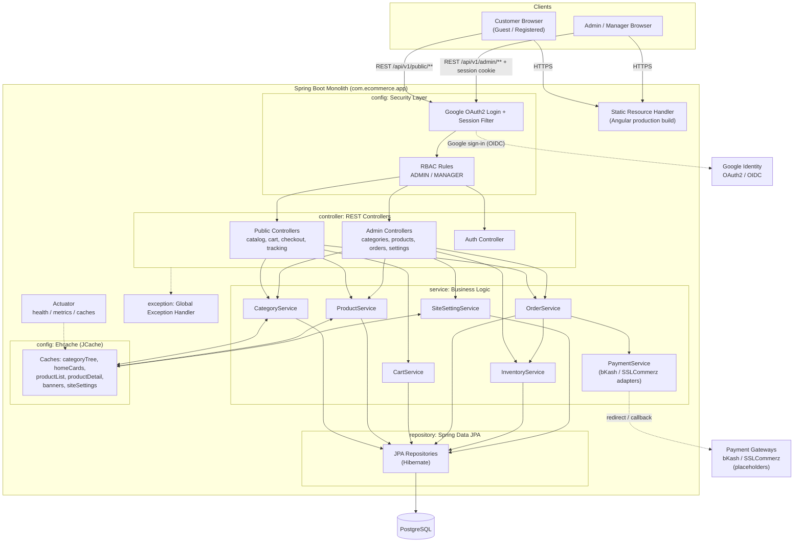
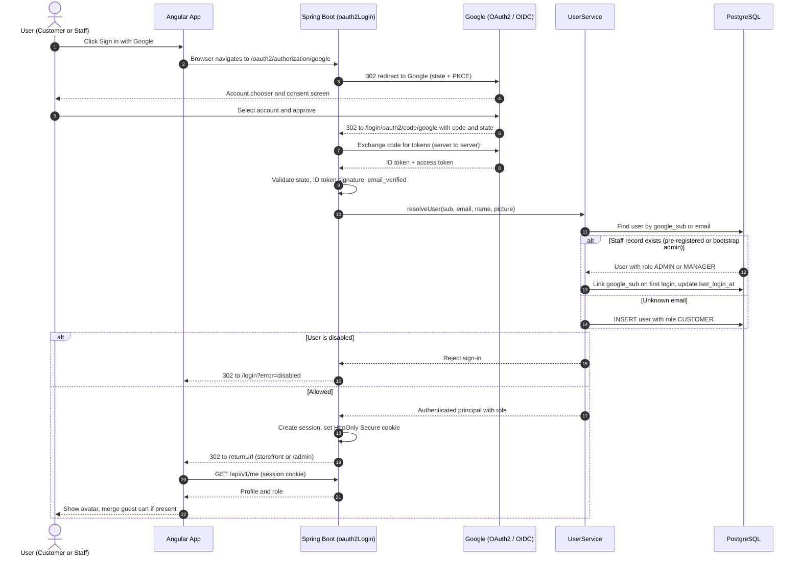
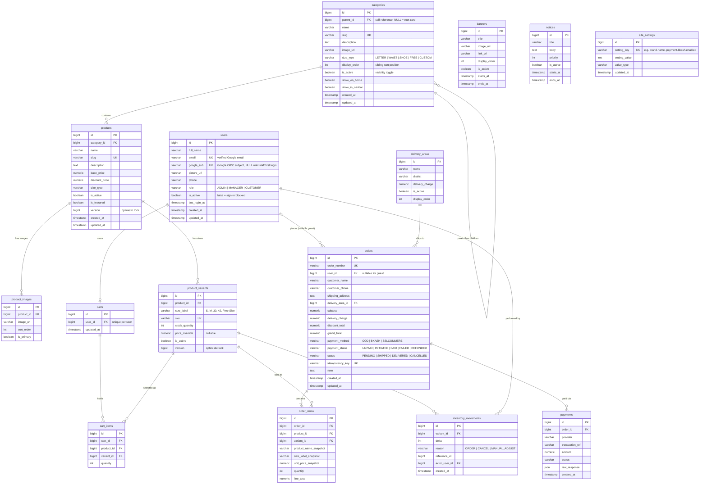
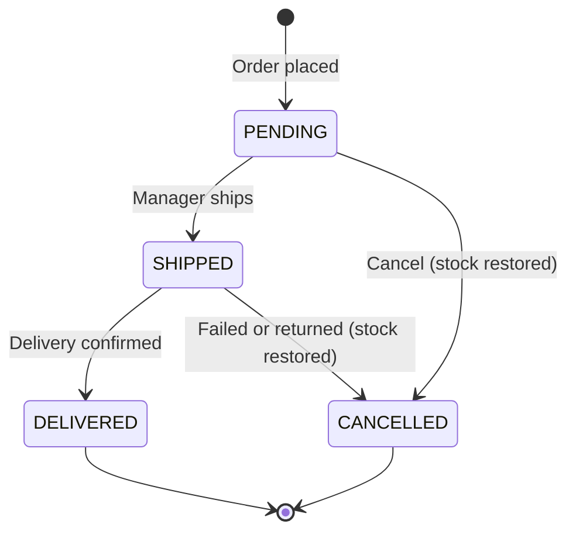
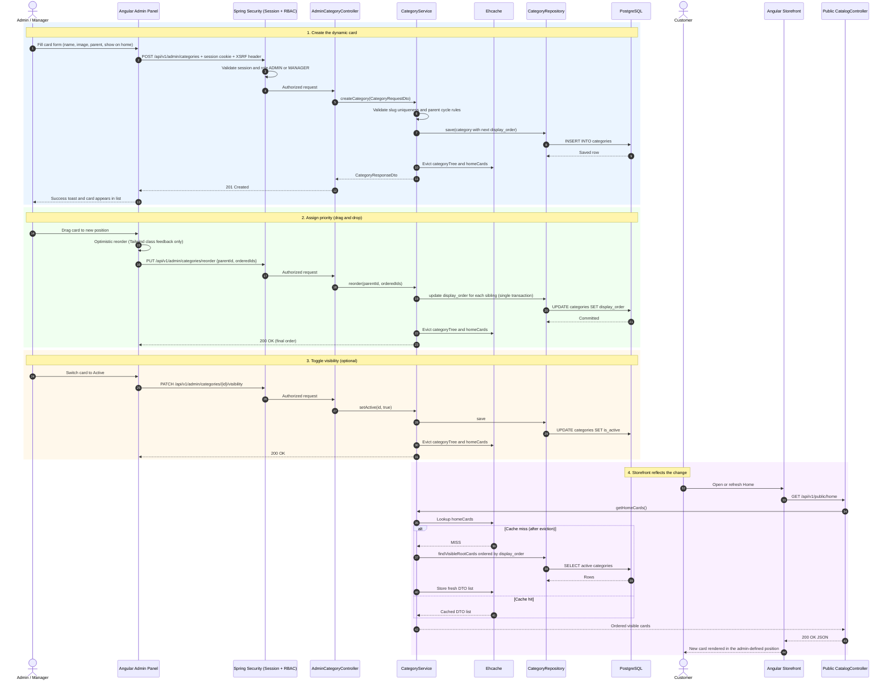

# Product Requirements Document (PRD)

## Dynamic E-commerce Web Application — Bangladesh Market

| Field | Value |
|---|---|
| **Document Version** | 1.1 (Draft for Review — Google OAuth2-only authentication added) |
| **Date** | 2026-11-09 |
| **Architecture Style** | Monolith (single deployable Spring Boot application serving REST APIs + hosted Angular build) |
| **Target Market** | Bangladesh (BDT currency, local phone formats, COD-first, bKash / SSLCommerz) |
| **Primary Stakeholders** | Business Owner, Admin, Manager, Customers (guest and registered), Engineering |

---

## Table of Contents

1. [Project Overview & Objectives](#1-project-overview--objectives)
2. [Scope, Personas & Roles](#2-scope-personas--roles)
3. [Technology Stack & Technical Specifications](#3-technology-stack--technical-specifications)
4. [System Architecture](#4-system-architecture)
5. [Functional Requirements](#5-functional-requirements)
6. [Data Model](#6-data-model)
7. [REST API Specification](#7-rest-api-specification)
8. [Caching Strategy (Ehcache)](#8-caching-strategy-ehcache)
9. [Security & RBAC](#9-security--rbac)
10. [Frontend Guidelines (Angular + Tailwind + DaisyUI, No Inline CSS)](#10-frontend-guidelines-angular--tailwind--daisyui-no-inline-css)
11. [Project Structure](#11-project-structure)
12. [Non-Functional Requirements](#12-non-functional-requirements)
13. [Bangladesh Localization](#13-bangladesh-localization)
14. [Testing & Quality Strategy](#14-testing--quality-strategy)
15. [Deployment & Operations](#15-deployment--operations)
16. [Delivery Roadmap](#16-delivery-roadmap)
17. [Risks, Assumptions & Open Questions](#17-risks-assumptions--open-questions)
18. [Acceptance Criteria Summary](#18-acceptance-criteria-summary)

---

## 1. Project Overview & Objectives

### 1.1 Product Summary

A fully dynamic e-commerce platform where the **Admin/Manager controls the storefront from the admin panel** without code deployments. Categories, homepage cards, banners, notices, card ordering, sub-category hierarchies, delivery areas and payment options are all data-driven. Customers can browse, add items to a cart, and place orders **as guests** — login is optional for customers and mandatory only for back-office users.

### 1.2 Business Goals

| # | Goal | Success Indicator |
|---|---|---|
| G1 | Zero-deployment merchandising | Admin can create a category card, set its position and publish it live in under 2 minutes |
| G2 | Frictionless purchase | Guest can go from product page to placed order in ≤ 4 steps |
| G3 | Operational control | Managers process orders, update stock and print invoices from one panel |
| G4 | Local fit | COD, local delivery areas, BDT formatting, +880 phone validation, bKash/SSLCommerz-ready |
| G5 | Performance | Cached catalog reads served in < 100 ms (p95) at the application layer |

### 1.3 Non-Goals (v1.0)

- Multi-vendor marketplace functionality
- Native mobile apps (the Angular app is fully responsive instead)
- Real payment settlement (bKash / SSLCommerz are **integration placeholders** in v1.0; adapters and contracts are defined)
- Microservices decomposition (explicitly a monolith)
- Email/password login, OTP login, or other social providers — **Google OAuth2 is the only sign-in method** (see §5.G and §9)

---

## 2. Scope, Personas & Roles

### 2.1 Personas

| Persona | Description | Authentication |
|---|---|---|
| **Guest Customer** | Browses, builds a cart (localStorage), checks out with name/phone/address | None |
| **Registered Customer** | Same as guest, plus cart synced to PostgreSQL and order history | Optional Google sign-in |
| **Manager** | Day-to-day operations: products, stock, cards/categories, banners, orders | Mandatory Google sign-in (allow-listed staff) |
| **Admin** | Super user: everything a Manager can do plus managing managers, system configuration, analytics | Mandatory Google sign-in (allow-listed staff) |

### 2.2 Role–Permission Matrix

| Capability | Guest | Customer | Manager | Admin |
|---|:---:|:---:|:---:|:---:|
| Browse catalog, collections, products | ✅ | ✅ | ✅ | ✅ |
| Cart (local) / Cart (server-synced) | ✅ / ❌ | ✅ / ✅ | — | — |
| Place order (guest checkout allowed) | ✅ | ✅ | — | — |
| View own order history | ❌ | ✅ | — | — |
| Track order by order number + phone | ✅ | ✅ | — | — |
| Product CRUD, variant & stock updates | ❌ | ❌ | ✅ | ✅ |
| Dynamic category/card creation, ordering, visibility | ❌ | ❌ | ✅ | ✅ |
| Banner / notice management | ❌ | ❌ | ✅ | ✅ |
| Order processing & status changes, invoice printing | ❌ | ❌ | ✅ | ✅ |
| Delivery area & charge management | ❌ | ❌ | ❌ | ✅ |
| Manager account management | ❌ | ❌ | ❌ | ✅ |
| Site settings (branding, payment toggles) | ❌ | ❌ | ❌ | ✅ |
| Analytics dashboard | ❌ | ❌ | Limited | ✅ |

---

## 3. Technology Stack & Technical Specifications

### 3.1 Backend

| Layer | Technology | Notes |
|---|---|---|
| Language / Runtime | Java (current LTS) | Pin the LTS version in the Gradle toolchain |
| Framework | **Spring Boot (latest stable)** | Resolve the exact version at project bootstrap |
| Web | Spring Web (REST) | JSON over HTTP, versioned under `/api/v1` |
| Security | **Spring Security** + **OAuth2 Client** | **Google OAuth2 / OIDC login only** (no passwords stored); Role-Based Access Control for **ADMIN** / **MANAGER** / **CUSTOMER**; server-side session in an HttpOnly cookie |
| Persistence | Spring Data JPA + **Hibernate** | Entity auditing, optimistic locking on stock |
| Database | **PostgreSQL (latest stable)** | Flyway migrations recommended |
| Caching | **Ehcache** (via JCache / JSR-107 and Spring Cache abstraction) | Product & category caching |
| Observability | **Spring Boot Actuator** | Health, metrics, cache stats; secured endpoints |
| Utilities | **Lombok** | Reduce boilerplate in entities/DTOs |
| Build Tool | **Gradle** | Kotlin or Groovy DSL (team choice) |
| Validation | Jakarta Bean Validation | On all request DTOs |
| API Docs | springdoc-openapi (recommended) | Auto-generated OpenAPI UI |

### 3.2 Frontend

| Layer | Technology | Notes |
|---|---|---|
| Framework | **Angular (latest stable)** | Standalone components, Signals, lazy-loaded routes |
| UI Library | **DaisyUI** | Component classes (`btn`, `card`, `navbar`, `badge`, `modal`, `carousel`, etc.) |
| Styling | **Tailwind CSS** | **Strictly external utility classes. NO inline CSS under any circumstances** (see §10) |
| State | Angular Signals + services | RxJS for HTTP streams |
| Forms | Reactive Forms | Typed forms with validators |

### 3.3 Reference Gradle Dependencies (Backend)

```groovy
dependencies {
    implementation 'org.springframework.boot:spring-boot-starter-web'
    implementation 'org.springframework.boot:spring-boot-starter-security'
    implementation 'org.springframework.boot:spring-boot-starter-data-jpa'
    implementation 'org.springframework.boot:spring-boot-starter-validation'
    implementation 'org.springframework.boot:spring-boot-starter-actuator'
    implementation 'org.springframework.boot:spring-boot-starter-cache'

    // Ehcache 3 via JCache
    implementation 'org.ehcache:ehcache'
    implementation 'javax.cache:cache-api'

    // Google OAuth2 / OIDC login (the only authentication mechanism)
    implementation 'org.springframework.boot:spring-boot-starter-oauth2-client'

    runtimeOnly   'org.postgresql:postgresql'
    compileOnly   'org.projectlombok:lombok'
    annotationProcessor 'org.projectlombok:lombok'

    testImplementation 'org.springframework.boot:spring-boot-starter-test'
    testImplementation 'org.springframework.security:spring-security-test'
    testImplementation 'org.testcontainers:postgresql'
}
```

> Versions are managed by the Spring Boot BOM; the Ehcache artifact may require the `jakarta` classifier depending on the Boot generation. Verify at bootstrap.

---

## 4. System Architecture

### 4.1 Architecture Principles

1. **Monolith, modular inside** — one deployable, strict package separation (controller → service → repository).
2. **Data-driven storefront** — nothing about categories, cards, banners or sort order is hard-coded.
3. **Read-heavy optimization** — public catalog endpoints are cached; admin writes evict precisely.
4. **Google-only authentication** — OAuth2/OIDC sign-in with Google for staff and customers; server-side session in an HttpOnly cookie; guests need no credentials (client-side cart, order tracking by order number + phone).
5. **Server-side truth** — prices, stock and totals are always recomputed on the server at checkout.

### 4.2 Diagram 1 — System Architecture (Monolith)



---

## 5. Functional Requirements

Priority legend: **P0** = must-have for launch, **P1** = should-have, **P2** = nice-to-have.

### 5.A Frontend Navigation & Dynamic UI (`/`)

| ID | Requirement | Priority |
|---|---|---|
| FR-A1 | **Navbar** renders dynamic branding (logo + store name from `site_settings`). | P0 |
| FR-A2 | Navbar lists links to main collections: **Men's Collection**, **Women's Collection**, and any admin-created root categories that are visible, ordered by `display_order`. | P0 |
| FR-A3 | Navbar shows a **Cart icon with a live item-count badge** (DaisyUI `indicator` + `badge`), updating instantly on add/remove. | P0 |
| FR-A4 | Navbar shows a **Sign in with Google** button when unauthenticated, or the user's **Google avatar + Profile / Logout** menu when authenticated. | P0 |
| FR-A5 | **Dynamic Hero Banner**: automated slider of newly added products (latest N active products, N configurable). | P0 |
| FR-A6 | Admin can **pin custom promotional banners** that appear in the hero slider with admin-defined order, optional link target and active date range. | P0 |
| FR-A7 | **Notice Board**: admin-managed announcements shown in a notice strip/board; supports activation window, priority and dismissible display. | P0 |
| FR-A8 | **Dynamic Main Collection Cards**: large responsive cards for Men's, Women's and any custom root cards, rendered purely from the category API. | P0 |
| FR-A9 | Clicking a collection card navigates to its **sub-collection page** (`/collections/:slug`). | P0 |
| FR-A10 | Fully responsive layout (mobile-first) using Tailwind breakpoints. | P0 |

### 5.B Multi-Level Dynamic Category & Card Management

| ID | Requirement | Priority |
|---|---|---|
| FR-B1 | **Admin Dynamic Card Creator**: create a category/card on the fly (name, slug, image, description, parent, size type). Examples: *Jewelry*, *Kids*, *Eid Campaign*. | P0 |
| FR-B2 | **Multi-level hierarchy**: categories are self-referencing (`parent_id`), supporting arbitrary depth (UI guidance: up to 4 levels). | P0 |
| FR-B3 | **Dynamic positioning** via `display_order` (integer, per sibling group). Admin reorders by **drag-and-drop** with up/down buttons as an accessible fallback. | P0 |
| FR-B4 | **Visibility toggle** (`is_active`): hide/show a card or category instantly; hiding a parent hides its subtree on the storefront. | P0 |
| FR-B5 | Slug uniqueness validation; slug auto-generated from the name and editable. | P0 |
| FR-B6 | Deleting a category with children or products is blocked; Admin is offered **deactivate** or **reassign** instead. | P0 |
| FR-B7 | Placement flags: `show_on_home` (appears as a main card on `/`) and `show_in_navbar`. | P1 |
| FR-B8 | Every create/update/reorder/toggle **evicts the relevant caches** so the storefront reflects changes immediately (see §8). | P0 |

### 5.C Product Listing, Size Selection & Smart Cart

#### Product Navigation

| ID | Requirement | Priority |
|---|---|---|
| FR-C1 | Clicking a sub-category card (e.g., *Pant*, *Sharee*, *Panjabi*, *Shoe*) loads a **product grid** with individual product cards (image, name, price, discount badge, stock state). | P0 |
| FR-C2 | Product listing supports pagination, sort (newest, price asc/desc) and basic filters (price range, size availability). | P1 |
| FR-C3 | Product detail page (`/products/:slug`) with gallery, description, price, size selector and stock indicator. | P0 |

#### Mandatory Size Validation

Each product declares a **size type**, and each variant row carries the concrete size label and its own stock.

| Size Type | Example Values |
|---|---|
| `LETTER` | S, M, L, XL, XXL |
| `WAIST` | 28, 30, 32, 34, 36 |
| `SHOE` | 39, 40, 41, 42, 43 |
| `FREE` | Free Size (e.g., Sharee) |
| `CUSTOM` | Admin-defined labels |

| ID | Requirement | Priority |
|---|---|---|
| FR-C4 | The size selector is rendered dynamically from the product's variants. | P0 |
| FR-C5 | The user **must select a size** before **Add to Cart** or **Order Now**. If omitted, the UI blocks the action and shows a validation warning (DaisyUI `alert` / `validator-hint`) and moves focus to the size selector. | P0 |
| FR-C6 | `FREE` products auto-select "Free Size" but still send a `variantId`. | P0 |
| FR-C7 | Out-of-stock sizes are shown as disabled. | P0 |
| FR-C8 | The **server re-validates** that `variantId` belongs to the product and has sufficient stock (client validation is never trusted). | P0 |

#### Selective Cart Checkout System (`/cart`)

| ID | Requirement | Priority |
|---|---|---|
| FR-C9 | **Guest cart** persists in browser `localStorage` (key e.g. `ecom.cart.v1`) storing `productId`, `variantId`, `quantity` only — never prices. | P0 |
| FR-C10 | **Logged-in cart** is synced with PostgreSQL (`carts`, `cart_items`). On login, the local cart is **merged** into the server cart (quantities summed, capped by stock). | P0 |
| FR-C11 | Cart page has **Select All** plus a **checkbox per item**. | P0 |
| FR-C12 | The user can proceed to checkout with **only the selected items**; unselected items remain in the cart afterwards. | P0 |
| FR-C13 | Cart re-prices from the server on load (`POST /public/cart/price`) and flags price/stock changes. | P0 |
| FR-C14 | Quantity stepper respects available stock; min 1. | P0 |
| FR-C15 | Cart totals display only for the selected subset (items subtotal, estimated delivery, grand total). | P0 |

### 5.D Checkout & Order Placement (`/checkout`)

| ID | Requirement | Priority |
|---|---|---|
| FR-D1 | **Guest checkout supported**; login is **not mandatory** for customers. | P0 |
| FR-D2 | **Checkout form** collects: Customer Name, Phone Number, Full Address, **Delivery Area** (dropdown from admin-managed delivery areas), optional order note. | P0 |
| FR-D3 | Phone validated against Bangladeshi mobile formats (see §13). | P0 |
| FR-D4 | **Payment methods**: (a) **Cash on Delivery (COD)**; (b) **Online / Prepaid** via **bKash** and **SSLCommerz** integration placeholders. Admin can enable/disable each method in `site_settings`. | P0 |
| FR-D5 | **Order Summary** panel shows selected items, chosen sizes, quantities, line totals, subtotal, delivery charge (by area), discount, grand total. | P0 |
| FR-D6 | **Order Now** (from product page) creates a single-item checkout without touching the cart. | P0 |
| FR-D7 | On success: unique **order number** (e.g., `ORD-20261109-000123`), confirmation page, and a **track-order** link (order number + phone). | P0 |
| FR-D8 | Checkout is **idempotent**: a client-generated `Idempotency-Key` prevents duplicate orders on double-click or retry. | P0 |
| FR-D9 | Prepaid flow: order is created as `PENDING` with payment `INITIATED`; redirected to the gateway; callback/IPN marks payment `PAID` or `FAILED`. | P1 (placeholder in v1.0) |
| FR-D10 | Only the selected cart items are removed from the cart after a successful order. | P0 |

### 5.E Admin & Manager Panel

| ID | Requirement | Priority |
|---|---|---|
| FR-E1 | Admin panel is a lazy-loaded Angular area (`/admin/**`) protected by route guards and server-side RBAC. | P0 |
| FR-E2 | **Admin** — full privileges: manage Manager accounts (Google-email allow-list), system configuration (`site_settings`), delivery areas/charges, payment toggles, analytics. | P0 |
| FR-E3 | **Manager** — product management, **inventory/stock updates**, dynamic card/category creation, banner and notice updates, order processing. | P0 |
| FR-E4 | **Real-time stock decrement** upon order confirmation (see §5.E.1). | P0 |
| FR-E5 | **Order status management**: `PENDING → SHIPPED → DELIVERED`, plus `CANCELLED`. Transitions are validated server-side. | P0 |
| FR-E6 | **Bulk invoice printing**: select multiple orders → generate a print-optimized invoice layout (one invoice per page) using a dedicated print route and Tailwind `print:` utilities. | P0 |
| FR-E7 | Order list with filters (status, date range, phone, order number) and pagination. | P0 |
| FR-E8 | Low-stock alerts on the dashboard (threshold configurable). | P1 |
| FR-E9 | Dashboard analytics (Admin): orders/day, revenue, top products, status distribution. | P1 |
| FR-E10 | Audit trail of admin actions (who changed what, when) for orders, stock and settings. | P1 |

#### 5.E.1 Inventory Rules

1. Stock is tracked **per variant** (`product_variants.stock_quantity`).
2. Stock is decremented **inside the same transaction that confirms the order** (COD: at placement; prepaid: on payment success — see Open Question OQ-1).
3. Decrement uses **optimistic locking (`@Version`)** or a guarded update (`UPDATE ... SET stock = stock - :qty WHERE id = :id AND stock >= :qty`) to prevent overselling.
4. If any line has insufficient stock, the entire order is rejected with a clear per-item error.
5. Cancelling an order **restores** stock for its items.
6. Every stock change writes an `inventory_movements` audit row (recommended).

### 5.F Diagram 2 — User Journey & Navigation Flow

```mermaid
flowchart TD
    START(["Visitor lands on Home /"]) --> HOME["Home Page<br/>Navbar + Hero Slider + Notice Board<br/>+ Dynamic Collection Cards"]

    HOME --> CARDS{"Choose a<br/>Collection Card"}
    CARDS -->|"Men's Collection"| COLL["Collection / Sub-category Page<br/>/collections/:slug"]
    CARDS -->|"Women's Collection"| COLL
    CARDS -->|"Admin-created card<br/>e.g. Jewelry, Kids"| COLL

    COLL --> SUB{"Choose a<br/>Sub-category Card"}
    SUB -->|"Pant / Panjabi / Shoe / Sharee ..."| LIST["Product Listing Grid<br/>/collections/:slug/products"]
    SUB -->|"Has deeper children"| COLL

    LIST --> PDP["Product Detail Page<br/>/products/:slug"]
    PDP --> SIZE{"Size selected?"}
    SIZE -->|"No"| WARN["Validation warning<br/>Please select a size"]
    WARN --> PDP
    SIZE -->|"Yes"| ACTION{"Action"}

    ACTION -->|"Add to Cart"| CART["Cart Page /cart<br/>localStorage (guest) or DB (logged in)"]
    ACTION -->|"Order Now"| CHK

    CART --> SELECT["Select All / pick individual items<br/>via checkboxes"]
    SELECT --> ANY{"At least one<br/>item selected?"}
    ANY -->|"No"| SELECT
    ANY -->|"Yes"| CHK["Checkout /checkout<br/>Name, Phone, Address, Delivery Area"]

    CHK --> AUTHQ{"Logged in?"}
    AUTHQ -->|"Yes"| PAYSEL
    AUTHQ -->|"No (Guest checkout allowed)"| PAYSEL["Select Payment Method"]

    PAYSEL -->|"Cash on Delivery"| PLACE["Place Order"]
    PAYSEL -->|"bKash / SSLCommerz (prepaid)"| GATE["Gateway redirect (placeholder)"]
    GATE --> PLACE

    PLACE --> OK{"Stock + validation OK?"}
    OK -->|"No"| ERR["Show per-item errors<br/>Return to Cart"]
    ERR --> CART
    OK -->|"Yes"| DONE(["Order Confirmation<br/>Order No. + Track link"])
```



### 5.G Authentication — Google OAuth2 Only (Admin, Manager and Customer)

Google is the **single identity provider** for everyone who signs in. The application never stores or handles passwords.

| ID | Requirement | Priority |
|---|---|---|
| FR-G1 | **Google OAuth2 / OpenID Connect is the only sign-in method** for Admin, Manager and normal users (customers). No password login, registration form or password-reset flow exists. | P0 |
| FR-G2 | A **Sign in with Google** button is available in the storefront navbar, on `/login` and on `/admin/login`. | P0 |
| FR-G3 | **Normal users:** the first successful Google sign-in **auto-creates** a `CUSTOMER` account from the Google profile (name, verified email, picture). | P0 |
| FR-G4 | **Staff:** Admin pre-registers Managers by **Google email + role** (staff allow-list). The record is linked to the Google `sub` on first sign-in. The first Admin(s) are bootstrapped from a configuration property. | P0 |
| FR-G5 | A Google account that is **not** on the staff allow-list can never obtain `ADMIN` or `MANAGER`; opening `/admin/**` shows a 403 page. | P0 |
| FR-G6 | Sign-in is rejected when Google reports the email as **unverified**. | P0 |
| FR-G7 | Admin can **disable** any user or staff account; disabled users cannot sign in and their active sessions are invalidated. | P0 |
| FR-G8 | **Logout** invalidates the server session. | P0 |
| FR-G9 | **Guest checkout stays available** without signing in. After a Google sign-in, the guest `localStorage` cart is merged into the server cart (see FR-C10). | P0 |
| FR-G10 | Google does not supply a phone number, so the **phone is collected at checkout** and may be saved to the profile. | P0 |
| FR-G11 | After sign-in the user returns to the page where they started; the `returnUrl` must be a **relative in-app path** (prevents open redirects). | P0 |

#### Diagram 5 — Google OAuth2 Sign-in Flow



#### Google Cloud and Spring Configuration

| Item | Value |
|---|---|
| OAuth client type | Web application (one client per environment) |
| Scopes | `openid`, `email`, `profile` |
| Authorized redirect URI | `https://<domain>/login/oauth2/code/google` (plus `http://localhost:8080/login/oauth2/code/google` for dev) |
| Secrets | `GOOGLE_CLIENT_ID`, `GOOGLE_CLIENT_SECRET` from environment variables, never committed |

```yaml
spring:
  security:
    oauth2:
      client:
        registration:
          google:
            client-id: ${GOOGLE_CLIENT_ID}
            client-secret: ${GOOGLE_CLIENT_SECRET}
            scope: openid,email,profile

app:
  security:
    bootstrap-admin-emails: ${BOOTSTRAP_ADMIN_EMAILS}   # comma-separated Google emails
```

---

## 6. Data Model

### 6.1 Diagram 3 — Entity-Relationship (ER) Diagram



### 6.2 Key Data Rules

| Rule | Detail |
|---|---|
| Category tree | `categories.parent_id` self-FK; roots have `parent_id IS NULL`. Index on `(parent_id, display_order)`. |
| Ordering | `display_order` is unique-by-convention among siblings; the reorder API accepts an ordered list of IDs and rewrites positions in one transaction. |
| Cycle prevention | A category cannot be moved under its own descendant (service-level validation). |
| Snapshots | `order_items` store name, size, and unit price **snapshots** so later catalog edits never alter past orders. |
| Money | `NUMERIC(12,2)`, BDT; never floating point. |
| Soft visibility | Prefer `is_active` over deletion for categories/products with history. |
| Guest orders | `orders.user_id` is nullable; guests identified by `order_number` + `customer_phone`. |
| Settings | `site_settings` is a key-value store, cached as a single map. |

---

## 7. REST API Specification

Base path: `/api/v1`. All responses are JSON. Errors use a uniform envelope (see §9.4).

### 7.1 Public Endpoints (no authentication)

| Method | Endpoint | Description |
|---|---|---|
| GET | `/public/home` | Aggregated home payload: settings (branding), banners, notices, latest products, home cards |
| GET | `/public/categories/tree` | Visible category tree (cached) |
| GET | `/public/categories/{slug}` | Category + visible children |
| GET | `/public/categories/{slug}/products` | Paginated products (`page`, `size`, `sort`, `minPrice`, `maxPrice`) |
| GET | `/public/products/{slug}` | Product detail with variants and stock state |
| POST | `/public/cart/price` | Re-price guest cart lines (`[{variantId, quantity}]`) |
| GET | `/public/delivery-areas` | Active delivery areas with charges |
| GET | `/public/payment-methods` | Enabled payment methods |
| POST | `/public/orders` | Place order (guest or authenticated). Header: `Idempotency-Key` |
| POST | `/public/orders/track` | Track by `orderNumber` + `phone` |
| POST | `/public/payments/{provider}/callback` | Gateway callback/IPN (placeholder) |

### 7.2 Authenticated User Endpoints (Google sign-in, any role)

| Method | Endpoint | Description |
|---|---|---|
| GET | `/oauth2/authorization/google` | Start Google sign-in (browser redirect) |
| GET | `/login/oauth2/code/google` | Google callback, handled by Spring Security |
| POST | `/auth/logout` | Invalidate session |
| GET | `/me` | Profile |
| GET / PUT | `/me/cart` | Fetch / replace server cart |
| POST | `/me/cart/merge` | Merge local guest cart after login |
| GET | `/me/orders` | Order history |

### 7.3 Admin / Manager Endpoints

| Method | Endpoint | Roles | Description |
|---|---|---|---|
| GET | `/admin/session` | ADMIN, MANAGER | Current staff identity and role (used by the admin route guard) |
| GET | `/admin/categories` | ADMIN, MANAGER | Full tree including hidden |
| POST | `/admin/categories` | ADMIN, MANAGER | Create card/category |
| PUT | `/admin/categories/{id}` | ADMIN, MANAGER | Update |
| PATCH | `/admin/categories/{id}/visibility` | ADMIN, MANAGER | Toggle `is_active` |
| PUT | `/admin/categories/reorder` | ADMIN, MANAGER | Body: `{ parentId, orderedIds: [..] }` |
| DELETE | `/admin/categories/{id}` | ADMIN | Guarded delete |
| GET / POST / PUT | `/admin/products[/{id}]` | ADMIN, MANAGER | Product CRUD with variants |
| PATCH | `/admin/products/{id}/variants/{vid}/stock` | ADMIN, MANAGER | Stock adjustment |
| GET / POST / PUT / DELETE | `/admin/banners[/{id}]` | ADMIN, MANAGER | Banner management |
| GET / POST / PUT / DELETE | `/admin/notices[/{id}]` | ADMIN, MANAGER | Notice management |
| GET | `/admin/orders` | ADMIN, MANAGER | Filtered, paginated list |
| GET | `/admin/orders/{id}` | ADMIN, MANAGER | Detail |
| PATCH | `/admin/orders/{id}/status` | ADMIN, MANAGER | Status transition |
| POST | `/admin/orders/invoices` | ADMIN, MANAGER | Bulk invoice data for printing (`orderIds[]`) |
| GET / PUT | `/admin/delivery-areas` | ADMIN | Manage areas and charges |
| GET / PUT | `/admin/settings` | ADMIN | Site settings |
| GET / POST / PUT / DELETE | `/admin/managers[/{id}]` | ADMIN | Staff allow-list: Google email + role, enable/disable; no passwords |
| GET | `/admin/analytics/summary` | ADMIN (Manager: limited) | Dashboard metrics |

### 7.4 Order Status State Machine



---

## 8. Caching Strategy (Ehcache)

### 8.1 Cache Regions

| Cache Name | Contents | Key | TTL (suggested) | Evicted When |
|---|---|---|---|---|
| `categoryTree` | Public visible category tree | constant | 30 min | Any category create/update/reorder/toggle/delete |
| `homeCards` | Root cards flagged `show_on_home` | constant | 30 min | Same as above |
| `productList` | Paged product lists per category | `slug:page:size:sort` | 10 min | Product or category change affecting the category |
| `productDetail` | Product with variants | `slug` | 10 min | Product update, stock change crossing 0 |
| `banners` | Active banners | constant | 15 min | Banner change |
| `notices` | Active notices | constant | 15 min | Notice change |
| `siteSettings` | Settings map | constant | 60 min | Settings update |

### 8.2 Rules

1. Caching annotations (`@Cacheable`, `@CacheEvict`, `@Caching`) live in the **service** layer only, never in controllers.
2. Cached values are **DTOs**, not JPA entities (avoids lazy-loading and detached-entity problems).
3. **Stock is never trusted from cache** at checkout: the order transaction reads fresh rows with locking.
4. Heap-based Ehcache is sufficient for a single-node monolith; if horizontally scaled later, move to a replicated/distributed cache (e.g., Redis) — noted as a future option, not a v1.0 requirement.
5. Cache statistics are exposed through Actuator metrics for tuning.

### 8.3 Reference Configuration Sketch (`com.ecommerce.app.config.CacheConfig`)

```java
@Configuration
@EnableCaching
public class CacheConfig {
    // Define JCache CacheManager backed by Ehcache.
    // Register caches: categoryTree, homeCards, productList, productDetail,
    // banners, notices, siteSettings — each with heap size and TTL expiry
    // as per the table above.
}
```

---

## 9. Security & RBAC

### 9.1 Authentication — Google OAuth2 / OIDC Only

- Google is the **sole identity provider** for Admin, Manager and normal users. No passwords are stored, hashed or reset by the application.
- Spring Security `oauth2Login()` using the Authorization Code flow with PKCE and `state`; scopes `openid email profile` (full sequence in Diagram 5, §5.G).
- Only accounts with `email_verified = true` are accepted. The stable identity key is the Google `sub`; email is unique but secondary.
- After login, Spring creates a **server-side session** delivered as an `HttpOnly`, `Secure`, `SameSite=Lax` cookie. In production the Angular build and API share one origin (monolith); in development an Angular dev-server proxy keeps requests same-origin.
- **Guests** need no credentials.

### 9.2 Account Provisioning & Role Assignment

| Account Type | How it is created | Role |
|---|---|---|
| Normal user (customer) | Automatically on first Google sign-in | `CUSTOMER` |
| Manager | Admin adds the Manager's Google email to the staff allow-list; linked to the Google `sub` at first sign-in | `MANAGER` |
| Admin | Initial Admin email(s) from `app.security.bootstrap-admin-emails`; more Admins added by an existing Admin | `ADMIN` |

Rules:

1. A Google email that matches an active staff record receives that staff role; any other email can only ever become `CUSTOMER`.
2. Disabled accounts (`is_active = false`) cannot sign in, and their live sessions are invalidated.
3. Role changes made by an Admin take effect immediately (sessions of the affected user are invalidated and re-resolved at next sign-in).
4. The last remaining active Admin cannot be disabled or demoted.

### 9.3 Authorization Rules & Security Controls

| Pattern | Access |
|---|---|
| `/api/v1/public/**` | `permitAll` |
| `/oauth2/**`, `/login/oauth2/**` | `permitAll` (Spring Security OAuth2 endpoints) |
| `/api/v1/me/**`, `/api/v1/auth/logout` | Any authenticated user |
| `/api/v1/admin/managers/**`, `/admin/settings/**`, `/admin/delivery-areas/**` | `hasRole('ADMIN')` |
| `/api/v1/admin/**` (others) | `hasAnyRole('ADMIN','MANAGER')` |
| `/actuator/health` | `permitAll`; other Actuator endpoints `hasRole('ADMIN')` |

Method-level security (`@PreAuthorize`) is applied on admin services as defense in depth.

| Area | Requirement |
|---|---|
| Transport | HTTPS only; HSTS enabled |
| CSRF | **Enabled** (cookie-based session) using `CookieCsrfTokenRepository`; Angular's built-in XSRF support sends the `X-XSRF-TOKEN` header |
| Session | Session-fixation protection; idle timeout shorter for staff (e.g., 30 min) than customers; logout invalidates the session |
| OAuth hardening | `state` + PKCE, exact redirect-URI allow-list, ID token signature/issuer/audience validation, `email_verified` check, relative-only `returnUrl` |
| Staff domain restriction (optional) | Restrict staff sign-in to a Google Workspace domain via the `hd` claim (see OQ-8) |
| CORS | Same-origin in production; allow-list for dev origins only |
| Input | Bean Validation on every DTO; output encoding handled by Angular |
| Content Security Policy | Strict CSP **without `unsafe-inline`** — compatible with, and reinforces, the no-inline-CSS rule; allow `accounts.google.com` and Google avatar image hosts only where required |
| Rate limiting | On order placement, order tracking and OAuth start endpoints |
| Secrets | Google client secret and other secrets from environment variables / secret store |
| Uploads | Validate MIME type, size and extension for product/banner images |
| Auditing | Record actor and timestamp for admin mutations and staff sign-ins |

### 9.4 Global Exception Handling (`com.ecommerce.app.exception`)

A `@RestControllerAdvice` maps exceptions to a uniform response:

```json
{
  "timestamp": "2026-11-09T10:15:30Z",
  "status": 422,
  "error": "INSUFFICIENT_STOCK",
  "message": "Requested quantity exceeds available stock",
  "path": "/api/v1/public/orders",
  "details": [
    { "field": "items[1].quantity", "message": "Only 2 left in size M" }
  ]
}
```

| Exception | HTTP |
|---|---|
| `ResourceNotFoundException` | 404 |
| `ValidationException` / `MethodArgumentNotValidException` | 400 |
| `SizeNotSelectedException` | 400 |
| `InsufficientStockException` | 409 / 422 |
| `InvalidStatusTransitionException` | 409 |
| `DuplicateResourceException` (slug, SKU) | 409 |
| `AccessDeniedException` | 403 |
| `AuthenticationException` | 401 |
| Unhandled | 500 (no stack trace leaked) |

---

## 10. Frontend Guidelines (Angular + Tailwind + DaisyUI, No Inline CSS)

### 10.1 Styling Policy — **No Inline CSS, Ever**

| Rule | Detail |
|---|---|
| ✅ Allowed | Tailwind CSS utility classes and DaisyUI component/modifier classes applied through `class` attributes and Angular class bindings (`[class.xyz]`, `[ngClass]`). |
| ❌ Forbidden | `style="..."` attributes, `[style.*]` bindings, `[ngStyle]`, component-level `styles: []`, injected `<style>` blocks, and JavaScript that writes `element.style.*`. |
| Enforcement | ESLint rules (e.g., Angular template rules banning `style` attributes and `[ngStyle]`) plus a CI check that greps templates for `style=`; code review checklist item. |
| Theming | DaisyUI themes configured in the Tailwind config (external stylesheet), switched with the `data-theme` attribute — never with inline colors. |
| Dynamic values | Map data to **predefined class sets** (e.g., status → `badge-warning` / `badge-info` / `badge-success` / `badge-error`). Arbitrary runtime pixel/color values are not used; use a bounded design scale instead. |

### 10.2 Component-to-DaisyUI Mapping

| UI Element | DaisyUI / Tailwind Approach |
|---|---|
| Navbar | `navbar`, `menu`, `dropdown`; cart count via `indicator` + `badge` |
| Hero slider | `carousel` (CSS scroll-snap) with `carousel-item`; autoplay controlled through class/scroll behavior in TypeScript, **not** inline styles |
| Notice board | `alert`, `collapse`, or a `stats`-style strip |
| Collection / category cards | `card`, `card-body`, `card-actions`, responsive grid (`grid grid-cols-1 sm:grid-cols-2 lg:grid-cols-3 gap-6`) |
| Size selector | `join` + `btn` radio group; disabled state via `btn-disabled` |
| Validation warning | `alert alert-warning`, form `validator` / `validator-hint` |
| Cart checkboxes | `checkbox checkbox-primary` |
| Tables (admin) | `table table-zebra`, responsive wrapper `overflow-x-auto` |
| Modals / confirmations | `modal` |
| Toasts | `toast` + `alert` |
| Skeleton loaders | `skeleton` |
| Progress / stats | `progress` element (use `value`/`max` attributes) and `stats` — avoid components that require inline CSS variables |
| Invoice print layout | Tailwind `print:` variants (`print:hidden`, `print:break-after-page`) |

### 10.3 Drag-and-Drop Sorting (Admin) — Inline-CSS-Safe Design

Many drag-and-drop libraries (including Angular CDK's drag module) apply **runtime inline transforms**, which would violate the policy. Therefore:

1. Implement reordering with the **native HTML5 Drag and Drop API** (`draggable`, `dragstart`, `dragover`, `drop`).
2. Provide visual feedback **only via Tailwind class toggles** (e.g., `opacity-50`, `ring-2 ring-primary`, `border-dashed`).
3. Provide **Up / Down buttons** as a keyboard-accessible alternative (also satisfies WCAG).
4. On drop, send the new ordered ID list to `PUT /admin/categories/reorder`; update the UI optimistically and roll back on failure.

### 10.4 Angular Architecture

- Standalone components, lazy-loaded feature routes (`/`, `/collections`, `/products`, `/cart`, `/checkout`, `/track`, `/admin/**`).
- `ChangeDetectionStrategy.OnPush` + **Signals** for cart state, auth state and UI state.
- `HttpInterceptor`s: send credentials (session cookie) and the XSRF header, redirect to Google sign-in on 401, global error toast, loading indicator.
- Login UI is a single **Sign in with Google** button (DaisyUI `btn`); the page navigates to `/oauth2/authorization/google?returnUrl=<relative path>`.
- Route guards: `authGuard`, `roleGuard('ADMIN' | 'MANAGER')`.
- `CartService` abstracts storage: `LocalCartStore` (guest) vs `ServerCartStore` (logged in) behind one interface, with merge-on-login.
- Typed API client models mirroring backend DTOs (consider OpenAPI codegen).
- Accessibility: semantic HTML, labelled controls, focus management on validation errors.

### 10.5 Cart State Contract (Frontend)

```ts
interface CartLine {
  productId: number;
  variantId: number;      // size is mandatory — never null
  quantity: number;
  selected: boolean;      // checkbox state for selective checkout
}
```

---

## 11. Project Structure

### 11.1 Backend (Gradle, Package Layout under `com.ecommerce.app`)

```text
ecommerce-app/
├── build.gradle
├── settings.gradle
├── src/
│   ├── main/
│   │   ├── java/com/ecommerce/app/
│   │   │   ├── EcommerceApplication.java
│   │   │   ├── controller/                 # REST Controllers
│   │   │   │   ├── publicapi/
│   │   │   │   │   ├── HomeController.java
│   │   │   │   │   ├── CatalogController.java
│   │   │   │   │   ├── CartController.java
│   │   │   │   │   ├── CheckoutController.java
│   │   │   │   │   └── OrderTrackingController.java
│   │   │   │   ├── admin/
│   │   │   │   │   ├── AdminCategoryController.java
│   │   │   │   │   ├── AdminProductController.java
│   │   │   │   │   ├── AdminOrderController.java
│   │   │   │   │   ├── AdminBannerController.java
│   │   │   │   │   ├── AdminNoticeController.java
│   │   │   │   │   ├── AdminSettingsController.java
│   │   │   │   │   └── AdminUserController.java
│   │   │   │   └── AuthController.java
│   │   │   ├── service/                    # Business logic & caching services
│   │   │   │   ├── CategoryService.java
│   │   │   │   ├── ProductService.java
│   │   │   │   ├── CartService.java
│   │   │   │   ├── OrderService.java
│   │   │   │   ├── InventoryService.java
│   │   │   │   ├── PaymentService.java
│   │   │   │   ├── SiteSettingService.java
│   │   │   │   ├── BannerService.java
│   │   │   │   └── impl/
│   │   │   ├── repository/                 # Spring Data JPA repositories
│   │   │   │   ├── UserRepository.java
│   │   │   │   ├── CategoryRepository.java
│   │   │   │   ├── ProductRepository.java
│   │   │   │   ├── ProductVariantRepository.java
│   │   │   │   ├── OrderRepository.java
│   │   │   │   └── SiteSettingRepository.java
│   │   │   ├── model/
│   │   │   │   └── entity/                 # JPA entities
│   │   │   │       ├── User.java
│   │   │   │       ├── Category.java
│   │   │   │       ├── Product.java
│   │   │   │       ├── ProductVariant.java
│   │   │   │       ├── Cart.java
│   │   │   │       ├── CartItem.java
│   │   │   │       ├── Order.java
│   │   │   │       ├── OrderItem.java
│   │   │   │       ├── Banner.java
│   │   │   │       ├── Notice.java
│   │   │   │       ├── DeliveryArea.java
│   │   │   │       └── SiteSetting.java
│   │   │   ├── dto/                        # Request/response DTOs
│   │   │   │   ├── request/
│   │   │   │   └── response/
│   │   │   ├── config/                     # Security, Ehcache, DB, CORS configs
│   │   │   │   ├── SecurityConfig.java
│   │   │   │   ├── JwtAuthenticationFilter.java
│   │   │   │   ├── CacheConfig.java
│   │   │   │   ├── JpaAuditingConfig.java
│   │   │   │   └── WebConfig.java
│   │   │   └── exception/                  # Global exception handling
│   │   │       ├── GlobalExceptionHandler.java
│   │   │       ├── ResourceNotFoundException.java
│   │   │       ├── InsufficientStockException.java
│   │   │       └── ApiError.java
│   │   └── resources/
│   │       ├── application.yml
│   │       ├── application-dev.yml
│   │       ├── application-prod.yml
│   │       ├── ehcache.xml
│   │       ├── db/migration/               # Flyway scripts
│   │       └── static/                     # Angular production build output
│   └── test/java/com/ecommerce/app/
```

**Layering rules**

| From → To | Allowed |
|---|---|
| controller → service | ✅ |
| controller → repository | ❌ |
| service → repository | ✅ |
| service → service | ✅ (avoid cycles) |
| Any layer → `dto` | ✅ |
| Entities exposed from controllers | ❌ (always map to DTOs) |

### 11.2 Frontend (Angular)

```text
frontend/
├── angular.json
├── tailwind.config.js        # DaisyUI plugin + themes
├── package.json
└── src/
    ├── styles.css            # @tailwind directives / @plugin daisyui (only global stylesheet)
    └── app/
        ├── core/             # interceptors, guards, auth, api client
        ├── shared/           # reusable ui: product-card, category-card, size-picker, toast
        ├── layout/           # navbar, footer, notice-board, hero-slider
        ├── features/
        │   ├── home/
        │   ├── collections/
        │   ├── products/
        │   ├── cart/
        │   ├── checkout/
        │   ├── order-tracking/
        │   └── admin/
        │       ├── dashboard/
        │       ├── categories/    # card creator + drag-sort
        │       ├── products/
        │       ├── orders/        # list, status, bulk invoice print
        │       ├── banners-notices/
        │       └── settings/
        └── app.routes.ts
```

---

## 12. Non-Functional Requirements

| Category | Requirement |
|---|---|
| **Performance** | p95 < 100 ms for cached catalog endpoints; < 300 ms for uncached; Largest Contentful Paint < 2.5 s on 4G; image lazy-loading and responsive sizes |
| **Scalability** | Vertical scaling first; stateless API enables later horizontal scaling; DB indexes on slugs, `(parent_id, display_order)`, `orders(status, created_at)`, `orders(customer_phone)` |
| **Availability** | Target 99.5% monthly; health checks via Actuator |
| **Reliability** | Transactional order placement; idempotent checkout; graceful degradation if a cache miss occurs |
| **Security** | See §9; OWASP Top 10 mitigations; dependency scanning in CI |
| **Maintainability** | Strict layering, ≥ 80% unit-test coverage on services, Flyway-managed schema |
| **Usability** | Mobile-first, accessible (WCAG 2.1 AA targets), clear validation messaging |
| **Observability** | Structured logs with correlation IDs, Actuator metrics (`/actuator/metrics`, cache stats), alerting on error rate |
| **Browser Support** | Latest two versions of Chrome, Edge, Firefox, Safari; Android Chrome and iOS Safari |
| **Data Protection** | Customer PII (name, phone, address) minimized, access-controlled, and retained per policy; backups encrypted |
| **Compliance Awareness** | Align with Bangladesh Digital Commerce guidelines and applicable data-protection requirements — confirm with legal counsel |

---

## 13. Bangladesh Localization

| Area | Requirement |
|---|---|
| **Currency** | BDT (৳). Display `৳1,250` format with Indian-style/Bangladeshi digit grouping option |
| **Phone validation** | Accept `01[3-9]XXXXXXXX` (11 digits) and `+8801[3-9]XXXXXXXX`; normalize to one canonical format before saving |
| **Address** | Free-text full address + required **Delivery Area** selection; optional District/Upazila fields |
| **Delivery charges** | Area-based charge table managed by Admin (e.g., inside-city vs outside-city tiers); values are configurable, not hard-coded |
| **Payment** | COD primary; bKash and SSLCommerz **placeholders** behind a `PaymentGateway` interface with provider-specific adapters |
| **Language** | English at launch; i18n-ready (Angular i18n or a translation library) for **Bangla (বাংলা)** as a P1 follow-up |
| **Date/Time** | Store in UTC; display in `Asia/Dhaka` |
| **Product taxonomy** | First-class support for local categories: Panjabi, Sharee, Three-piece, Borka, etc. via dynamic cards |

### 13.1 Payment Gateway Abstraction

```java
public interface PaymentGateway {
    String providerCode();                       // "BKASH", "SSLCOMMERZ"
    PaymentInitResponse initiate(Order order);   // returns redirect URL / reference
    PaymentVerifyResult verifyCallback(Map<String, String> params);
}
```

In v1.0, adapters return stubbed responses behind a feature flag in `site_settings`; the order/payment state machine and callback endpoints are fully wired so real credentials can be dropped in later.

---

## 14. Testing & Quality Strategy

| Level | Scope | Tooling |
|---|---|---|
| Unit | Services (pricing, stock, status transitions, cycle prevention) | JUnit 5, Mockito |
| Repository / Integration | JPA queries, constraints, locking behavior | `@DataJpaTest` + Testcontainers (PostgreSQL) |
| API | Controllers, security rules per role, validation errors | `@WebMvcTest`, Spring Security Test, MockMvc |
| OAuth2 login | Customer auto-create, staff allow-list role mapping, disabled user blocked, unverified email rejected, open-redirect blocked | Spring Security Test (`oauth2Login()` MockMvc post-processor) |
| Concurrency | Two simultaneous orders on the last unit — exactly one succeeds | Integration test with parallel threads |
| Cache | Admin change evicts cache and the public API reflects it | Integration test with cache stats |
| Frontend unit | Components, services, cart store merge logic | Jest or Karma/Jasmine |
| E2E | Browse → size warning → add to cart → select subset → guest checkout; admin creates card → appears on home | Playwright or Cypress |
| Style policy | No `style=` / `[ngStyle]` / `styles:` anywhere | ESLint + CI grep gate |
| Accessibility | Automated axe checks on key pages | axe-core |

---

## 15. Deployment & Operations

| Topic | Decision |
|---|---|
| Packaging | Angular production build copied into `src/main/resources/static` during the Gradle build; output a single executable JAR |
| Containers | Multi-stage Dockerfile; `docker-compose` for local dev (app + PostgreSQL) |
| Environments | `dev`, `staging`, `prod` Spring profiles; secrets via environment variables |
| Google OAuth2 | One Google Cloud OAuth client per environment; redirect URI `https://<domain>/login/oauth2/code/google`; app must run behind HTTPS with forwarded headers configured |
| Database | Flyway migrations; nightly backups with restore drills |
| CI/CD | Build → lint (incl. no-inline-CSS gate) → tests → image build → deploy to staging → manual promote |
| Monitoring | Actuator health/metrics scraped by Prometheus (optional), log aggregation, uptime check |
| Media | Product/banner images on local volume or object storage behind a CDN (configurable abstraction) |

---

## 16. Delivery Roadmap

| Phase | Scope | Outcome |
|---|---|---|
| **Phase 0 — Foundations** | Repo setup, Gradle, Spring Boot skeleton, Angular + Tailwind + DaisyUI, CI, Flyway, security skeleton | Running "hello" end-to-end |
| **Phase 1 — Catalog & Dynamic Cards** | Categories (self-ref), cards, ordering, visibility, products, variants, public catalog APIs, Ehcache | Admin-driven storefront browsable |
| **Phase 2 — Cart & Checkout** | Size validation, localStorage cart, server cart + merge, selective checkout, guest checkout, COD, order placement, stock decrement | Customers can order |
| **Phase 3 — Admin Operations** | Order management, status transitions, bulk invoice printing, banners & notices, delivery areas, manager accounts | Store is operable |
| **Phase 4 — Payments & Hardening** | bKash / SSLCommerz adapters, analytics, audit trail, performance and security hardening, accessibility pass | Launch-ready |
| **Phase 5 — Post-launch** | Bangla localization, coupons, wishlist, SMS/email notifications | Growth features |

---

## 17. Risks, Assumptions & Open Questions

### 17.1 Risks

| ID | Risk | Mitigation |
|---|---|---|
| R1 | Overselling during concurrent checkouts | Guarded stock update / optimistic locking + concurrency tests |
| R2 | Stale storefront after admin edits | Targeted cache eviction + short TTLs + frontend refetch on navigation |
| R3 | Inline-CSS rule broken by third-party UI libraries | Library vetting; native DnD; lint gate in CI |
| R4 | Guest order abuse / fake orders | Rate limiting, phone validation, optional OTP verification (P2) |
| R5 | Payment gateway onboarding delays | Placeholder adapters keep the rest of the system shippable |
| R6 | Deep category trees hurt UX/performance | Recommend ≤ 4 levels; cache the full tree |
| R7 | Google-only login locks out users without a Google account, and an outage or lost staff Google access blocks sign-in | Guest checkout remains available; keep ≥ 2 Admin accounts; document account-recovery via config bootstrap |

### 17.2 Assumptions

- A1. Single store, single currency (BDT), single warehouse.
- A2. "Online Payment / Prepaid with Cash options" is interpreted as **prepaid via bKash / SSLCommerz** alongside **COD**.
- A3. Customer registration is optional and lightweight (email/phone + password).
- A5. Server-side session (not JWT) is used after Google sign-in, which fits a single-node monolith; Spring Session (JDBC) can be added if scaled horizontally.
- A4. Latest stable versions of Spring Boot, Angular, PostgreSQL, Java LTS, Tailwind and DaisyUI are resolved at project bootstrap and then pinned.

### 17.3 Open Questions

| ID | Question | Default if unanswered |
|---|---|---|
| OQ-1 | Should stock be decremented at **order placement** or only when a **Manager confirms** the order? | Decrement at placement (COD) / on payment success (prepaid); restore on cancel |
| OQ-2 | Is an extra `CONFIRMED` status wanted between `PENDING` and `SHIPPED`? | Not in v1.0 (only the four specified statuses) |
| OQ-3 | Is SMS/OTP verification required for guest orders? | Not in v1.0 |
| OQ-4 | Should Managers see revenue analytics? | Limited counts only; revenue is Admin-only |
| OQ-5 | Per-product delivery charges or only per-area? | Per-area only |
| OQ-6 | Is multi-language (Bangla) required at launch? | English at launch; i18n-ready |
| OQ-7 | Should customers without a Google account be supported at all? | No — guest checkout only |
| OQ-8 | Should staff sign-in be restricted to one Google Workspace domain? | No restriction; allow-list only |

---

## 18. Acceptance Criteria Summary

| # | Criterion | Verified By |
|---|---|---|
| AC-1 | Admin creates a new root card (e.g., "Jewelry"); it appears on the home page and navbar within seconds of saving, with no deployment | E2E + cache test |
| AC-2 | Admin drags a card to a new position; the storefront order matches after refresh | E2E |
| AC-3 | Hiding a category removes it and its subtree from public APIs and UI immediately | API + E2E |
| AC-4 | Multi-level sub-categories can be created and navigated at least 3 levels deep | E2E |
| AC-5 | "Add to Cart" and "Order Now" are blocked with a visible warning if no size is selected; the server rejects requests without a valid `variantId` | UI test + API test |
| AC-6 | Guest cart persists across reloads via `localStorage`; on login it merges into the server cart | E2E |
| AC-7 | Selecting a subset of cart items and checking out orders only those items; the rest stay in the cart | E2E |
| AC-8 | A guest completes an order with name, phone, address and delivery area without logging in | E2E |
| AC-9 | COD orders succeed; bKash / SSLCommerz options appear only when enabled in settings | E2E |
| AC-10 | Concurrent orders for the last unit never oversell | Concurrency test |
| AC-11 | Order status transitions follow the allowed state machine; cancellation restores stock | Unit + integration |
| AC-12 | Admin/Manager routes return 401/403 for unauthorized access; Manager cannot access Admin-only endpoints | Security tests |
| AC-13 | Bulk invoice print renders one invoice per page for selected orders | Manual + E2E |
| AC-14 | No `style=`, `[style.*]`, `[ngStyle]` or component `styles` exist in the frontend codebase | CI gate |
| AC-15 | Backend packages match the `com.ecommerce.app.{controller, service, repository, model.entity, dto, config, exception}` layout | Architecture test (ArchUnit) |
| AC-16 | Sign-in works only through Google; no password field or registration form exists anywhere | E2E + code review |
| AC-17 | First Google sign-in creates a `CUSTOMER`; a pre-registered Manager email signs in as `MANAGER`; an unlisted email can never reach `/admin/**` | Integration + E2E |
| AC-18 | A disabled user is rejected at sign-in and an unverified Google email is refused | Integration test |

---

## Appendix A — Diagram 4: Admin Dynamic Management Sequence



---

## Appendix B — Glossary

| Term | Meaning |
|---|---|
| **Dynamic Card** | A category presented as a visual card on the storefront; fully admin-controlled (content, position, visibility) |
| **Root Card** | Category with no parent; shown on the home page / navbar |
| **Variant** | A concrete purchasable size of a product with its own SKU and stock |
| **Guest Checkout** | Order placement without a customer account |
| **COD** | Cash on Delivery |
| **Idempotency Key** | Client-generated token ensuring a retried request creates only one order |
| **RBAC** | Role-Based Access Control |
| **OIDC** | OpenID Connect, the identity layer on top of OAuth2 used by Google sign-in |
| **Staff allow-list** | Admin-managed list of Google emails permitted to hold `ADMIN` / `MANAGER` roles |
| **BDT** | Bangladeshi Taka (৳) |

---

*End of Document*
